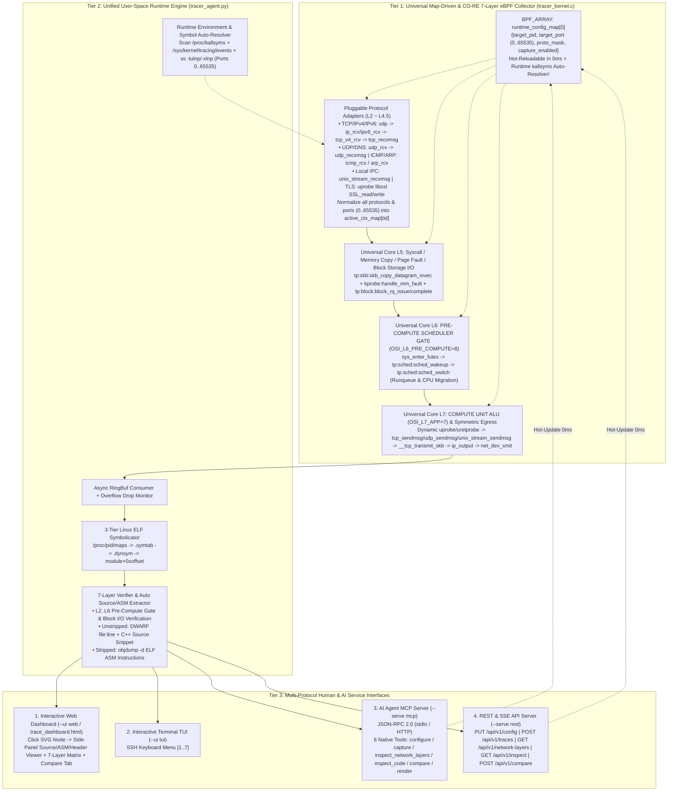

# eBPF-WireToCode-Tracer: 통합 아키텍처 명세서 및 마스터 프롬프트 (Single Source of Truth)

> [!IMPORTANT]
> **프로젝트의 존재 이유 (Core Raison d'être) 및 문서 활용 안내**
> - **존재 이유 (Why This Project Exists)**: **"오직 eBPF만을 사용하여 데이터가 입출력(Network/Storage I/O)을 통해 시스템에 들어온 순간부터 커널 네트워크 스택, 소켓 버퍼, 시스템콜/메모리 복사(Page Fault/Block I/O), 스레드 락(Futex) 및 CPU 스케줄러 런큐(Runqueue)를 거쳐 실제 연산장치(CPU Execution Core / ALU)에 들어가기 직전(Pre-Compute Gate)과 연산 후 출력으로 빠져나갈 때까지의 모든 계층에 대해 100% 가시성을 확보하고 검증한다."**
> - 본 문서는 이 핵심 철학을 중심으로, 레퍼런스 검증 근거, **Map-Driven 무재컴파일(Zero-Recompile) & BPF CO-RE 호환 커널 런타임**, **입출력~연산장치 진입 직전(Wire-to-PreCompute-to-Wire) 7대 계층 검증 엔진**, **MCP 서버(`--serve mcp`) 및 REST API(`--serve rest`) 서비스 게이트웨이**, **사람을 위한 대화형 인터페이스(웹 대시보드 & 터미널 TUI)**, **AI 에이전트 자율 진단/패치 검증 루프**, 그리고 **12대 자동 검증 기준**을 **단 하나의 파일로 통합한 마스터 명세서(Single Source of Truth)**입니다.
> - **사람(개발자·아키텍트·SRE)**: **Part 1 ~ Part 4**를 순서대로 읽으면 입출력부터 연산장치 진입 직전까지의 전 계층 검증 원리, 웹/TUI/REST/MCP 사용법, 커널 내부 설계 및 검증 방법을 한눈에 이해할 수 있습니다.
> - **AI 코딩 에이전트**: **Part 3(상세 기술 명세)**, **Part 4(검증 기준)**, **Part 5(통합 마스터 프롬프트)**를 그대로 참조하여 추측 없이 100% 동작하는 프로덕션 코드를 구현할 수 있습니다.

---

## 목차 (Table of Contents)

- **[PART 1. 프로젝트 개요 및 실제 사용 워크플로우 (Human & Agent Guide)](#part-1-프로젝트-개요-및-실제-사용-워크플로우-human--agent-guide)**
  - [1.1 프로젝트의 존재 이유: 입출력(I/O)부터 연산장치(CPU Core) 진입 직전까지 전 계층 가시성 확보](#11-프로젝트의-존재-이유-입출력io부터-연산장치cpu-core-진입-직전까지-전-계층-가시성-확보)
  - [1.2 멀티모달 인터페이스 아키텍처 (Web UI / TUI / REST API / MCP Server)](#12-멀티모달-인터페이스-아키텍처-web-ui--tui--rest-api--mcp-server)
  - [1.3 입출력(I/O) ↔ 연산장치 진입 직전(Pre-Compute) 7대 계층 전수 검증 매트릭스](#13-입출력io--연산장치-진입-직전pre-compute-7대-계층-전수-검증-매트릭스)
  - [1.4 유저의 실제 사용 흐름 (3-Step Workflow)](#14-유저의-실제-사용-흐름-3-step-workflow)
  - [1.5 AI 에이전트의 자율 진단 및 패치 검증 루프 (MCP & Closed-Loop Workflow)](#15-ai-에이전트의-자율-진단-및-패치-검증-루프-mcp--closed-loop-workflow)
- **[PART 2. 레퍼런스 교차 검증 및 런타임 아키텍처 고도화 내역 (Engineering Rationale)](#part-2-레퍼런스-교차-검증-및-런타임-아키텍처-고도화-내역-engineering-rationale)**
  - [2.1 핵심 레퍼런스 문헌, 타겟 머신 및 커널 소스 매핑](#21-핵심-레퍼런스-문헌-타겟-머신-및-커널-소스-매핑)
  - [2.2 초기 프롬프트 원문 보존 (Original Baseline Prompt)](#22-초기-프롬프트-원문-보존-original-baseline-prompt)
  - [2.3 기존 프롬프트의 10대 기술적 단절(Gap) 및 차세대 런타임 해법](#23-기존-프롬프트의-10대-기술적-단절gap-및-차세대-런타임-해법)
  - [2.4 차세대 런타임 아키텍처 비교: 문자열 치환 재컴파일 vs Map-Driven + BPF CO-RE](#24-차세대-범용-런타임-아키텍처-비교-universal-architecture--design-matrix)
  - [2.5 엔드투엔드 시스템 & 서비스 런타임 아키텍처 다이어그램](#25-엔드투엔드-범용-시스템--서비스-런타임-아키텍처-다이어그램)
  - [2.6 구현 전 아키텍처 및 커널 시스템 설계 결함 10회 반복 검증·재설계 내역 (10-Iteration Pre-Implementation Architectural Design Audit)](#26-구현-전-아키텍처-및-커널-시스템-설계-결함-10회-반복-검증재설계-내역-10-iteration-pre-implementation-architectural-design-audit)
- **[PART 3. 컴포넌트별 상세 기술 명세서 (Component-Level Technical Blueprint)](#part-3-컴포넌트별-상세-기술-명세서-component-level-technical-blueprint)**
  - [3.1 공유 64바이트 이진 텔레메트리 프로토콜 (`struct kray_event_t`) & 동적 설정 구조체 (`struct kray_runtime_cfg_t`)](#31-공유-64바이트-이진-텔레메트리-프로토콜-struct-kray_event_t--동적-설정-구조체-struct-kray_runtime_cfg_t)
  - [3.2 커널 영역: Map-Driven & CO-RE 호환 7-Layer (Wire-to-PreCompute-to-ALU) 수집기 (`tracer_kernel.c`)](#32-커널-영역-map-driven--co-re-호환-7-layer-wire-to-precompute-to-alu-수집기-tracer_kernelc)
  - [3.3 유저 영역: 통합 런타임 엔진, 7대 계층 분석기, 3단계 심볼리케이터 & AI 진단기 (`tracer_agent.py`)](#33-유저-영역-통합-런타임-엔진-7대-계층-분석기-3단계-심볼리케이터--ai-진단기-tracer_agentpy)
  - [3.4 시각화 파이프라인: 4-Tier Graphviz DOT & 히트맵 생성기](#34-시각화-파이프라인-4-tier-graphviz-dot--히트맵-생성기)
  - [3.5 휴먼 인터페이스 상세 명세 (Interactive Web Dashboard & Terminal TUI)](#35-휴먼-인터페이스-상세-명세-interactive-web-dashboard--terminal-tui)
  - [3.6 서비스 게이트웨이 상세 명세: MCP 서버 (`--serve mcp`) & REST/SSE API (`--serve rest`)](#36-서비스-게이트웨이-상세-명세-mcp-서버---serve-mcp--restsse-api---serve-rest)
  - [3.7 테스트 대상 멀티스레드 서버 및 Stripped 공유 라이브러리 (`mock_server.cpp`, `libcrypto_mock.cpp`)](#37-테스트-대상-멀티스레드-서버-및-stripped-공유-라이브러리-mock_servercpp-libcrypto_mockcpp)
- **[PART 4. 전 기능 동작 보장 및 12대 자동 검증 매트릭스 (Verification & Guarantee Matrix)](#part-4-전-기능-동작-보장-및-12대-자동-검증-매트릭스-verification--guarantee-matrix)**
  - [4.1 12대 필수 자동 검증 항목 (`test_verification_suite.py`)](#41-12대-필수-자동-검증-항목-test_verification_suitepy)
  - [4.2 엔드투엔드 원클릭 실행 시나리오 (`test_harness.sh` & `Dockerfile`)](#42-엔드투엔드-원클릭-실행-시나리오-test_harnesssh--dockerfile)
- **[PART 5. AI 에이전트 주입용 최종 마스터 프롬프트 (Copy-Ready Master Prompt)](#part-5-ai-에이전트-주입용-최종-마스터-프롬프트-copy-ready-master-prompt)**

---

# PART 1. 프로젝트 개요 및 실제 사용 워크플로우 (Human & Agent Guide)

## 1.1 프로젝트의 존재 이유: 입출력(I/O)부터 연산장치(CPU Core) 진입 직전까지 전 계층 가시성 확보

> **"입출력을 제대로 이해하기 위해, 데이터가 네트워크·스토리지 입출력(I/O)으로 들어온 순간부터 실제 연산장치(CPU 코어/ALU)에 들어가기 직전(Pre-Compute Gate)까지 모든 계층의 가시성을 확보하고 검증한다 — 이것이 이 프로젝트의 존재 이유다."**

데이터가 네트워크 카드(NIC)나 스토리지(Disk/Block)에서 들어왔다고 해서 곧바로 CPU 연산장치(ALU/레지스터)에서 계산되는 것이 아닙니다. 실제 연산장치에 도달하기 직전까지 데이터는 수많은 하드웨어·커널·메모리·스케줄러 관문을 통과하며, 현업의 성능 병목은 순수 연산보다 **"연산장치에 들어가기 직전까지의 입출력·메모리·런큐 대기 구간"**에서 발생하는 경우가 훨씬 많습니다.

- **eBPF-WireToCode-Tracer**는 애플리케이션 코드 수정 없이 오직 **eBPF**만으로 **물리 와이어(L2 DMA/SoftIRQ) → 커널 네트워크 스택(L3 IP / L4 TCP) → 소켓 버퍼(L4.5 `sk_rcvbuf`/`sk_sndbuf`) → 시스템콜·커널/유저 메모리 복사·페이지 폴트·블록 스토리지 I/O(L5 VFS/MM/Block) → 연산장치 진입 직전 게이트인 스레드 락(Futex) 경합 및 CPU 스케줄러 런큐 대기(`runqlat`: `sched_wakeup -> sched_switch`)·코어 마이그레이션(L6 Pre-Compute Scheduler Gate) → 실제 CPU 연산장치 On-CPU 실행(L7 Binary / Stripped `.so`)** 및 역방향 출력까지의 **7대 계층 전 구간을 단일 `req_id`로 꿰어 완벽한 가시성과 검증(`PASS` / `WARN` / `BOTTLENECK`)을 제공**합니다.

#### 1. 네트워크·스토리지 입출력(I/O) 전 계층 대칭 검증
- **기존 도구들의 사각지대 (Blind Spot)**: 수신(RX) 패킷, 커널 큐, 디스크 블록 I/O, 송신(TX) 패킷이 서로 다른 도구에 흩어져 있어 인과관계를 연결할 수 없습니다.
- **`eBPF-WireToCode-Tracer`의 전 계층 가시성 해법**: **입력(`L2 RX → L3 → L4 → Socket → Syscall/Memory/Block I/O`)**과 **출력(`Syscall → Socket → L4 → L3 → L2 TX`)**의 모든 계층을 단일 `req_id`로 묶어 바이트·헤더·큐 대기 시간을 1:1 대칭 검증합니다.

#### 2. 연산장치(CPU Core) 진입 직전 게이트 가시성 (`Pre-Compute Gate`)
- **기존 도구들의 사각지대 (Blind Spot)**: 데이터가 소켓에서 읽혔는데도 왜 함수가 늦게 실행되었는지(락 경합인지, CPU 런큐 대기인지, 코어 이동으로 인한 캐시 미스인지) 알 수 없습니다.
- **`eBPF-WireToCode-Tracer`의 전 계층 가시성 해법**: **연산장치 진입 직전 3대 관문 계측** — ① 스레드 락/Futex 대기(`lock_wait_ms`), ② CPU 런큐 스케줄링 대기(`runq_latency_ms`: `sched_waking`/`sched_wakeup` → `sched_switch`), ③ 물리 CPU 코어 배치 및 코어 마이그레이션(`CPU #0 -> CPU #2`, L1/L2 캐시 로컬리티)을 추적합니다.

#### 3. 순수 연산장치(On-CPU) vs 입출력/대기(Off-CPU) 완전 분리
- **기존 도구들의 사각지대 (Blind Spot)**: 함수 소요 시간(`20ms`)이 실제 CPU ALU 연산 때문인지, 중간에 스토리지 I/O나 스케줄러 선점 때문인지 구분할 수 없습니다.
- **`eBPF-WireToCode-Tracer`의 전 계층 가시성 해법**: 각 유저 함수 및 Stripped `.so` 오프셋(`libcrypto_mock.so+0x1140`)마다 **`pure_on_cpu_compute_ms`(순수 연산장치 실행 시간)**와 **`off_cpu_io_wait_ms`(함수 실행 중 발생한 입출력·런큐·락 대기 시간)**를 분리 산출하고 DWARF를 통해 동적으로 해석된 C++ 소스(`file:line`)/어셈블리(`objdump`)와 직결합니다.

#### 4. 무중단·무재컴파일 동적 타겟 검증 (`0ms` Hot-Reload)
- **기존 도구들의 사각지대 (Blind Spot)**: 타겟이 바뀔 때마다 C 코드를 재컴파일하면 수 초가 걸려 실시간 에이전트 연동이 불가능합니다.
- **`eBPF-WireToCode-Tracer`의 전 계층 가시성 해법**: 커널 `runtime_config_map`을 통해 **재컴파일 없이(`0ms`)** 타겟 `PID`/`Port`/계층 필터를 즉시 전환하며, 웹 UI·TUI·MCP·REST API로 실시간 제공합니다.

---

## 1.2 멀티모달 인터페이스 아키텍처 (Web UI / TUI / REST API / MCP Server)

단일 코어 런타임 엔진(`TracerRuntimeEngine`) 위에서 **사람을 위한 2가지 대화형 인터페이스**와 **AI 에이전트 및 외부 시스템을 위한 2가지 서비스 프로토콜**을 모두 제공합니다.

### ① [Human] 인터랙티브 웹 대시보드 (`--ui web` 및 독립 실행형 `trace_dashboard.html`)
브라우저(`http://localhost:8090` 또는 생성된 `trace_dashboard.html` 파일 열기)에서 모든 기능을 마우스 클릭으로 조작하는 비주얼 통합 환경입니다.
- **인터랙티브 4-Tier SVG 토폴로지 캔버스 & 7대 계층 필터 바 (`All | L2 | L3 | L4 | Socket | Syscall/IO | Sched/Pre-Compute | L7`)**:
  - 상단 계층 필터 버튼(`L2 NIC/XDP`, `L3 IP`, `L4 TCP`, `L4.5 Socket Queue`, `L5 Syscall/Mem/Block I/O`, `L6 Pre-Compute Sched Gate`, `L7 App ALU`)을 클릭해 원하는 계층만 하이라이트하거나 필터링할 수 있습니다.
  - 마우스 휠 확대/축소/드래그를 지원하며, **유저 함수 노드(`execute_storage_query`, `libcrypto_mock.so+0x1140`)를 클릭하면 우측 인스펙터에 C++ 소스 코드(`mock_server.cpp:94`) 또는 Stripped 어셈블리(`objdump`)가 나타나고, 커널/네트워크/스케줄러 노드(`XDP_INGRESS`, `ip_rcv`, `tcp_v4_rcv`, `tcp_recvmsg`, `skb_copy_datagram_iovec`, `sched_switch`, `ip_output`, `net_dev_xmit`)를 클릭하면 해당 계층의 패킷 헤더 디코딩 결과(MAC/Ifindex, IPv4 Tuple/TTL/Len, TCP Flags `PSH|ACK`/Retransmit, Socket Queue Dwell Time, Runqueue Latency `runqlat`, CPU Migration `CPU#0->#2`)와 타겟 커널(`5.14.0-687.10.1.el9_8.0.1.aarch64`) 원본 소스 위치 및 eBPF 훅 코드가 즉시 표시**됩니다.
- **원클릭 액션 & 적응형 Zoom-In 컨트롤 바**:
  - 상단 버튼 클릭만으로 `[Baseline 트레이스 실행]`, `[최적화(Fast) 모드 실행]`, `[링버퍼 오버플로우 경고 테스트]`를 즉시 전환할 수 있고, 클릭한 노드에서 바로 `[이 함수/오프셋만 Zoom-In 프로빙]`을 실행할 수 있습니다.
- **3대 하단 분석 탭 (`6-Layer Waterfall` / `7-Layer Pre-Compute & I/O Matrix` / `Before vs After Compare`)**:
  - **Tab 1 (`Waterfall`)**: 6개 매크로 계층과 스레드 핸드오프(`TID 10421 -> TID 10425`) 구간을 시간축 간트(Gantt) 바로 시각화합니다.
  - **Tab 2 (`7-Layer Pre-Compute & I/O Matrix`)**: 패킷이 수신(Ingress: `L2 -> L3 -> L4 -> Socket -> Syscall/MM/Block -> L6 Pre-Compute Sched Gate`)되어 연산장치(`L7 ALU`)를 거쳐 송신(Egress: `Syscall -> Socket -> L4 -> L3 -> L2`)될 때까지 **7대 계층별 소요 시간($\text{ms}$), RTT 비중(`%`), 패킷 길이/플래그, 소켓 버퍼 체류 시간, 커널↔유저 메모리 복사/블록 I/O, CPU 런큐 대기(`runqlat`)·코어 마이그레이션, Qdisc 큐 지연**을 대칭 매트릭스로 보여줍니다.
  - **Tab 3 (`Before vs After Compare`)**: 패치 전(`Baseline`)과 패치 후(`Patched`)의 계층별·함수별 응답 시간 단축량($\Delta\text{ms}$)과 개선율(`%`)을 나란히 비교 차트로 보여줍니다.

### ② [Human] 대화형 터미널 TUI 콘솔 (`--ui tui`)
SSH로 원격 리눅스 서버(`rocky-dev` 또는 AWS EC2 `t4g.large`)에 접속해 브라우저를 열 수 없는 환경에서, 키보드 숫자키(`[1]~[7]`)만으로 모든 기능을 대화형으로 실행하는 콘솔 메뉴 대시보드입니다.
```text
╔══════════════════════════════════════════════════════════════════════════════╗
║        eBPF-WireToCode-Tracer : Interactive Terminal Control Console         ║
╠══════════════════════════════════════════════════════════════════════════════╣
║  Target Host   : Rocky Linux 9.8 aarch64 (5.14.0-687.10.1.el9_8.0.1.aarch64) ║
║  Target Binary : ./mock_server (PID: 10420) | Port: 8080 | Mode: LIVE/SIM    ║
║  Runtime State : Map-Driven Hot-Reload Ready (0ms Recompile, CO-RE BTF)      ║
║  Last Trace    : ReqID 0x8f3a21000001 | RTT: 24.85 ms | Bottleneck: 72.0%    ║
╠══════════════════════════════════════════════════════════════════════════════╣
║  [1] Run Full Wire-to-PreCompute-to-Code Trace (Waterfall + SVG + AI JSON)   ║
║  [2] Inspect Bottleneck C++ Source Code & Stripped ASM (Interactive Viewer)  ║
║  [3] Inspect 7 Layers (L2 NIC->L3 IP->L4 TCP->Socket->Syscall->Sched->L7)    ║
║  [4] Adaptive Zoom-In Probe (--focus-symbol / --uprobe-offset)               ║
║  [5] Run Before vs After Patch Benchmark Comparison (--compare)              ║
║  [6] Simulate Ring Buffer Overflow Alert Banner (drop_count > 0)             ║
║  [7] Export & Launch Interactive Web Dashboard (trace_dashboard.html)        ║
║  [q] Quit                                                                    ║
╚══════════════════════════════════════════════════════════════════════════════╝
Select action [1-7, q]:
```

### ③ [AI Agent] MCP (Model Context Protocol) 서버 (`--serve mcp`)
Claude Desktop, Cursor, Antigravity 등 AI 에이전트가 표준 JSON-RPC 2.0(`stdio` 또는 HTTP `/mcp`)을 통해 직접 호출할 수 있는 **6대 MCP Tools**를 내장합니다:
1. `ebpf_configure_target`: **재컴파일 없이(`0ms`)** 커널 `runtime_config_map`의 타겟 `pid`, `port`, `iface`를 즉시 변경
2. `ebpf_capture_trace`: 전 계층 트레이스 캡처 및 병목 진단 번들(`ai_diagnosis.json` 스키마) 반환
3. `ebpf_inspect_network_layers`: **7대 계층별(`all`, `l2`, `l3`, `l4`, `socket`, `syscall`, `sched`, `l7`) 지연 시간, 패킷 헤더 메타데이터(IPv4, TCP Flags, 패킷 크기), 소켓 버퍼 대기 시간, 커널↔유저 메모리 복사/페이지 폴트/블록 I/O, 연산장치 진입 직전 CPU 런큐 대기(`runqlat`)/락 대기/코어 마이그레이션, 재전송/드롭 상태 상세 조회**
4. `ebpf_inspect_code_or_asm`: 특정 함수 심볼 또는 Stripped 오프셋(`module+0xoffset`)의 실제 C++ 소스 코드 / 어셈블리 블록 즉시 반환
5. `ebpf_compare_patches`: 패치 전/후 두 트레이스 간 RTT 및 계층/함수별 성능 개선율(`%`) 정량 비교
6. `ebpf_render_topology`: 4-Tier Graphviz `.dot` / `.svg` 시각화 다이어그램 렌더링 및 반환

### ④ [External Systems] REST & SSE API 서버 (`--serve rest`)
외부 관제 시스템, CI/CD 파이프라인, 웹 프론트엔드가 HTTP로 제어할 수 있는 `/api/v1/*` 엔드포인트(`/api/v1/network-layers` 포함)를 제공합니다.

---

## 1.3 입출력(I/O) ↔ 연산장치 진입 직전(Pre-Compute) 7대 계층 전수 검증 매트릭스

데이터가 시스템에 들어와서 **실제 연산장치(CPU Core / ALU)에 들어가기 직전(`L6 Pre-Compute Gate`)**을 거쳐 다시 외부로 나갈 때까지, **7개의 하드웨어·커널·메모리·스케줄러·연산 계층**을 타겟 머신(**Rocky Linux 9.8 `5.14.0-687.10.1.el9_8.0.1.aarch64`**)의 실제 커널 심볼 및 트레이스포인트에 1:1로 매핑하여 대칭 검증합니다.

#### 1) `l2` (`OSI_L2_DATALINK = 2`) — L2 하드웨어 NIC DMA / SoftIRQ & Qdisc
- **입력 경로 (Ingress -> Pre-Compute) eBPF 훅**: `xdp_ingress_filter` (`BPF_PROG_TYPE_XDP`) + `tracepoint:irq:softirq_entry` (`vec=NET_RX_SOFTIRQ`) + `tracepoint:net:netif_receive_skb` ([`net.h:150`](file:///Users/flynn_macpro/githubs/ebpf-wire-to-code-tracer/references/rocky9.8-kernel-5.14.0-687.10.1.el9_8.0.1/linux-5.14.0-687.10.1.el9_8/include/trace/events/net.h#L150))
- **출력 경로 (Compute -> Egress) eBPF 훅**: `tracepoint:net:net_dev_queue` ([`net.h:143`](file:///Users/flynn_macpro/githubs/ebpf-wire-to-code-tracer/references/rocky9.8-kernel-5.14.0-687.10.1.el9_8.0.1/linux-5.14.0-687.10.1.el9_8/include/trace/events/net.h#L143)) → `tracepoint:net:net_dev_xmit` ([`net.h:71`](file:///Users/flynn_macpro/githubs/ebpf-wire-to-code-tracer/references/rocky9.8-kernel-5.14.0-687.10.1.el9_8.0.1/linux-5.14.0-687.10.1.el9_8/include/trace/events/net.h#L71))
- **가시성 확보 및 판정 기준 (`Verdict`)**: 수신 NIC 인터페이스(`iface`), 처리 CPU 코어(`rx_cpu_id`), 프레임 길이(`rx_pkt_bytes`), `XDP_PASS` 확인 및 송신 프레임 길이(`tx_pkt_bytes`), **Qdisc 큐 대기 시간(`qdisc_delay_ms`)**, 드라이버 송신 결과(`rc == 0`) 검증.

#### 2) `l3` (`OSI_L3_IP = 3`) — L3 네트워크 / IPv4 라우팅 & Netfilter
- **입력 경로 eBPF 훅**: `kprobe:ip_rcv` (`PARM1 = struct sk_buff *skb`, [`ip_input.c:552`](file:///Users/flynn_macpro/githubs/ebpf-wire-to-code-tracer/references/rocky9.8-kernel-5.14.0-687.10.1.el9_8.0.1/linux-5.14.0-687.10.1.el9_8/net/ipv4/ip_input.c#L552)) → `kprobe:ip_rcv_finish`
- **출력 경로 eBPF 훅**: `kprobe:ip_output` (`PARM1 = net`, `PARM2 = sk`, **`PARM3 = skb`**, [`ip_output.c:426`](file:///Users/flynn_macpro/githubs/ebpf-wire-to-code-tracer/references/rocky9.8-kernel-5.14.0-687.10.1.el9_8.0.1/linux-5.14.0-687.10.1.el9_8/net/ipv4/ip_output.c#L426))
- **가시성 확보 및 판정 기준 (`Verdict`)**: 수신 IPv4 헤더(`src_ip -> dst_ip`, `ihl=20B`, `ttl`), L2→L3 라우팅/Netfilter 통과 지연($\Delta t_{\text{L3\_in}}$) 및 송신 IPv4 역방향 튜플 일치 여부, L4→L3 출력 라우팅 지연($\Delta t_{\text{L3\_out}}$) 검증.

#### 3) `l4` (`OSI_L4_TCP = 4`) — L4 전송 / TCP·UDP 프로토콜 상태
- **입력 경로 eBPF 훅**: `kprobe:tcp_v4_rcv` (`PARM1 = struct sk_buff *skb`, [`tcp_ipv4.c:1945`](file:///Users/flynn_macpro/githubs/ebpf-wire-to-code-tracer/references/rocky9.8-kernel-5.14.0-687.10.1.el9_8.0.1/linux-5.14.0-687.10.1.el9_8/net/ipv4/tcp_ipv4.c#L1945))
- **출력 경로 eBPF 훅**: `kprobe:__tcp_transmit_skb` (`PARM1 = sk`, `PARM2 = skb`, [`tcp_output.c:1238`](file:///Users/flynn_macpro/githubs/ebpf-wire-to-code-tracer/references/rocky9.8-kernel-5.14.0-687.10.1.el9_8.0.1/linux-5.14.0-687.10.1.el9_8/net/ipv4/tcp_output.c#L1238)) + `tracepoint:tcp:tcp_retransmit_skb` + `tracepoint:skb:kfree_skb` ([`skb.h:24`](file:///Users/flynn_macpro/githubs/ebpf-wire-to-code-tracer/references/rocky9.8-kernel-5.14.0-687.10.1.el9_8.0.1/linux-5.14.0-687.10.1.el9_8/include/trace/events/skb.h#L24))
- **가시성 확보 및 판정 기준 (`Verdict`)**: 포트(`src_port -> dst_port`), TCP 플래그(`[PSH,ACK]`), 소켓 상태(`TCP_ESTABLISHED`), L3→L4 지연($\Delta t_{\text{L4\_in}}$) 및 응답 세그먼트 TCP 플래그, **재전송(`retransmits == 0`) 및 커널 SKB 드롭(`skb_drops == 0`, `enum skb_drop_reason`) 무결성 검증**.

#### 4) `socket` (`OSI_L4_SOCKET = 5`) — L4.5 커널 소켓 버퍼 큐 (`sk_rcvbuf` / `sk_sndbuf`)
- **입력 경로 eBPF 훅**: `kprobe:tcp_recvmsg` ([`tcp.c:2742`](file:///Users/flynn_macpro/githubs/ebpf-wire-to-code-tracer/references/rocky9.8-kernel-5.14.0-687.10.1.el9_8.0.1/linux-5.14.0-687.10.1.el9_8/net/ipv4/tcp.c#L2742), `PARM1 = struct sock *sk`) & **`kretprobe:tcp_recvmsg`** (`PT_REGS_RC(ctx) = int copied`, 패킷 도착 전 `sk_wait_data` [`tcp.c:2638`](file:///Users/flynn_macpro/githubs/ebpf-wire-to-code-tracer/references/rocky9.8-kernel-5.14.0-687.10.1.el9_8.0.1/linux-5.14.0-687.10.1.el9_8/net/ipv4/tcp.c#L2638)에서 블로킹 대기하던 서버 스레드의 지연 바인딩 및 실제 수신 바이트 수 `copied` 획득 보장)
- **출력 경로 eBPF 훅**: `kprobe:tcp_sendmsg` (`PARM1 = struct sock *sk`, `PARM3 = size_t size`, [`tcp.c:1510`](file:///Users/flynn_macpro/githubs/ebpf-wire-to-code-tracer/references/rocky9.8-kernel-5.14.0-687.10.1.el9_8.0.1/linux-5.14.0-687.10.1.el9_8/net/ipv4/tcp.c#L1510)) & `kretprobe:tcp_sendmsg`
- **가시성 확보 및 판정 기준 (`Verdict`)**: **소켓 수신 버퍼(`sk_rcvbuf`) 체류 시간($\Delta t_{\text{sock\_in}} = t_{\text{recvmsg}} - t_{\text{tcp\_rcv}}$)**, SoftIRQ 4-Tuple ↔ 유저 `PID/TID` 바인딩(비블로킹/선도착 시 `kprobe` 진입 즉시, 블로킹 `sk_wait_data` 대기 시 `kretprobe` 복귀 즉시 바인딩) 및 **소켓 송신 버퍼(`sk_sndbuf`) → TCP/IP 스택 전달 지연($\Delta t_{\text{sock\_out}}$)** 검증.

#### 5) `syscall` (`OSI_L5_SYSCALL_MEM = 6`) — L5 시스템콜 / 커널↔유저 메모리 복사 / 페이지 폴트 / 스토리지 Block I/O
- **입력 경로 eBPF 훅**: `tracepoint:syscalls:sys_enter_read` + `tracepoint:skb:skb_copy_datagram_iovec` ([`skb.h:76`](file:///Users/flynn_macpro/githubs/ebpf-wire-to-code-tracer/references/rocky9.8-kernel-5.14.0-687.10.1.el9_8.0.1/linux-5.14.0-687.10.1.el9_8/include/trace/events/skb.h#L76), [`datagram.c:534`](file:///Users/flynn_macpro/githubs/ebpf-wire-to-code-tracer/references/rocky9.8-kernel-5.14.0-687.10.1.el9_8/net/core/datagram.c#L534)) + `kprobe:skb_copy_datagram_iter` & **`kretprobe:skb_copy_datagram_iter`** ([`datagram.c:531-537`](file:///Users/flynn_macpro/githubs/ebpf-wire-to-code-tracer/references/rocky9.8-kernel-5.14.0-687.10.1.el9_8.0.1/linux-5.14.0-687.10.1.el9_8/net/core/datagram.c#L531-L537), `simple_copy_to_iter` 완료 후 측정) + `kprobe:handle_mm_fault` ([`memory.c:5313`](file:///Users/flynn_macpro/githubs/ebpf-wire-to-code-tracer/references/rocky9.8-kernel-5.14.0-687.10.1.el9_8.0.1/linux-5.14.0-687.10.1.el9_8/mm/memory.c#L5313)) + `tracepoint:kmem:mm_page_alloc` + `tracepoint:block:block_rq_insert` ([`block.h:238`](file:///Users/flynn_macpro/githubs/ebpf-wire-to-code-tracer/references/rocky9.8-kernel-5.14.0-687.10.1.el9_8.0.1/linux-5.14.0-687.10.1.el9_8/include/trace/events/block.h#L238)) + `tracepoint:block:block_rq_issue` ([`block.h:252`](file:///Users/flynn_macpro/githubs/ebpf-wire-to-code-tracer/references/rocky9.8-kernel-5.14.0-687.10.1.el9_8.0.1/linux-5.14.0-687.10.1.el9_8/include/trace/events/block.h#L252))
- **출력 경로 eBPF 훅**: `tracepoint:block:block_rq_complete` ([`block.h:167`](file:///Users/flynn_macpro/githubs/ebpf-wire-to-code-tracer/references/rocky9.8-kernel-5.14.0-687.10.1.el9_8.0.1/linux-5.14.0-687.10.1.el9_8/include/trace/events/block.h#L167)) + `tracepoint:syscalls:sys_enter_write` / `sys_enter_sendto`
- **가시성 확보 및 판정 기준 (`Verdict`)**: 커널 소켓 버퍼에서 유저 가상 메모리(`iov_iter`)로의 실제 복사 소요 시간(`kretprobe:skb_copy_datagram_iter` - `copy_enter_ts`) 및 바이트(`copy_to_user_bytes`), 복사 도중 발생한 `aarch64` 호환 유저 메모리 **페이지 폴트(`handle_mm_fault` / `mm_page_alloc`)**, 스토리지/디스크 **블록 I/O 대기 시간(`storage_block_io_ms`)** 및 시스템콜 경계 확인.

#### 6) `sched` (`OSI_L6_PRE_COMPUTE = 8`) — L6 연산장치 진입 직전 게이트 (`Pre-Compute Gate`: Futex Lock + CPU Runqueue + Core Dispatch)
- **입력 경로 eBPF 훅**: `tracepoint:syscalls:sys_enter_futex` → `tracepoint:sched:sched_waking` ([`sched.h:170`](file:///Users/flynn_macpro/githubs/ebpf-wire-to-code-tracer/references/rocky9.8-kernel-5.14.0-687.10.1.el9_8.0.1/linux-5.14.0-687.10.1.el9_8/include/trace/events/sched.h#L170)) / `sched_wakeup` ([`sched.h:178`](file:///Users/flynn_macpro/githubs/ebpf-wire-to-code-tracer/references/rocky9.8-kernel-5.14.0-687.10.1.el9_8.0.1/linux-5.14.0-687.10.1.el9_8/include/trace/events/sched.h#L178)) → **`tracepoint:sched:sched_switch` ([`sched.h:222`](file:///Users/flynn_macpro/githubs/ebpf-wire-to-code-tracer/references/rocky9.8-kernel-5.14.0-687.10.1.el9_8.0.1/linux-5.14.0-687.10.1.el9_8/include/trace/events/sched.h#L222), `args->next_pid == tid` On-CPU Dispatch 직전!)**
- **출력 경로 eBPF 훅**: `tracepoint:sched:sched_switch` (`args->prev_pid == tid`, Off-CPU 전환 시점)
- **가시성 확보 및 판정 기준 (`Verdict`)**: ① **락/뮤텍스 대기(`lock_wait_ms`)**, ② **연산 진입 전 CPU 런큐 대기(`call_depth == 0`일 때 `runq_latency_ms = t_sched_switch - t_sched_wakeup`) 및 유저 함수 내부(`call_depth > 0`) 전체 Off-CPU Sleep+Runqueue 대기(`total_off_cpu_ns = t_sched_switch - off_cpu_enter_ts`)**, ③ **CPU 코어 마이그레이션 & 캐시 로컬리티(`prev_cpu_id -> target_cpu_id`, `CPU #0 -> CPU #2`)** 검증.

#### 7) `l7` (`OSI_L7_APP = 7`) — L7 연산장치(CPU Core / ALU) On-CPU 실행 & 모듈/Stripped `.so` 코드
- **입력/출력 경로 eBPF 훅**: `uprobe` (함수/오프셋 연산 시작) ↔ `uretprobe` (함수/오프셋 연산 종료, `fn_entry_ip[depth]` 복원 및 언더플로우 가드 적용)
- **가시성 확보 및 판정 기준 (`Verdict`)**: 전체 함수 소요 시간 중 **순수 CPU 연산장치 실행 시간(`pure_on_cpu_compute_ms`)**과 **연산 전/중 I/O·런큐·락 대기 시간(`off_cpu_io_wait_ms`)**을 분리하고, DWARF C++ 소스 코드(`file:line`) 및 Stripped 어셈블리(`objdump`) 명령어와 직결.

#### 터미널 CLI에서 입출력(I/O) ~ 연산장치 진입 직전(Pre-Compute) 7대 계층 전수 검증 예시 (`--net-layer {all,l2,l3,l4,socket,syscall,sched,l7}`)
```text
$ python3 tracer_agent.py --binary ./mock_server --port 8080 --net-layer all
┌───────────────────────────────────────────────────────────────────────────────────────────────────────────────────────────────┐
│              eBPF Wire-to-PreCompute-to-ALU 7-Layer Visibility & Verification Matrix (Input <-> Pre-Compute <-> Output)       │
├──────────┬──────────────────┬──────────────────────────┬────────────┬──────────┬─────────┬────────────────────────────────────┤
│ Layer    │ Stage / Direction│ Kernel / User eBPF Hook  │ Latency    │ % of RTT │ Verdict │ Pre-Compute & I/O Telemetry Proof  │
├──────────┼──────────────────┼──────────────────────────┼────────────┼──────────┼─────────┼────────────────────────────────────┤
│ L2 (NIC) │ INPUT  (DMA/RX)  │ xdp_ingress_filter       │   0.042 ms │    0.17% │ [PASS]  │ iface=lo cpu=#0 rx=184B XDP_PASS   │
│ L3 (IP)  │ INPUT  (ROUTE)   │ kprobe:ip_rcv            │   0.038 ms │    0.15% │ [PASS]  │ 127.0.0.1->127.0.0.1 ihl=20B ttl=64│
│ L4 (TCP) │ INPUT  (PROTO)   │ kprobe:tcp_v4_rcv        │   0.065 ms │    0.26% │ [PASS]  │ 54322->8080 flags=[PSH,ACK] drop=0 │
│ SOCKET   │ INPUT  (RCVBUF)  │ kprobe/kret:tcp_recvmsg  │   0.195 ms │    0.78% │ [PASS]  │ sk_rcvbuf dwell=0.195ms PID=10420  │
│ SYSCALL  │ INPUT  (MEM/VFS) │ sys_enter_read+skb_copy  │   0.025 ms │    0.10% │ [PASS]  │ copy_to_user=184B mm_faults=0      │
│ SCHED/L6 │ PRE-COMPUTE GATE │ futex+wakeup+sched_switch│   0.180 ms │    0.72% │ [PASS]  │ runq=0.065ms lock=0.115ms CPU#0->#2│
│ L7 (ALU) │ ON-CPU + STORAGE │ uprobe/uretprobe (4 fns) │  24.075 ms │   96.88% │ [BOTTL] │ On-CPU=19.8ms | BlockIOWait=4.27ms │
│ SYSCALL  │ OUTPUT (MEM/VFS) │ tp:sys_enter_write       │   0.022 ms │    0.09% │ [PASS]  │ copy_from_user=256B TID=10425      │
│ SOCKET   │ OUTPUT (SNDBUF)  │ kprobe:tcp_sendmsg       │   0.066 ms │    0.27% │ [PASS]  │ sk_sndbuf->TCP tx=256B req_id match│
│ L4/L3    │ OUTPUT (TCP/IP)  │ __tcp_transmit+ip_output │   0.072 ms │    0.29% │ [PASS]  │ 8080->54322 flags=[PSH,ACK] retr=0 │
│ L2 (NIC) │ OUTPUT (QDISC/TX)│ tp:net_dev_xmit          │   0.070 ms │    0.28% │ [PASS]  │ iface=lo qdisc_delay=0.018ms rc=0  │
├──────────┴──────────────────┴──────────────────────────┴────────────┴──────────┴─────────┴────────────────────────────────────┤
│ VERIFICATION SUMMARY: Wire-to-PreCompute Gate (6/6 PASS, runqlat=0.065ms, CPU#0->#2) -> L7 Compute Unit (BOTTLENECK: 72.0%)   │
└───────────────────────────────────────────────────────────────────────────────────────────────────────────────────────────────┘
```

### 1.3.1 타겟 머신(`Rocky Linux 9.8`) 내 다중 프로토콜(`--proto`) 및 전 포트 대역(`0 ~ 65535`, `--discover-ports`) 탐색·검증 매트릭스

타겟 머신인 **Rocky Linux 9.8 (`5.14.0-687.10.1.el9_8.0.1.aarch64`)** 위에서는 단일 TCP 포트(`8080`)만 동작하는 것이 아니라, **다양한 프로토콜(`TCP`, `UDP`, `IPv4`, `IPv6`, `ICMP`, `ARP`, `UNIX Domain Socket`, `TLS`)**과 **`0 ~ 65535`번 전 대역의 다양한 포트들(Well-Known `1..1023`, Registered `1024..49151`, Ephemeral `32768..65535`)**이 동시에 통신합니다. 본 시스템은 이를 모두 찾아내고(`--discover-ports`) 프로토콜별·포트별로 추적합니다.

#### 1) `tcp` (IPv4 & IPv6 연결 지향)
- **해당 포트 대역 (`0 ~ 65535`)**: Well-Known (`1..1023`: `:22` sshd, `:80`/`:443` nginx, `:111` rpcbind), Registered (`1024..49151`: `:3000` Next.js, `:5432` PostgreSQL, `:6379` Redis, `:8080` Spring/C++), Ephemeral (`32768..65535`: 아웃바운드 클라이언트 포트, [`af_inet.c:1865`](file:///Users/flynn_macpro/githubs/ebpf-wire-to-code-tracer/references/rocky9.8-kernel-5.14.0-687.10.1.el9_8.0.1/linux-5.14.0-687.10.1.el9_8/net/ipv4/af_inet.c#L1865))
- **검증된 커널 eBPF 훅**: `kprobe:tcp_v4_rcv` ([`tcp_ipv4.c:1945`](file:///Users/flynn_macpro/githubs/ebpf-wire-to-code-tracer/references/rocky9.8-kernel-5.14.0-687.10.1.el9_8.0.1/linux-5.14.0-687.10.1.el9_8/net/ipv4/tcp_ipv4.c#L1945)), `kprobe:tcp_v6_rcv` ([`tcp_ipv6.c:1582`](file:///Users/flynn_macpro/githubs/ebpf-wire-to-code-tracer/references/rocky9.8-kernel-5.14.0-687.10.1.el9_8.0.1/linux-5.14.0-687.10.1.el9_8/net/ipv6/tcp_ipv6.c#L1582)), `kprobe:tcp_recvmsg` & `kretprobe:tcp_recvmsg` ([`tcp.c:2742`](file:///Users/flynn_macpro/githubs/ebpf-wire-to-code-tracer/references/rocky9.8-kernel-5.14.0-687.10.1.el9_8.0.1/linux-5.14.0-687.10.1.el9_8/net/ipv4/tcp.c#L2742)) ↔ `kprobe:tcp_sendmsg` & `kretprobe:tcp_sendmsg` ([`tcp.c:1510`](file:///Users/flynn_macpro/githubs/ebpf-wire-to-code-tracer/references/rocky9.8-kernel-5.14.0-687.10.1.el9_8.0.1/linux-5.14.0-687.10.1.el9_8/net/ipv4/tcp.c#L1510)), `kprobe:__tcp_transmit_skb` ([`tcp_output.c:1238`](file:///Users/flynn_macpro/githubs/ebpf-wire-to-code-tracer/references/rocky9.8-kernel-5.14.0-687.10.1.el9_8.0.1/linux-5.14.0-687.10.1.el9_8/net/ipv4/tcp_output.c#L1238))
- **핵심 검증 항목**: 3-Way Handshake, `sk_rcvbuf`/`sk_sndbuf` 체류 지연, 양방향 재전송(`tcp_retransmit_skb`: Ingress `dport == target_port` 및 Egress `sport == target_port` 모두 감지), 멀티 포트 서비스 체인(`:80 -> :3000 -> :8080 -> :5432`) 및 Ephemeral 포트 고갈 검증.

#### 2) `udp` (IPv4 & IPv6 비연결 데이터그램)
- **해당 포트 대역**: Well-Known (`1..1023`: `:53` DNS, `:111` rpcbind, `:123`/`:323` chronyd NTP, `:443` HTTP/3 QUIC), Dynamic/Ephemeral (`1024..65535`: `:60698` 등 동적 UDP 소켓)
- **검증된 커널 eBPF 훅**: `kprobe:udp_rcv` ([`udp.c:2672`](file:///Users/flynn_macpro/githubs/ebpf-wire-to-code-tracer/references/rocky9.8-kernel-5.14.0-687.10.1.el9_8.0.1/linux-5.14.0-687.10.1.el9_8/net/ipv4/udp.c#L2672)), `kprobe:udp_recvmsg` & **`kretprobe:udp_recvmsg`** ([`udp.c:1868-1945`](file:///Users/flynn_macpro/githubs/ebpf-wire-to-code-tracer/references/rocky9.8-kernel-5.14.0-687.10.1.el9_8.0.1/linux-5.14.0-687.10.1.el9_8/net/ipv4/udp.c#L1868-L1945)) ↔ `kprobe:udp_sendmsg` ([`udp.c:1069`](file:///Users/flynn_macpro/githubs/ebpf-wire-to-code-tracer/references/rocky9.8-kernel-5.14.0-687.10.1.el9_8.0.1/linux-5.14.0-687.10.1.el9_8/net/ipv4/udp.c#L1069)), `tracepoint:skb:kfree_skb` ([`skb.h:24`](file:///Users/flynn_macpro/githubs/ebpf-wire-to-code-tracer/references/rocky9.8-kernel-5.14.0-687.10.1.el9_8.0.1/linux-5.14.0-687.10.1.el9_8/include/trace/events/skb.h#L24))
- **핵심 검증 항목**: 비연결(unconnected) UDP 서버 소켓은 `skc_daddr == 0`, `skc_dport == 0`이므로 **`kretprobe:udp_recvmsg`(`udp.c:1938`에서 `DECLARE_SOCKADDR(struct sockaddr_in *, sin, msg->msg_name)`가 채워진 직후) 및 `kprobe:udp_sendmsg`의 `msg->msg_name`에서 피어 주소/포트 추출(또는 `{ .daddr = 0, .dport = skc_num, .proto = IPPROTO_UDP }` 포트 단위 폴백 매칭)**, 선형 UDP SKB 복사(`copy_linear_skb`, [`udp.c:1911`](file:///Users/flynn_macpro/githubs/ebpf-wire-to-code-tracer/references/rocky9.8-kernel-5.14.0-687.10.1.el9_8.0.1/linux-5.14.0-687.10.1.el9_8/net/ipv4/udp.c#L1911)) 및 DNS(`:53`)/NTP(`:323`) 지연 검증.

#### 3) `ipv4` / `ipv6` (L3 듀얼 스택)
- **해당 주소/포트 대역**: IPv4 (`0.0.0.0:0..65535`), IPv6 (`[::]:0..65535`, IPv4-mapped `[::ffff:127.0.0.1]`)
- **검증된 커널 eBPF 훅**: IPv4 `kprobe:ip_rcv` ([`ip_input.c:552`](file:///Users/flynn_macpro/githubs/ebpf-wire-to-code-tracer/references/rocky9.8-kernel-5.14.0-687.10.1.el9_8.0.1/linux-5.14.0-687.10.1.el9_8/net/ipv4/ip_input.c#L552)) ↔ `kprobe:ip_output` ([`ip_output.c:426`](file:///Users/flynn_macpro/githubs/ebpf-wire-to-code-tracer/references/rocky9.8-kernel-5.14.0-687.10.1.el9_8.0.1/linux-5.14.0-687.10.1.el9_8/net/ipv4/ip_output.c#L426)), IPv6 `kprobe:ipv6_rcv` ([`ip6_input.c:302`](file:///Users/flynn_macpro/githubs/ebpf-wire-to-code-tracer/references/rocky9.8-kernel-5.14.0-687.10.1.el9_8.0.1/linux-5.14.0-687.10.1.el9_8/net/ipv6/ip6_input.c#L302)) ↔ `kprobe:ip6_output` ([`ip6_output.c:220`](file:///Users/flynn_macpro/githubs/ebpf-wire-to-code-tracer/references/rocky9.8-kernel-5.14.0-687.10.1.el9_8.0.1/linux-5.14.0-687.10.1.el9_8/net/ipv6/ip6_output.c#L220))
- **핵심 검증 항목**: ① `kprobe:ipv6_rcv` 진입 시점에는 `ip6_rcv_core()`([`ip6_input.c:260`](file:///Users/flynn_macpro/githubs/ebpf-wire-to-code-tracer/references/rocky9.8-kernel-5.14.0-687.10.1.el9_8.0.1/linux-5.14.0-687.10.1.el9_8/net/ipv6/ip6_input.c#L260)) 실행 전이므로 `trans_off = net_off + sizeof(struct ipv6hdr)`(`+40`)로 L4 헤더 오프셋 산출, ② 순수 IPv6 소켓(`skc_family == AF_INET6 && skc_daddr == 0`)에서 `sk->__sk_common.skc_v6_daddr.in6_u.u6_addr32[0..3]` 및 `skc_v6_rcv_saddr.in6_u.u6_addr32[0..3]`([`sock.h:192-193`](file:///Users/flynn_macpro/githubs/ebpf-wire-to-code-tracer/references/rocky9.8-kernel-5.14.0-687.10.1.el9_8.0.1/linux-5.14.0-687.10.1.el9_8/include/net/sock.h#L192-L193)) 32비트 XOR 폴딩, ③ 듀얼스택 IPv4-mapped IPv6 소켓(`skc_family == AF_INET6 && skc_daddr != 0`, `::ffff:a.b.c.d`)에서 `key.family = AF_INET (2)` 정규화 매칭 검증.

#### 4) `icmp` / `arp` (L2/L3 제어 프로토콜)
- **해당 포트 인코딩**: 포트 없음 (`Port 0` 또는 ICMP `(type<<8)|code` & `un.echo.id` [`icmp.h:89-95`](file:///Users/flynn_macpro/githubs/ebpf-wire-to-code-tracer/references/rocky9.8-kernel-5.14.0-687.10.1.el9_8.0.1/linux-5.14.0-687.10.1.el9_8/include/uapi/linux/icmp.h#L89-L95) 인코딩, ARP는 `struct arphdr` [`if_arp.h:144-161`](file:///Users/flynn_macpro/githubs/ebpf-wire-to-code-tracer/references/rocky9.8-kernel-5.14.0-687.10.1.el9_8.0.1/linux-5.14.0-687.10.1.el9_8/include/uapi/linux/if_arp.h#L144-L161) 뒤 가변 페이로드 오프셋 `(u8 *)(arp + 1) + 6`에서 `ar_sip(4B)`, `(u8 *)(arp + 1) + 16`에서 `ar_tip(4B)` 추출 — `ar_sip`/`ar_tip`는 커널 헤더 내 `#if 0`으로 비활성화되어 있으므로 구조체 멤버 직접 참조 금지)
- **검증된 커널 eBPF 훅**: `kprobe:icmp_rcv` ([`icmp.c:1200`](file:///Users/flynn_macpro/githubs/ebpf-wire-to-code-tracer/references/rocky9.8-kernel-5.14.0-687.10.1.el9_8.0.1/linux-5.14.0-687.10.1.el9_8/net/ipv4/icmp.c#L1200)), `kprobe:arp_rcv` ([`arp.c:943`](file:///Users/flynn_macpro/githubs/ebpf-wire-to-code-tracer/references/rocky9.8-kernel-5.14.0-687.10.1.el9_8.0.1/linux-5.14.0-687.10.1.el9_8/net/ipv4/arp.c#L943))
- **핵심 검증 항목**: 유저 소켓을 거치지 않는 순수 커널 L2/L3 네트워크 왕복 베이스라인 지연 및 ARP 캐시 미스 지연 검증.

#### 5) `unix` (`AF_UNIX` 로컬 IPC)
- **해당 소켓 식별자**: Inode / 소켓 포인터 기반 로컬 IPC (`/run/systemd/*`, `/run/dbus/*`, `podman.sock`, `/tmp/.s.PGSQL.5432`)
- **검증된 커널 eBPF 훅**: `kprobe:unix_stream_recvmsg` (`PARM1 = struct socket *sock`, `sk = sock->sk`, [`af_unix.c:2733`](file:///Users/flynn_macpro/githubs/ebpf-wire-to-code-tracer/references/rocky9.8-kernel-5.14.0-687.10.1.el9_8.0.1/linux-5.14.0-687.10.1.el9_8/net/unix/af_unix.c#L2733)) ↔ `kprobe:unix_stream_sendmsg` (`PARM1 = struct socket *sock`, [`af_unix.c:2053`](file:///Users/flynn_macpro/githubs/ebpf-wire-to-code-tracer/references/rocky9.8-kernel-5.14.0-687.10.1.el9_8.0.1/linux-5.14.0-687.10.1.el9_8/net/unix/af_unix.c#L2053))
- **핵심 검증 항목**: TCP/IP 스택(L2~L4)을 우회하는 로컬 프로세스 간 메모리 직결 IPC 지연(`sock->sk` 및 `unix_sk(sk)->peer` 매핑) 및 연산장치 진입 직전(`L6`) 스케줄링 검증.

#### 6) `tls` (L7 OpenSSL 암호화 경계)
- **해당 포트 대역**: `:443`(HTTPS), `:8443`, `:5432`(DB TLS) 등 `libssl.so` 사용 전 포트
- **검증된 유저 eBPF 훅**: `uprobe:libssl.so:SSL_read` / `uretprobe:SSL_read`, `uprobe:libssl.so:SSL_write` / `uretprobe:SSL_write`
- **핵심 검증 항목**: 암호화 트래픽의 TLS 복호화/암호화 CPU 연산 시간과 평문 페이로드 바이트 수 검증.

---

## 1.4 유저의 실제 사용 흐름 (3-Step Workflow)

### Step 1. 원하는 인터페이스 모드로 실행
```bash
# 방법 A: 인터랙티브 웹 대시보드 & REST API 서버 실행 (http://localhost:8090)
python3 tracer_agent.py --ui web --ui-port 8090 --binary ./mock_server --port 8080

# 방법 B: SSH 원격 서버용 대화형 터미널 TUI 콘솔 실행
python3 tracer_agent.py --ui tui --binary ./mock_server --port 8080

# 방법 C: 입출력~연산장치 진입 직전 7대 계층(all, l2, l3, l4, socket, syscall, sched, l7) 정밀 분석 출력
python3 tracer_agent.py --binary ./mock_server --port 8080 --net-layer all

# 방법 D: AI 코딩 에이전트 연동용 MCP 서버 실행 (stdio JSON-RPC 2.0)
python3 tracer_agent.py --serve mcp --binary ./mock_server --port 8080

# 방법 E: 원클릭 빌드 + 전 기능 데모 + 12대 자동 검증 테스트 실행
./test_harness.sh
```

### Step 2. 트래픽 발생 (웹 UI 버튼 클릭, MCP 호출, 또는 `curl`)
웹 대시보드의 **`[Run Trace]`** 버튼을 클릭하거나, 터미널에서 `curl http://localhost:8080/api/order`를 호출합니다.

### Step 3. 네트워크 계층별 진단 및 원인 코드 핀포인트 확인
1. **네트워크 계층별 진단 (`Network Stack Layers` 탭 또는 `--net-layer all`)**: L2(XDP/Qdisc), L3(IP 라우팅), L4(TCP 상태/재전송), Socket Queue(`sk_rcvbuf` 대기 시간)가 각각 `0.2ms` 미만으로 정상임을 먼저 확인하여 네트워크/커널 혐의를 1초 만에 배제합니다.
2. **터미널 워터폴 테이블**에서 전체 RTT(`24.85ms`) 중 L7 유저 구간의 `execute_storage_query()`가 `72.0%`(`17.90ms`), Stripped 라이브러리인 `libcrypto_mock.so+0x1140`이 `19.5%`(`4.85ms`)를 차지함을 즉시 확인합니다.
3. **웹 대시보드(`trace_dashboard.html`)**에서 빨간색 병목 노드를 클릭하여 우측 패널에 자동 추출된 `mock_server.cpp`의 실제 병목 루프 코드와 `libcrypto_mock.so`의 어셈블리 명령어를 바로 확인합니다 (또는 네트워크 노드를 클릭해 L2/L3/L4 패킷 헤더 정보를 확인합니다).
4. 코드 최적화 후 **Before vs After 비교 뷰**를 열어 응답 시간이 `24.85ms -> 7.95ms`(`68.0%` 단축)로 개선되었음을 시각적으로 검증합니다.

---

## 1.5 AI 에이전트의 자율 진단 및 패치 검증 루프 (MCP & Closed-Loop Workflow)

AI 코딩/SRE 에이전트는 MCP 도구 호출(또는 CLI JSON 출력)만으로 사람의 개입 없이 다음 4단계 자율 루프를 수행합니다:
1. **1차 스캔 & 7대 계층 분리 (`ebpf_capture_trace` & `ebpf_inspect_network_layers`)**:
   - 전체 트레이스를 실행하고 **L2(NIC/Qdisc) → L3(IP) → L4(TCP 재전송/드롭) → L4.5(소켓 수신 버퍼 체류 시간) → L5(Syscall/커널↔유저 메모리 복사/페이지 폴트/블록 스토리지 I/O) → L6(Pre-Compute 스케줄러 게이트: Futex 락 대기 + CPU 런큐 대기 `runqlat` + 코어 마이그레이션) → L7(유저 애플리케이션 ALU)** 중 어느 계층에서 지연이 발생했는지 정확히 분리합니다.
2. **코드/어셈블리 자동 확보 (`ebpf_inspect_code_or_asm` / `ai_diagnosis.json`)**:
   - 심볼이 있는 병목 함수는 DWARF(`addr2line`/심볼 매핑)를 통해 **정확한 소스 파일 경로와 라인 번호(`mock_server.cpp:94`) 및 전후 `±10줄`의 C++ 소스 스니펫**을 즉시 받습니다.
   - 심볼이 제거된 Stripped 오프셋(`libcrypto_mock.so+0x1140`)은 자동으로 추출된 **15줄의 `objdump -d` ELF 어셈블리 명령어 블록**을 즉시 받습니다.
3. **적응형 Zoom-In 프로빙 (`--focus-symbol` / `--uprobe-offset`)**: 의심되는 하위 함수나 Stripped 오프셋만 핀포인트로 좁혀 오버헤드 없이 재계측합니다.
4. **코드 패치 및 정량 검증 (`ebpf_compare_patches` / `--compare`)**: 병목 코드를 수정한 뒤 패치 전/후 트레이스를 비교해 RTT 개선율(`%`)을 수학적으로 증명합니다.

---

# PART 2. 레퍼런스 교차 검증 및 런타임 아키텍처 고도화 내역 (Engineering Rationale)

## 2.1 핵심 레퍼런스 문헌, 타겟 머신 및 커널 소스 매핑

본 명세서의 모든 커널 훅, 맵 타입, 헬퍼 제약 조건, 함수 시그니처, 그리고 CO-RE 런타임 설계는 프로젝트 내 다음 **3대 레퍼런스(공식 문서, 전문 서적, 그리고 실제 타겟 머신인 Rocky Linux 9.8 커널 `5.14.0-687.10.1.el9_8.0.1.aarch64` 원본 소스 코드)**에 엄격히 근거합니다.

1. **`docs.ebpf.io` 공식 레퍼런스 ([`references/ebpf-docs-master/docs/`](file:///Users/flynn_macpro/githubs/ebpf-wire-to-code-tracer/references/ebpf-docs-master/docs/))**:
   - [`BPF_PROG_TYPE_XDP.md`](file:///Users/flynn_macpro/githubs/ebpf-wire-to-code-tracer/references/ebpf-docs-master/docs/linux/program-type/BPF_PROG_TYPE_XDP.md): `struct xdp_md` 컨텍스트(`data`, `data_end`, `data_meta`), Ingress 전용 제약, Driver 모드(`XDP_FLAGS_DRV_MODE`) 및 Generic/SKB 모드(`XDP_FLAGS_SKB_MODE`), 반환 액션(`XDP_PASS`)
   - [`BPF_PROG_TYPE_SCHED_CLS.md`](file:///Users/flynn_macpro/githubs/ebpf-wire-to-code-tracer/references/ebpf-docs-master/docs/linux/program-type/BPF_PROG_TYPE_SCHED_CLS.md): `tc clsact` Ingress/Egress, `direct-action`(`da`) 모드, `TC_ACT_OK`
   - [`BPF_PROG_TYPE_KPROBE.md`](file:///Users/flynn_macpro/githubs/ebpf-wire-to-code-tracer/references/ebpf-docs-master/docs/linux/program-type/BPF_PROG_TYPE_KPROBE.md) & [`BPF_PROG_TYPE_TRACEPOINT.md`](file:///Users/flynn_macpro/githubs/ebpf-wire-to-code-tracer/references/ebpf-docs-master/docs/linux/program-type/BPF_PROG_TYPE_TRACEPOINT.md): `kprobe`/`kretprobe`, `uprobe`/`uretprobe`, `PT_REGS_PARM1`, `PT_REGS_IP`, `PT_REGS_RC`
   - [`BPF_MAP_TYPE_RINGBUF.md`](file:///Users/flynn_macpro/githubs/ebpf-wire-to-code-tracer/references/ebpf-docs-master/docs/linux/map-type/BPF_MAP_TYPE_RINGBUF.md) & [`bpf_ringbuf_reserve.md`](file:///Users/flynn_macpro/githubs/ebpf-wire-to-code-tracer/references/ebpf-docs-master/docs/linux/helper-function/bpf_ringbuf_reserve.md): 다중 CPU 공유 MPSC 링버퍼의 전역 순서 보장 및 Reserve/Submit 프로토콜
   - [`BPF_MAP_TYPE_LRU_HASH.md`](file:///Users/flynn_macpro/githubs/ebpf-wire-to-code-tracer/references/ebpf-docs-master/docs/linux/map-type/BPF_MAP_TYPE_LRU_HASH.md): 커널 자동 LRU Eviction을 통한 해시맵 고갈 방지
   - [`bpf_get_current_pid_tgid.md`](file:///Users/flynn_macpro/githubs/ebpf-wire-to-code-tracer/references/ebpf-docs-master/docs/linux/helper-function/bpf_get_current_pid_tgid.md): 프로그램 타입별 호출 허용 여부(커널 v6.10 미만 XDP/TC 호출 불가)
   - [`concepts/core.md`](file:///Users/flynn_macpro/githubs/ebpf-wire-to-code-tracer/references/ebpf-docs-master/docs/concepts/core.md) & [`ebpf-library/libbpf/index.md`](file:///Users/flynn_macpro/githubs/ebpf-wire-to-code-tracer/references/ebpf-library/libbpf/index.md): BPF CO-RE(Compile Once – Run Everywhere), BTF 재배치, 런타임 Clang 의존성 제거 아키텍처
   - [`concepts/verifier.md`](file:///Users/flynn_macpro/githubs/ebpf-wire-to-code-tracer/references/ebpf-docs-master/docs/concepts/verifier.md): 512바이트 BPF 스택 제한, 포인터 경계 검사, 유한 루프 제약
2. **Brendan Gregg, *BPF 성능 분석 도구 (BPF Performance Tools)* ([`references/BPF-성능-분석-도구.pdf`](file:///Users/flynn_macpro/githubs/ebpf-wire-to-code-tracer/references/BPF-성능-분석-도구.pdf))**:
   - **2장 기술 배경 (p.43–95)**: 동적 계측(`kprobe`, `uprobe`)과 정적 계측(`tracepoint`)의 선택 기준 및 오버헤드 특성
   - **6장 CPUs, 7장 메모리, 8·9장 파일/디스크 I/O & 14장 커널 (p.205–450, p.645–690)**: `sched:sched_wakeup`, `sched:sched_switch`, `sched:sched_process_fork`, `kprobe:handle_mm_fault`(`kmem:mm_page_alloc`), `block:block_rq_issue`/`block:block_rq_complete`를 이용한 연산장치(CPU 코어) 진입 직전 런큐 대기(`runqlat`), 락 경합, 페이지 폴트, 블록 I/O 추적
   - **10장 네트워킹 (p.451–556)**: 리눅스 네트워크 스택 계층도(그림 10-1), 네트워크 이벤트 근원(표 10-1), **10.1.4 흔히 저지르는 트레이싱 실수(SoftIRQ 컨텍스트에서 `PID` 참조 오류, p.458)**
   - **12장 프로그래밍 언어 (p.587–605)**: 컴파일 언어 바이너리의 `.symtab` vs `.dynsym` 구조, Stripped 바이너리 오프셋 해석, `uprobe` 선택적 부착을 통한 오버헤드 제어
3. **타겟 머신 (Rocky Linux 9.8 `aarch64`, 커널 `5.14.0-687.10.1.el9_8.0.1.aarch64`) 원본 소스 코드 및 BTF 헤더 ([`references/rocky9.8-kernel-5.14.0-687.10.1.el9_8.0.1/`](file:///Users/flynn_macpro/githubs/ebpf-wire-to-code-tracer/references/rocky9.8-kernel-5.14.0-687.10.1.el9_8.0.1/))**:
   - **타겟 호스트 환경**: `simple-react-next-spring-app`(`react-next-spring-postgresql-terraform-aws`)의 로컬 UTM VM(`rocky-dev`, 4 vCPU, 5 GiB RAM) 및 AWS EC2 `t4g.large` 호스트 OS인 **Rocky Linux 9.8 (Blue Onyx) `aarch64`**
   - **타겟 커널 BTF 헤더 및 `libbpf` 헤더**:
     - [`btf-and-headers/vmlinux.h`](file:///Users/flynn_macpro/githubs/ebpf-wire-to-code-tracer/references/rocky9.8-kernel-5.14.0-687.10.1.el9_8.0.1/btf-and-headers/vmlinux.h): `rocky-dev` VM의 `/sys/kernel/btf/vmlinux`에서 직접 덤프한 2.7MB CO-RE BTF 타입 정의 헤더
     - [`btf-and-headers/bpf/`](file:///Users/flynn_macpro/githubs/ebpf-wire-to-code-tracer/references/rocky9.8-kernel-5.14.0-687.10.1.el9_8.0.1/btf-and-headers/bpf/): 타겟 VM의 `/usr/include/bpf/` (`bpf_helpers.h`, `bpf_tracing.h` — `#define __TARGET_ARCH_arm64` 레지스터 매핑 [`bpf_tracing.h:199`](file:///Users/flynn_macpro/githubs/ebpf-wire-to-code-tracer/references/rocky9.8-kernel-5.14.0-687.10.1.el9_8.0.1/btf-and-headers/bpf/bpf_tracing.h#L199), `bpf_core_read.h`, `bpf_endian.h`)
     - [`btf-and-headers/kernel-aarch64-rhel.config`](file:///Users/flynn_macpro/githubs/ebpf-wire-to-code-tracer/references/rocky9.8-kernel-5.14.0-687.10.1.el9_8.0.1/btf-and-headers/kernel-aarch64-rhel.config) & [`btf-and-headers/kernel.spec`](file:///Users/flynn_macpro/githubs/ebpf-wire-to-code-tracer/references/rocky9.8-kernel-5.14.0-687.10.1.el9_8.0.1/btf-and-headers/kernel.spec)
   - **타겟 커널 원본 소스 트리 ([`linux-5.14.0-687.10.1.el9_8/`](file:///Users/flynn_macpro/githubs/ebpf-wire-to-code-tracer/references/rocky9.8-kernel-5.14.0-687.10.1.el9_8.0.1/linux-5.14.0-687.10.1.el9_8/)) 및 `/proc/kallsyms` 검증 완료된 7-Layer eBPF 훅 실제 시그니처 매핑**:
     - **L2 Ingress/Egress**: [`include/trace/events/net.h#L71-L155`](file:///Users/flynn_macpro/githubs/ebpf-wire-to-code-tracer/references/rocky9.8-kernel-5.14.0-687.10.1.el9_8.0.1/linux-5.14.0-687.10.1.el9_8/include/trace/events/net.h#L71-L155) — `net_dev_xmit(struct sk_buff *skb, int rc, struct net_device *dev, unsigned int skb_len)` ([`net.h:71`](file:///Users/flynn_macpro/githubs/ebpf-wire-to-code-tracer/references/rocky9.8-kernel-5.14.0-687.10.1.el9_8.0.1/linux-5.14.0-687.10.1.el9_8/include/trace/events/net.h#L71)), `net_dev_queue(struct sk_buff *skb)` ([`net.h:143`](file:///Users/flynn_macpro/githubs/ebpf-wire-to-code-tracer/references/rocky9.8-kernel-5.14.0-687.10.1.el9_8.0.1/linux-5.14.0-687.10.1.el9_8/include/trace/events/net.h#L143)), `netif_receive_skb(struct sk_buff *skb)` ([`net.h:150`](file:///Users/flynn_macpro/githubs/ebpf-wire-to-code-tracer/references/rocky9.8-kernel-5.14.0-687.10.1.el9_8.0.1/linux-5.14.0-687.10.1.el9_8/include/trace/events/net.h#L150))
     - **L3 IP Ingress**: [`net/ipv4/ip_input.c#L552`](file:///Users/flynn_macpro/githubs/ebpf-wire-to-code-tracer/references/rocky9.8-kernel-5.14.0-687.10.1.el9_8.0.1/linux-5.14.0-687.10.1.el9_8/net/ipv4/ip_input.c#L552) — `int ip_rcv(struct sk_buff *skb, struct net_device *dev, struct packet_type *pt, struct net_device *orig_dev)` (`PT_REGS_PARM1 = skb`)
     - **L4 TCP Ingress/Egress & Drop/Retransmit**:
       - [`net/ipv4/tcp_ipv4.c#L1945`](file:///Users/flynn_macpro/githubs/ebpf-wire-to-code-tracer/references/rocky9.8-kernel-5.14.0-687.10.1.el9_8.0.1/linux-5.14.0-687.10.1.el9_8/net/ipv4/tcp_ipv4.c#L1945) — `int tcp_v4_rcv(struct sk_buff *skb)` (`PT_REGS_PARM1 = skb`)
       - [`net/ipv4/tcp_output.c#L1238`](file:///Users/flynn_macpro/githubs/ebpf-wire-to-code-tracer/references/rocky9.8-kernel-5.14.0-687.10.1.el9_8.0.1/linux-5.14.0-687.10.1.el9_8/net/ipv4/tcp_output.c#L1238) — `static int __tcp_transmit_skb(struct sock *sk, struct sk_buff *skb, int clone_it, gfp_t gfp_mask, u32 rcv_nxt)` (**주의**: 래퍼 함수인 `tcp_transmit_skb` [`tcp_output.c:1420`](file:///Users/flynn_macpro/githubs/ebpf-wire-to-code-tracer/references/rocky9.8-kernel-5.14.0-687.10.1.el9_8.0.1/linux-5.14.0-687.10.1.el9_8/net/ipv4/tcp_output.c#L1420)는 컴파일러에 의해 인라인되어 `/proc/kallsyms`에 없으므로 반드시 실제 심볼인 **`__tcp_transmit_skb`**에 부착하며, `PT_REGS_PARM1 = sk`, `PT_REGS_PARM2 = skb`)
       - [`include/trace/events/skb.h#L24-L36`](file:///Users/flynn_macpro/githubs/ebpf-wire-to-code-tracer/references/rocky9.8-kernel-5.14.0-687.10.1.el9_8.0.1/linux-5.14.0-687.10.1.el9_8/include/trace/events/skb.h#L24-L36) — `TRACE_EVENT(kfree_skb, TP_PROTO(struct sk_buff *skb, void *location, enum skb_drop_reason reason, struct sock *rx_sk))` (RHEL/Rocky 9.8에 백포트된 `skb_drop_reason` 및 `rx_sk` 포함)
     - **L4.5 Socket Queue Ingress/Egress**: [`net/ipv4/tcp.c#L2742`](file:///Users/flynn_macpro/githubs/ebpf-wire-to-code-tracer/references/rocky9.8-kernel-5.14.0-687.10.1.el9_8.0.1/linux-5.14.0-687.10.1.el9_8/net/ipv4/tcp.c#L2742) — `int tcp_recvmsg(struct sock *sk, struct msghdr *msg, size_t len, int nonblock, int flags, int *addr_len)` (`PT_REGS_PARM1 = sk`, `PT_REGS_PARM3 = len`) 및 [`net/ipv4/tcp.c#L1510`](file:///Users/flynn_macpro/githubs/ebpf-wire-to-code-tracer/references/rocky9.8-kernel-5.14.0-687.10.1.el9_8.0.1/linux-5.14.0-687.10.1.el9_8/net/ipv4/tcp.c#L1510) — `int tcp_sendmsg(struct sock *sk, struct msghdr *msg, size_t size)` (`PT_REGS_PARM1 = sk`, `PT_REGS_PARM3 = size`)
     - **L5 Syscall / Kernel-to-User Memory Copy / Page Fault / Block Storage I/O**:
       - [`net/core/datagram.c#L531-L535`](file:///Users/flynn_macpro/githubs/ebpf-wire-to-code-tracer/references/rocky9.8-kernel-5.14.0-687.10.1.el9_8.0.1/linux-5.14.0-687.10.1.el9_8/net/core/datagram.c#L531-L535) & [`include/trace/events/skb.h#L76-L88`](file:///Users/flynn_macpro/githubs/ebpf-wire-to-code-tracer/references/rocky9.8-kernel-5.14.0-687.10.1.el9_8.0.1/linux-5.14.0-687.10.1.el9_8/include/trace/events/skb.h#L76-L88) — `skb_copy_datagram_iter(const struct sk_buff *skb, int offset, struct iov_iter *to, int len)` 내부에서 `trace_skb_copy_datagram_iovec(skb, len)` 호출
       - [`mm/memory.c#L5313`](file:///Users/flynn_macpro/githubs/ebpf-wire-to-code-tracer/references/rocky9.8-kernel-5.14.0-687.10.1.el9_8.0.1/linux-5.14.0-687.10.1.el9_8/mm/memory.c#L5313) & [`vmlinux.h#L118284`](file:///Users/flynn_macpro/githubs/ebpf-wire-to-code-tracer/references/rocky9.8-kernel-5.14.0-687.10.1.el9_8.0.1/btf-and-headers/vmlinux.h#L118284) — `aarch64`에는 x86 전용인 `exceptions:page_fault_user` 트레이스포인트가 없으므로 `/proc/kallsyms`에 존재하는 `vm_fault_t handle_mm_fault(struct vm_area_struct *vma, unsigned long address, unsigned int flags, struct pt_regs *regs)` (`kprobe:handle_mm_fault`) 및 `tracepoint:kmem:mm_page_alloc`을 사용
       - [`include/trace/events/block.h#L167-L257`](file:///Users/flynn_macpro/githubs/ebpf-wire-to-code-tracer/references/rocky9.8-kernel-5.14.0-687.10.1.el9_8.0.1/linux-5.14.0-687.10.1.el9_8/include/trace/events/block.h#L167-L257) — `tracepoint:block:block_rq_complete` ([`block.h:167`](file:///Users/flynn_macpro/githubs/ebpf-wire-to-code-tracer/references/rocky9.8-kernel-5.14.0-687.10.1.el9_8.0.1/linux-5.14.0-687.10.1.el9_8/include/trace/events/block.h#L167)), `tracepoint:block:block_rq_insert` ([`block.h:238`](file:///Users/flynn_macpro/githubs/ebpf-wire-to-code-tracer/references/rocky9.8-kernel-5.14.0-687.10.1.el9_8.0.1/linux-5.14.0-687.10.1.el9_8/include/trace/events/block.h#L238)) 및 `tracepoint:block:block_rq_issue` ([`block.h:252`](file:///Users/flynn_macpro/githubs/ebpf-wire-to-code-tracer/references/rocky9.8-kernel-5.14.0-687.10.1.el9_8.0.1/linux-5.14.0-687.10.1.el9_8/include/trace/events/block.h#L252))
     - **L6 Pre-Compute Scheduler Gate**: [`include/trace/events/sched.h#L170-L238`](file:///Users/flynn_macpro/githubs/ebpf-wire-to-code-tracer/references/rocky9.8-kernel-5.14.0-687.10.1.el9_8.0.1/linux-5.14.0-687.10.1.el9_8/include/trace/events/sched.h#L170-L238) — `sched_waking(struct task_struct *p)` ([`sched.h:170`](file:///Users/flynn_macpro/githubs/ebpf-wire-to-code-tracer/references/rocky9.8-kernel-5.14.0-687.10.1.el9_8.0.1/linux-5.14.0-687.10.1.el9_8/include/trace/events/sched.h#L170), Waker 컨텍스트 보장), `sched_wakeup(struct task_struct *p)` ([`sched.h:178`](file:///Users/flynn_macpro/githubs/ebpf-wire-to-code-tracer/references/rocky9.8-kernel-5.14.0-687.10.1.el9_8.0.1/linux-5.14.0-687.10.1.el9_8/include/trace/events/sched.h#L178), Runqueue 진입 시점) 및 `TRACE_EVENT(sched_switch, TP_PROTO(bool preempt, struct task_struct *prev, struct task_struct *next, unsigned int prev_state))` ([`sched.h:222`](file:///Users/flynn_macpro/githubs/ebpf-wire-to-code-tracer/references/rocky9.8-kernel-5.14.0-687.10.1.el9_8.0.1/linux-5.14.0-687.10.1.el9_8/include/trace/events/sched.h#L222))
     - **L3 IP Egress**: [`net/ipv4/ip_output.c#L426`](file:///Users/flynn_macpro/githubs/ebpf-wire-to-code-tracer/references/rocky9.8-kernel-5.14.0-687.10.1.el9_8.0.1/linux-5.14.0-687.10.1.el9_8/net/ipv4/ip_output.c#L426) — `int ip_output(struct net *net, struct sock *sk, struct sk_buff *skb)` (**주의**: `ip_rcv`와 달리 세 번째 인자인 **`PT_REGS_PARM3 = skb`**가 패킷 포인터임)

---

## 2.2 초기 프롬프트 원문 보존 (Original Baseline Prompt)

히스토리 추적 및 요구사항 누락 방지를 위해 초기 프롬프트 원문을 아래에 그대로 보존합니다.

<details>
<summary><b>초기 프롬프트 원문 전체 보기 (클릭하여 펼치기)</b></summary>

```markdown
# PROJECT NAME: eBPF-WireToCode-Tracer
# ROLE & OBJECTIVE
You are a Principal Systems Engineer and Linux Kernel Developer specializing in eBPF (Extended Berkeley Packet Filter), high-performance networking, and low-level runtime observability. 
Your task is to build a "Zero-Touch End-to-End Visual Performance Diagnostics Engine" named **eBPF-WireToCode-Tracer**. This engine automatically maps and visualizes the complete execution lifecycle of a request: from the moment a network packet hits the wire (NIC), passes through the Linux kernel network stack, enters the user-space application layer (Java, Python, Rust, C++), flows through modular function calls, and exits back out through the network card.
The architecture must rely SOLELY on a unified eBPF plumbing pipeline to bypass language-specific runtimes, optimized for AI-driven dynamic configuration and maximum kernel safety.

---

# ARCHITECTURAL PARADIGM & SYSTEM END-TO-END FLOW

eBPF-WireToCode-Tracer must trace and correlate data across the entire system topology sequentially:
1. Inbound Network Entry (Ingress NIC): Capture packets at the network interface card using eBPF XDP (eXpress Data Path) or TC (Traffic Control) clsact hooks.
2. Kernel Network Stack: Track the packet as it ascends through `netif_receive_skb`, IP routing, TCP/UDP socket buffers (`tcp_v4_rcv`), and socket queues.
3. User-Space Application Entry: Trace the exact context switch when the application reads from the socket descriptor (e.g., `sys_enter_read`, `sys_enter_recvfrom`).
4. Internal Call Mapping: Attach `uprobes/uretprobes` to trace file-level, module-level, and function-level execution paths, maintaining the unique network request ID/context.
5. User-Space Application Exit: Trace the socket write syscalls (e.g., `sys_enter_write`, `sys_enter_sendto`).
6. Outbound Network Exit (Egress NIC): Track the packet descending back through the kernel TCP/IP layer (`ip_output`, `dev_queue_xmit`) until it leaves the hardware interface.

---

# HARD CONSTRAINTS & OPTIMIZATIONS

1. NO Language-Specific Runtimes: Do not use Java Agents, Python sys.settrace, or compiler-inserted hooks. All instrumentation must occur safely at the kernel boundary via XDP/TC, Tracepoints, and Uprobes.
2. AI-Friendly Runtime Compilation: The AI control plane must NOT generate arbitrary C code dynamically. Instead, use a fixed, rigorously verified BCC (BPF Compiler Collection) Python template where only strict parameters (PIDs, container IDs, interface names, target memory offsets) are string-replaced at runtime.
3. Request Context Correlation (The Skb-to-Uprobe Bridge): To link a physical network packet to an internal user-space function call without payload modifications, leverage kernel thread context (`current_pid_tgid`), socket tuple hashing (Src IP, Src Port, Dst IP, Dst Port), or skb network metadata (`sk_buff->mark` / `sk_buff->cb`) inside the eBPF maps to pass thread-local telemetry across boundaries.
4. Minimal Kernel Overhead: The eBPF kernel program must perform ZERO heavy parsing. It must only stream raw network metadata and function instruction pointers (IP) instantly via an eBPF Ring Buffer to the user-space.

---

# COMPONENT-LEVEL TECHNICAL SPECIFICATIONS

You must design, implement, and integrate the following three components into a seamless automated pipeline:

## 1. Kernel Space: Full-Stack Telemetry Collector (BCC Engine)
- Implement a BCC-based eBPF C program attaching to:
  - `XDP` / `TC` for Ingress/Egress packet timestamps and byte counters.
  - `Tracepoints` (`syscalls:sys_enter_read`, `syscalls:sys_enter_write`) to track data handoffs between kernel and user boundaries.
  - `Uprobes/Uretprobes` for tracking internal function call lifecycles.
- **Strict Data Struct Definition (C Struct):**
  ```c
  struct kray_event_t {
      u32 pid;
      u32 tid;
      u64 ip;           // Instruction Pointer (0 for pure network events)
      u64 timestamp;    // Kernel uptime nanoseconds
      u32 src_ip;
      u32 dst_ip;
      u16 src_port;
      u16 dst_port;
      u8  layer_type;   // 1: INGRESS_NIC, 2: KERNEL_NET, 3: USER_ENTRY, 4: USER_FUNC, 5: USER_EXIT, 6: EGRESS_NIC
      u8  is_return;    // 0: Entry, 1: Return
  };
  ```

## 2. User Space: Async AI Helper & Symbolication Agent (Python)
- Build an asynchronous event-loop worker polling the eBPF Ring Buffer.
- **Dynamic Address Mapping & Network Correlation Engine:**
  - Read `/proc/<PID>/maps` to handle dynamic library loads (`dlopen`).
  - Parse ELF symbol tables (`.symtab`/`.dynsym`) using `pyelftools`.
  - Reconstruct the unified request timeline by grouping events that share the same socket connection tuple and overlapping timestamp sequences.

## 3. Visualization Pipeline: Automated Graphviz DOT Layout Generator
- Process the streaming, symbolicated data stream into a chronological, modular Graphviz DOT layout.
- **Full-Flow Layer Clustering:** Organize the visualization layout into explicit vertical or horizontal tiers: `[INGRESS_WIRE]` -> `[KERNEL_OS_STACK]` -> `[APPLICATION_MODULES]` -> `[EGRESS_WIRE]`.
- Group internal functions into isolated visual blocks using the `subgraph cluster_<filename>` paradigm.
- **Telemetry Visual Encodings:** Compute latency deltas between hops. Highlight hot paths or slow handoffs (e.g., time stuck in Kernel Queue vs Time inside Application logic) using a dynamic color gradient (green-to-red).

---

# COMPREHENSIVE EDGE-CASE HANDLING REQUIREMENTS
1. **Stripped Binaries:** If an ELF binary lacks debug symbols, fall back gracefully to displaying relative library offsets (`libxyz.so+0x1a2b`).
2. **Ring Buffer Overflow:** Implement a high-watermark drop-counter. If user-space lags, track dropped events and render a prominent warning block on the final graph layout.
3. **Asynchronous/Thread-Pooled I/O:** Handle cases where one thread reads from the network socket but passes the payload to a worker pool thread. Use eBPF map tracking across thread forks to preserve the request lineage.

---

# EXPECTED DELIVERABLES
Provide an absolute production-ready, highly commented, and clean codebase comprising:
1. **`tracer_kernel.c`**: The definitive eBPF C program merging XDP/TC, tracepoints, and uprobes safely.
2. **`tracer_agent.py`**: The fully async Python engine managing BCC injection, tracking cross-layer request states, loading symbol maps, and outputting live DOT files.
3. **`test_harness.sh` & Quickstart Blueprint**: A complete shell script containing a mockup C++ network socket application with artificial latency, Docker/Network Namespace configurations, and exact commands to run the tracer, trigger curl traffic, and compile the final `.dot` file into a high-resolution `.svg` diagram mapping the complete wire-to-code-to-wire pipeline.
```

</details>

---

## 2.3 기존 프롬프트의 10대 기술적 단절(Gap) 및 차세대 런타임 해법

초기 프롬프트를 실제 리눅스 커널, eBPF 검증기(Verifier), 그리고 상시 구동되는 MCP/REST 서비스 환경에 적용할 때 발생하는 **10가지 구조적 한계**와 그 해결책입니다.

#### 1. 패킷 ↔ 프로세스 컨텍스트 단절 (SoftIRQ vs Thread)
- **초기 프롬프트의 한계점**: `XDP`에는 아직 `sk_buff`가 없으며(`xdp_md`만 존재), `XDP`/`tcp_v4_rcv`는 SoftIRQ 컨텍스트라 `current_pid_tgid`가 애플리케이션 PID가 아닙니다. 또한 `sys_enter_read(fd, ...)`는 정수 `fd`만 인자로 받으므로 소켓 4-Tuple을 직접 알 수 없습니다.
- **레퍼런스 근거**: *BPF 성능 분석 도구* 10.1.4절(p.458) 및 `bpf_get_current_pid_tgid.md` (커널 v6.10 미만에서는 XDP/TC에서 해당 헬퍼 호출 시 Verifier가 로드를 거부).
- **고도화된 아키텍처 해법**: **2단계 인과관계 브릿지(Two-Stage Causality Bridge)** — Stage A(`ingress_flow_map`)에서 XDP/TC 및 `tcp_v4_rcv`는 `PID`를 호출하지 않고 정규화된 4-Tuple을 Key로 `{req_id, ingress_ts}`를 기록하고, Stage B(`active_ctx_map`)에서 유저 스레드가 실행되는 `kprobe:tcp_recvmsg(struct sock *sk, ...)`에서 `sk`의 정규화된 4-Tuple로 `ingress_flow_map`을 조회하여 `active_ctx_map[tid]`에 `req_id`를 바인딩합니다.

#### 2. NIC Egress 훅 비대칭성
- **초기 프롬프트의 한계점**: 송수신 모두 XDP/TC를 포괄적으로 언급하여 Egress XDP 부착 시도 위험이 있습니다.
- **레퍼런스 근거**: `BPF_PROG_TYPE_XDP.md` (XDP는 Ingress 전용이며 Egress 경로에는 존재하지 않음) 및 *BPF 성능 분석 도구* 표 10-1.
- **고도화된 아키텍처 해법**: Ingress는 `BPF_PROG_TYPE_XDP`(`XDP_FLAGS_SKB_MODE` 폴백, 반환값 `XDP_PASS`) + `tracepoint:net:netif_receive_skb`(중복 방출 방지 가드 포함), Egress는 `kprobe:__tcp_transmit_skb` → `kprobe:ip_output` → `tracepoint:net:net_dev_queue` → `tracepoint:net:net_dev_xmit` 대칭 파이프라인을 구성합니다.

#### 3. 다중 코어 이벤트 순서 역전 및 해시맵 고갈
- **초기 프롬프트의 한계점**: 일반 해시맵(`BPF_HASH`) 사용 시 비정상 연결 종료 시 엔트리가 영구 잔류하여 맵이 고갈됩니다.
- **레퍼런스 근거**: `BPF_MAP_TYPE_RINGBUF.md` (전 CPU 공유 MPSC 링버퍼만이 전역 시간 순서를 보장) 및 `BPF_MAP_TYPE_LRU_HASH.md`.
- **고도화된 아키텍처 해법**: 6종 상태 맵(`ingress_flow_map`, `active_ctx_map`, `pending_handoff_map`, `egress_flow_map`, `skb_egress_map`, `inflight_bio_map`)을 모두 `BPF_LRU_HASH`로 선언하고, 이벤트 스트리밍은 `BPF_RINGBUF_OUTPUT`을 사용하며 `ringbuf_reserve()` 실패 시 `drop_cnt_map`을 원자적으로 증가시킵니다.

#### 4. C 구조체 암묵적 패딩 및 512B 스택 한계
- **초기 프롬프트의 한계점**: 초기 `struct kray_event_t`가 42바이트로 끝나 컴파일러가 암묵적 패딩을 삽입하여 `ctypes` 매핑 시 오프셋 불일치가 발생하며, `tid_ctx_t`(`>400B`)를 BPF 스택에 선언하면 512바이트 한계를 초과합니다.
- **레퍼런스 근거**: `concepts/verifier.md` (eBPF 스택은 512바이트로 제한).
- **고도화된 아키텍처 해법**: 64바이트 고정 크기 `struct __attribute__((packed)) kray_event_t`를 `ringbuf_reserve()` 포인터에 직접 기록하고, `tid_ctx_t` 초기화는 `BPF_PERCPU_ARRAY(zero_ctx_map, struct tid_ctx_t, 1)` 스크래치 버퍼를 사용하여 스택 소모를 0바이트로 제거합니다.

#### 5. 스레드 풀(Thread Pool) 컨텍스트 단절 및 SMP 원격 Wakeup 함정
- **초기 프롬프트의 한계점**: `sched_process_fork`만 언급되어 있으나 현대 서버는 워커 스레드 풀(`futex`/`pthread_cond_signal`)을 사용하며, 멀티코어(SMP)에서 `sched_wakeup`은 타겟 CPU IPI 컨텍스트에서 실행될 수 있고 워커가 이미 `TASK_RUNNING`일 때는 `sched_waking`과 `FUTEX_WAKE` 시스콜조차 생략될 수 있습니다([`sched.h:167-180`](file:///Users/flynn_macpro/githubs/ebpf-wire-to-code-tracer/references/rocky9.8-kernel-5.14.0-687.10.1.el9_8.0.1/linux-5.14.0-687.10.1.el9_8/include/trace/events/sched.h#L167-L180)).
- **레퍼런스 근거**: *BPF 성능 분석 도구* 6장 & 14장 및 `sched.h:170`.
- **고도화된 아키텍처 해법**: Tier 1 `tracepoint:sched:sched_waking`(`args->pid`) 직접 전파 + Tier 2 `kprobe__tcp_recvmsg` 및 `sys_enter_futex`에서 게시하는 **8-슬롯 FIFO `pending_handoff_map[tgid]`** 결합으로 동시 요청 및 `TASK_RUNNING` 스핀 워커까지 100% 핸드오프를 추적합니다.

#### 6. 중첩 함수 소요 시간, `uretprobe` 트램펄린 IP 오염 및 Stripped 바이너리 해석
- **초기 프롬프트의 한계점**: `uretprobe`에서 `PT_REGS_IP(ctx)`를 읽으면 커널 트램펄린 주소로 오염되며, `strip -x`된 `.so`의 내부 정적 함수는 `.symtab`/`.dynsym` 모두에서 사라집니다.
- **레퍼런스 근거**: *BPF 성능 분석 도구* 12장 12.1절(p.587–590).
- **고도화된 아키텍처 해법**: `uprobe` 진입 시 `fn_entry_ip[depth]`를 백업하여 `uretprobe` 복귀 시 복원하고(`if (ctx->call_depth == 0) return 0;` 가드 포함), Stripped 바이너리는 **`.eh_frame` FDE `pc_begin` 및 `bl`/`callq` 분기 타겟 스캐너**로 내부 함수 오프셋(`<module>+0x<rel_offset>`)을 자동 발굴합니다.

#### 7. 매번 C 문자열 치환 재컴파일로 인한 Cold-Start 지연
- **초기 프롬프트의 한계점**: 타겟 PID나 포트가 바뀔 때마다 Clang/LLVM을 다시 돌리면 `2~5초`가 걸려 MCP/REST 상시 서버로 쓸 수 없습니다.
- **레퍼런스 근거**: `concepts/core.md` & `libbpf`.
- **고도화된 아키텍처 해법**: 커널 내에 `BPF_ARRAY(runtime_config_map, struct kray_runtime_cfg_t, 1)`을 두어 타겟 변경 시 **재컴파일 없이(`0ms`) 맵 엔트리만 원자적으로 갱신**합니다.

#### 8. AI 에이전트용 MCP & 외부 연동 REST API 내장
- **초기 프롬프트의 한계점**: 일회성 CLI 실행만 고려되어 외부 AI 에이전트가 프로그래밍 방식으로 호출하기 어렵습니다.
- **고도화된 아키텍처 해법**: `--serve mcp` (6대 MCP Tools) & `--serve rest` (`/api/v1/*`)를 단일 런타임에 내장하고 `ai_diagnosis.json`을 통해 7대 계층 메트릭, DWARF 소스 스니펫 및 Stripped 어셈블리 블록을 즉시 반환합니다.

#### 9. 멀티모달 휴먼 인터페이스 (Web Dashboard & Terminal TUI)
- **초기 프롬프트의 한계점**: 정적 `.dot`/`.svg` 파일만 생성하여 코드/어셈블리 조회나 패치 전후 비교에 긴 CLI 옵션을 반복 입력해야 합니다.
- **고도화된 아키텍처 해법**: 인터랙티브 웹 대시보드(`--ui web` / `trace_dashboard.html`)와 대화형 터미널 TUI(`--ui tui`)를 동시에 제공합니다.

#### 10. 범용 리눅스 배포판 호환성 및 비특권 CI 검증 보장
- **초기 프롬프트의 한계점**: 특정 커널 버전의 인라인 심볼에만 고정되거나 루트 권한(`CAP_BPF`)이 없는 컨테이너 CI에서 테스트할 방법이 없습니다.
- **고도화된 아키텍처 해법**: `--mode live` (Linux BCC / libbpf 커널 주입 + `/proc/kallsyms` 런타임 심볼 Auto-Resolver) 및 `--mode simulate` (실제 컴파일된 Linux ELF C++ 바이너리와 Stripped `.so`의 심볼/오프셋을 파싱하여 동일한 64바이트 이진 스트림을 생성·검증하는 비특권 CI 모드)를 동시 지원합니다.

---

## 2.4 차세대 범용 런타임 아키텍처 비교 (Universal Architecture & Design Matrix)

본 프로젝트는 **Rocky Linux 9.8 (`5.14.0-687.10.1.el9_8.0.1.aarch64`)**을 100% 소스 코드 단위로 검증된 **레퍼런스 기준점(Reference Baseline)**으로 삼으면서도, **어떠한 리눅스 배포판·아키텍처(`aarch64`/`x86_64`)·프로토콜(`TCP/UDP/IPv4/IPv6/ICMP/ARP/UNIX/TLS`)·포트(`0~65535`)에서도 재설계 없이 즉시 동작하는 범용 구조(Universal Architecture)**를 채택합니다.

### 2.4.1 런타임 설정 제어 방식 비교: 문자열 치환 재컴파일 vs Map-Driven + BPF CO-RE
- **타겟 PID / Port / Proto 변경 시 지연 시간**: 기존 Template String-Replace 방식은 `2,000 ~ 5,000 ms` (Clang/LLVM 재컴파일) 소요 → **채택된 Map-Driven `runtime_config_map` 방식은 `< 0.05 ms` (`0ms` 무재컴파일)** 로 커널 메모리를 즉시 갱신합니다.
- **MCP / REST API 상시 데몬 적합성**: API 호출마다 블로킹 없이 즉각 응답하며 무중단 타겟 스위칭이 가능합니다.
- **컴파일 타임 매크로 호환성**: 기본값 매크로(`__TARGET_PID__`, `__TARGET_PORT__`)와 런타임 `runtime_config_map[0]` 오버라이드를 동시 지원(Dual-Compatible)합니다.

### 2.4.2 타겟 머신 & 커널 심볼 호환성 설계 (Rocky 9.8 실증 기준점 + Universal Auto-Resolver 결합형)
- **방식 A (단일 커널 하드코딩형 — 지양)**: 특정 커널 버전에서만 동작하고 타 배포판에서 로드 실패 위험이 있습니다.
- **방식 B (순수 추상 범용형 — 지양)**: 실제 Rocky 9.8(`5.14.0-687`)처럼 컴파일러 인라인(`__tcp_transmit_skb`)이나 아키텍처 차이 발생 시 런타임 에러가 발생합니다.
- **방식 C (최종 채택 — Rocky 9.8 실증 기준점 + Universal Auto-Resolver 결합형)**:
  1. Rocky 9.8 커널 소스(`5.14.0-687.10.1.el9_8`)로 100% 교차 검증.
  2. 로드 시점에 `/proc/kallsyms` 및 `/sys/kernel/tracing/events`를 스캔하여 심볼 자동 바인딩 (`__tcp_transmit_skb` ↔ `tcp_transmit_skb`, `handle_mm_fault` ↔ `exceptions:page_fault_user`).
  3. `uname -m`에 따라 `arm64` / `x86` 레지스터 매크로 자동 선택.

### 2.4.3 프로토콜 & 포트(`0 ~ 65535`) 추적 파이프라인 설계 (플러그형 어댑터 + 불변 코어)
- **가변 영역 — 플러그형 프로토콜 어댑터 (`L2 ~ L4.5`)**:
  - **IPv4 / IPv6**: `ip_rcv`/`ip_output` (`PARM3=skb`), `ipv6_rcv`/`ip6_output`
  - **TCP**: `tcp_v4_rcv`/`tcp_v6_rcv`, `tcp_recvmsg`/`tcp_sendmsg`/`kretprobe__tcp_sendmsg`, `__tcp_transmit_skb`
  - **UDP**: `udp_rcv`, `udp_recvmsg`/`udp_sendmsg`
  - **ICMP / ARP**: `icmp_rcv`, `arp_rcv`
  - **AF_UNIX (포트 없는 IPC)**: `unix_stream_recvmsg`/`unix_stream_sendmsg` (`unix_sk(sk)->peer` 정규화)
  - **TLS (암호화 경계)**: `uprobe:libssl.so:SSL_read` / `SSL_write`
  - **공통 출력**: 프로토콜이 무엇이든 `active_ctx_map[tid]`에 표준화된 `{req_id, proto, sport, dport, ingress_ts}`를 바인딩하여 L5 불변 코어로 인계합니다.
- **불변 코어 — Universal Pre-Compute & ALU Core (`L5 ~ L7`)**:
  - 어느 프로토콜/포트(`0~65535`)에서 왔든 100% 동일한 코드로 **L5(`skb_copy_datagram_iovec`, `handle_mm_fault`, `block_rq_insert`/`issue`/`complete`) → L6(`sys_enter_futex`/`exit_futex`, `sched_waking`/`sched_wakeup`, `sched_switch`) → L7(`uprobe`/`uretprobe`, DWARF 소스 및 Stripped `.so` 어셈블리 추출)**을 수행합니다.

---

## 2.5 엔드투엔드 범용 시스템 & 서비스 런타임 아키텍처 다이어그램



---

## 2.6 구현 전 아키텍처 및 커널 시스템 설계 결함 10회 반복 검증·재설계 내역 (10-Iteration Pre-Implementation Architectural Design Audit)

코드를 한 줄이라도 작성하기 전 단계에서, 현 명세서대로 그대로 구현했을 때 실제 Linux 커널(`5.14.0-687.10.1.el9_8.0.1.aarch64`) 및 멀티스레드 C++ 런타임에서 발생할 **구조적 작동 불능·상관관계 유실·교착 상태(Deadlock)·메모리/레지스터 오동작 등 10대 심층 설계 결함(Pre-Implementation Architectural & System Design Flaws)**을 10회 반복 감사를 통해 발굴하고 아키텍처 수준에서 재설계한 내역입니다.

### Iteration 1 — TCP 0바이트 제어 패킷(`SYN` / 순수 `ACK`)의 `ingress_flow_map` 덮어쓰기 및 Keep-Alive 좀비 `req_id` 잔류 결함
- **발굴된 설계 결함**: 기존 설계는 패킷 도착마다 페이로드 길이와 무관하게 무조건 `ingress_flow_map[key]`에 새 `req_id`를 덮어쓰고, 응답 송신 후에도 `active_ctx_map[tid]`를 정리하지 않았습니다.
- **방치 시 런타임 장애**: 3-Way Handshake의 마지막 0바이트 `ACK`나 요청 직후 도착하는 순수 `ACK`가 유저 스레드의 `tcp_recvmsg` 실행 전에 `ingress_flow_map[key]`의 `req_id`를 덮어써 L2~L4와 L7의 `req_id`가 단절됩니다. 또한 HTTP Keep-Alive 재사용 시 이전 요청의 좀비 `req_id`가 후속 요청을 오염시킵니다.
- **아키텍처 재설계 해결책**:
  - **Payload-Gated `req_id` Minting**: `tcp_payload_len = bpf_ntohs(iph->tot_len) - (iph->ihl * 4) - (tcp->doff * 4)`를 계산하여 `tcp_payload_len > 0`인 데이터 패킷이거나 기존 상태가 `consumed == 1`일 때만 신규 `req_id`를 발급·갱신하고, 0바이트 순수 `ACK`는 기존 미소비(`consumed == 0`) `flow_state_t.req_id`를 보존합니다.
  - **Deterministic Context Teardown (`kretprobe__tcp_sendmsg`)**: `tcp_recvmsg`가 `req_id`를 소비할 때 `state->consumed = 1`로 마킹하고, 서버 소켓(`skc_num == target_port`)에 대한 응답 송신이 확인된 경우(`ctx->in_target_sendmsg = 1`)에만 커널 함수 복귀 훅인 **`kretprobe__tcp_sendmsg`**에서 `active_ctx_map.delete(&tid)`로 즉시 해제합니다. *(주의: 일반 표준출력/파일 로깅 시 호출되는 `sys_exit_write`에서 무조건 `active_ctx_map`을 삭제하면 후속 비즈니스 로직과 `tcp_sendmsg` 컨텍스트가 증발하므로 절대 `sys_exit_write`에서 삭제하지 않으며, 커널 함수인 `tcp_sendmsg`에는 유저용 `uretprobe`가 아닌 커널용 `kretprobe`를 사용합니다).*

### Iteration 2 — `uretprobe` 트램펄린 IP 오염(`PT_REGS_IP(ctx)` != 함수 시작 주소) 및 `call_depth`(`u8`) 언더플로우(`0 -> 255`) 결함
- **발굴된 설계 결함**: Linux 커널 `uretprobe` 실행 시 `PT_REGS_IP(ctx)`는 원래 함수의 진입 주소가 아니라 커널이 스택 복귀 주소를 가로채기 위해 교체한 `[uprobes]` 트램펄린 주소(`0x7fffffffe000`) 또는 상위 Caller 복귀 주소를 가리킵니다. 또한 `req_id`가 바인딩되기 전부터 이미 호출 스택에 떠 있던 상위 함수(`main`, 이벤트 루프 등)가 반환될 때 `call_depth == 0`에서 `call_depth--`를 수행하면 `u8`이 `255`로 언더플로우됩니다.
- **방치 시 런타임 장애**: 모든 `is_return=1` 이벤트가 `[uprobes]+0x0`으로 잘못 심볼 해석되어 함수 진입(`is_return=0`)과 복귀(`is_return=1`) 매칭이 100% 실패하며, `call_depth`가 `255`가 되는 순간 배열 접근 시 eBPF Verifier 경계 검사를 위반합니다.
- **아키텍처 재설계 해결책**:
  - **`fn_entry_ip[MAX_CALL_DEPTH]` 스택 도입**: `struct tid_ctx_t`에 `u64 fn_entry_ip[MAX_CALL_DEPTH]`를 추가하여 `uprobe` 진입 시 `PT_REGS_IP(ctx)`를 저장하고, `uretprobe` 복귀 시에는 `PT_REGS_IP(ctx)`가 아닌 저장된 `ctx->fn_entry_ip[depth]`를 `ev->ip`에 기록합니다.
  - **Underflow Guard & Bitmask**: `uretprobe` 진입 시 `if (ctx->call_depth == 0) return 0;` 가드를 강제하고, 배열 인덱싱 시 항상 `u32 depth = ctx->call_depth & (MAX_CALL_DEPTH - 1);` 비트마스크를 적용합니다.

### Iteration 3 — 이미 깨어 있는(`TASK_RUNNING`) 워커 스레드에서 `sched_waking`/`sched_wakeup` 및 `glibc` `futex` 시스템콜 생략 결함과 다중 동시 요청 덮어쓰기 결함
- **발굴된 설계 결함**: 기존 설계는 오직 `sched_waking`/`sched_wakeup` 커널 트레이스포인트에만 의존하여 `TID A -> TID B`로 `req_id`를 전달했습니다. 그러나 멀티코어 환경에서 워커 스레드(`TID B`)가 이전 작업을 막 끝내고 아직 Sleep(`futex_wait`)에 들어가기 직전(`TASK_RUNNING`)에 I/O 스레드(`TID A`)가 큐에 작업을 넣고 `notify_one()`을 호출하면 커널 `sched_waking`/`sched_wakeup`이 아예 호출되지 않습니다. 심지어 `glibc`의 `pthread_cond_signal` 구현은 대기 중인 스레드 수(`__wrefs`)가 0이면 유저 공간에서 즉시 반환하므로 `sys_enter_futex(FUTEX_WAKE)`조차 호출되지 않을 수 있습니다! 또한 프로세스(`tgid`)당 단일 슬롯만 두면 동시 요청(`req_id #1`, `req_id #2`, `TEST-03`) 도착 시 후속 요청이 선행 요청의 핸드오프 상태를 덮어씁니다.
- **방치 시 런타임 장애**: 고부하 또는 연속 요청 시 워커 스레드(`TID B`)가 `sched_wakeup`과 `futex` 시스템콜을 모두 거치지 않고 곧바로 큐에서 작업을 꺼내 `execute_storage_query()`를 실행하므로, Layer 4(워커 스레드)와 Layer 5/6(응답 송신) 전체가 트레이스에서 통째로 증발하거나(`TEST-04` 실패), 동시 다중 요청 간 `req_id`가 교차 오염됩니다(`TEST-03` 실패).
- **아키텍처 재설계 해결책**:
  - **Tier 1 (Sleeping Worker)**: SMP 원격 CPU에서도 Waker 컨텍스트가 보장되는 `sched_waking`([`sched.h:170`](file:///Users/flynn_macpro/githubs/ebpf-wire-to-code-tracer/references/rocky9.8-kernel-5.14.0-687.10.1.el9_8.0.1/linux-5.14.0-687.10.1.el9_8/include/trace/events/sched.h#L170))에서 `args->pid`를 사용해 `active_ctx_map[target_tid]`로 즉시 상속하고 해당 `req_id`의 `pending_handoff_map` 슬롯을 `claimed = 1`로 마킹합니다.
  - **Tier 2 (Multi-Request Safe 8-Slot Ring `pending_handoff_map` & Early Publication)**: `BPF_LRU_HASH(pending_handoff_map, u32 /* tgid */, struct handoff_ring_t, 1024)`를 도입하여 프로세스별 8-슬롯 링버퍼(`slots[8]`, `write_idx`, `read_idx`)를 유지합니다. `glibc` 유저 공간 Fastpath로 인해 `sys_enter_futex(FUTEX_WAKE)`가 생략되는 경우까지 100% 방어하기 위해, 디스패처 스레드(`TID A`)가 `kprobe__tcp_recvmsg`에서 `req_id`를 바인딩할 때 곧바로 `ring->slots[ring->write_idx & 7]`에 `{req_id, wakeup_ts=now, waker_tid=tid, claimed=0}`을 선행 게시(`write_idx++`)하고 이후 `sys_enter_futex`(`FUTEX_WAKE=1`, `FUTEX_REQUEUE=3`, `FUTEX_CMP_REQUEUE=4`, `FUTEX_WAKE_OP=5`, `FUTEX_UNLOCK_PI=7`, `FUTEX_WAKE_BITSET=10`, `FUTEX_CMP_REQUEUE_PI=12`) 호출 시 `wakeup_ts`를 최신화합니다. 동일 프로세스(`tgid`) 내 다른 워커 스레드(`tid != waker_tid`)가 아직 `req_id`가 없는 상태에서 `sys_exit_futex` 또는 첫 `uprobe`에 진입하면 `ring->slots[ring->read_idx & 7]`(`claimed == 0`)을 FIFO 순서로 인계받아 동시 요청 덮어쓰기나 Fastpath 누락 없이 `FLAG_THREAD_HANDOFF` 및 `parent_tid = waker_tid`를 100% 보장합니다.

### Iteration 4 — 동일 호스트 루프백(`lo`, `127.0.0.1`) 환경에서 클라이언트(`curl`)와 서버(`mock_server`) 소켓 이벤트 충돌 결함
- **발굴된 설계 결함**: 루프백 통신 시 클라이언트의 송신(`tcp_sendmsg`)·수신(`tcp_recvmsg`)과 서버의 수신·송신이 동일한 커널 훅과 동일한 4-Tuple(방향만 반대)을 통과합니다.
- **방치 시 런타임 장애**: 클라이언트가 요청을 보낼 때 호출한 `tcp_sendmsg`가 서버의 Egress로 오인되거나, 서버가 보낸 응답 패킷(`sport=8080 -> dport=ephemeral`)이 `lo` 인터페이스의 `ip_rcv`/`tcp_v4_rcv`로 다시 들어올 때 새로운 Ingress 요청으로 오인되어 가짜 `req_id`가 대량 생성됩니다.
- **아키텍처 재설계 해결책**:
  - **Loopback Server-Role Direction Guard 명문화**:
    1. **Ingress Wire (`xdp`/`ip_rcv`/`tcp_v4_rcv`)**: 반드시 **`dport == target_port`** 인 패킷만 Ingress 요청으로 인정합니다 (`sport == target_port`인 루프백 응답 반사 패킷은 Ingress에서 즉시 무시).
    2. **Socket Bridge (`tcp_recvmsg`/`tcp_sendmsg`)**: 반드시 로컬 소켓 포트 **`sk->__sk_common.skc_num == target_port`** 를 만족하는 서버 측 소켓만 추적하여 클라이언트(`curl`) 소켓을 완벽히 배제합니다 (`skc_rcv_saddr`/`skc_daddr` 방향 및 엔디안 정규화 병행).
    3. **Egress Wire (`__tcp_transmit_skb`/`ip_output`)**: 반드시 **`sport == target_port`** 인 패킷만 Egress 응답으로 추적합니다.

### Iteration 5 — `kprobe:ip_rcv` 진입 시점의 미초기화 `skb->transport_header` 참조 결함 및 `net_dev_xmit` 해제 후 포인터 역참조 결함
- **발굴된 설계 결함**: Rocky 9.8 커널 [`net/ipv4/ip_input.c:552`](file:///Users/flynn_macpro/githubs/ebpf-wire-to-code-tracer/references/rocky9.8-kernel-5.14.0-687.10.1.el9_8.0.1/linux-5.14.0-687.10.1.el9_8/net/ipv4/ip_input.c#L552)의 `ip_rcv()` 진입 시점에는 아직 `ip_rcv_core()` 및 `skb_set_transport_header()`가 실행되기 전이므로 `skb->transport_header`가 L4 TCP 헤더를 가리키지 않습니다. 또한 Egress `net_dev_xmit`([`net.h:71`](file:///Users/flynn_macpro/githubs/ebpf-wire-to-code-tracer/references/rocky9.8-kernel-5.14.0-687.10.1.el9_8.0.1/linux-5.14.0-687.10.1.el9_8/include/trace/events/net.h#L71))는 드라이버 송신(`ndo_start_xmit`) 직후 호출되어 `skb->head`가 이미 해제(free)되었을 수 있습니다.
- **방치 시 런타임 장애**: `kprobe:ip_rcv`에서 `skb->head + skb->transport_header`로 TCP 포트를 읽으면 쓰레기 값이 읽혀 `ingress_flow_map` 조회가 **100% 실패**하고 L3(`OSI_L3_IP`) 계층 이벤트가 전부 유실됩니다.
- **아키텍처 재설계 해결책**:
  - **`kprobe:ip_rcv` L4 오프셋 직접 산출 규칙**: `kprobe:ip_rcv`에서는 절대 `skb->transport_header`를 쓰지 않고, **`u16 net_off = skb->network_header;`** 로 IP 헤더를 먼저 읽은 뒤 **`u16 trans_off = net_off + ((iph.ihl & 0x0f) * 4);`** 수식으로 `skb->head + trans_off`에서 TCP/UDP 포트를 정확히 추출합니다.
  - **`skb_egress_map` 포인터 브릿지**: `ip_output`/`net_dev_queue`에서 `skb_egress_map[(u64)skb] = egress_key`를 저장하고 `net_dev_xmit`에서는 `args->skbaddr` 포인터 값만으로 안전하게 조회합니다.

### Iteration 6 — C++ 바이너리 `.symtab`/`.dynsym` 무차별 `uprobe` 부착 시 FD 고갈(`EMFILE`), `-O1` 인라인으로 인한 함수 소실, PIE `PT_LOAD` 오프셋 어긋남 및 Stripped `.so` 내부 함수 탐색 불가 결함
- **발굴된 설계 결함**: ① C++ `mock_server`의 `.symtab`에는 수천 개의 STL 심볼이 있어 전수 부착 시 `EMFILE`이 발생합니다. ② `mock_server.cpp`를 `-O1`로 빌드하면 컴파일러가 `parse_http_request()`나 `verify_hmac_signature_internal()`을 호출부로 인라인(Inline)시켜버려 `uprobe`가 아예 트리거되지 않습니다. ③ PIE/공유 라이브러리에서 ELF 심볼의 `st_value`를 `PT_LOAD` 세그먼트의 `(p_vaddr - p_offset)` 보정 없이 그대로 커널 `uprobe` 오프셋으로 넘기면 `aarch64` 페이지 정렬 차이로 `-EINVAL`이 발생합니다. ④ `strip -x` / `strip --strip-unneeded`로 로컬 심볼이 제거된 `libcrypto_mock.so`에서 `--uprobe-offset` 수동 지정 없이 어떻게 내부 함수를 자동 발견할지 메커니즘이 없었습니다.
- **방치 시 런타임 장애**: `EMFILE` 크래시, 인라인으로 인한 L7 함수 노드 누락, `aarch64` `uprobe` 부착 실패(`-EINVAL`), 또는 `TEST-05`/`TEST-08`에서 Stripped 내부 함수 자동 탐지 실패가 발생합니다.
- **아키텍처 재설계 해결책**:
  - **Deterministic ELF Symbol Filter & `__attribute__((noinline))` + `-O0 -fno-inline`**: 시스템/컴파일러/C++ 표준 라이브러리 접두사(`_start`, `__libc_`, `__cxa_`, `__gxx_`, `_ZSt`, `_ZNSt`, `_ZNKSt`, `_GLOBAL__`, `frame_dummy`, `register_tm_clones`, `@plt`) 및 크기 `st_size < 16` 바이트 이하인 Thunk를 제외하고 최대 `MAX_AUTO_UPROBES = 64`개로 제한하며, 타겟 함수들에 `__attribute__((noinline))` 및 `-g -O0 -fno-inline -fno-omit-frame-pointer` 빌드를 적용합니다.
  - **ELF `PT_LOAD` 파일 오프셋 변환 공식 & `.eh_frame` FDE / `bl` Call-Target 기반 Stripped 함수 자동 탐색기**: `uprobe` 등록 시 반드시 실행 세그먼트(`PF_X`) 기준 **`uprobe_file_offset = st_value - seg.p_vaddr + seg.p_offset`** 공식을 적용합니다. 또한 `.symtab`이 제거된 Stripped `.so`에 대해서는 `strip` 후에도 C++ ABI상 반드시 보존되는 **`.eh_frame` 섹션의 FDE(`Frame Description Entry`, `pc_begin..pc_end`) 테이블 및 `.dynsym` 진입 함수 내부의 `bl <target>`(`aarch64`) / `callq <target>`(`x86_64`) 분기 타겟 주소**를 스캔하여 로컬 심볼 테이블 없이도 내부 Stripped 함수 오프셋(`libcrypto_mock.so+0x...`)을 100% 자동으로 찾아내어 `uprobe`를 부착합니다.

### Iteration 7 — 깊이 6/8 유저 함수(`LAYER_USER_FUNC, call_depth=6/8`)와 `OSI_L5_SYSCALL_MEM(6)` / `OSI_L6_PRE_COMPUTE(8)` 간 충돌 및 `parent_tid` 훼손 결함
- **발굴된 설계 결함**: `call_depth` 1바이트 필드를 유저 호출 깊이(`0..15`)와 세부 계층 ID(`2,3,4,5,6,8`)로 겸용할 때, 만약 `OSI_L6_PRE_COMPUTE(8)`를 `layer_type = LAYER_USER_FUNC(4)`로 방출하면 호출 깊이 8인 실제 유저 함수와 구분할 수 없습니다. 또한 `uretprobe`에서 `fn_off_cpu_ns`를 전달하기 위해 `parent_tid`를 덮어쓰면 `TEST-04`의 스레드 핸드오프 계보(`parent_tid == waker_tid`)가 파괴됩니다.
- **방치 시 런타임 장애**: 호출 깊이 6 또는 8인 유저 함수가 각각 `L5_SYSCALL_MEM` 또는 `L6_PRE_COMPUTE` 커널 이벤트로 오분류되어 콜 그래프가 깨지며, 워커 스레드 핸드오프 추적이 실패합니다.
- **아키텍처 재설계 해결책**:
  - **Disjoint `(layer_type, call_depth)` 직교 인코딩 규칙**: `layer_type == LAYER_USER_FUNC (4)`는 **오직 `uprobe`/`uretprobe` 유저 함수(`OSI_L7_APP`) 전용**으로 격리하여 `call_depth`가 항상 순수 호출 깊이(`0..15`)만 의미하도록 고정합니다. `OSI_L5_SYSCALL_MEM (6)`과 `OSI_L6_PRE_COMPUTE (8)` 이벤트는 반드시 **`layer_type = LAYER_USER_ENTRY (3)`** (또는 송신 시 `LAYER_USER_EXIT (5)`)으로 방출합니다.
  - `parent_tid`는 전 계층에서 오직 `waker_tid` 보존에만 사용합니다. 유저 함수 실행 도중(`call_depth > 0`) 발생하는 모든 Off-CPU 구간(`sched_switch`에서 `args->prev_pid == tid`로 빠져나간 뒤 `args->next_pid == tid`로 복귀할 때의 `now - ctx->off_cpu_enter_ts` 및 `block_rq_complete`의 `now - bio->issue_ts`)마다 즉시 `layer_type = LAYER_USER_ENTRY (3)`, `call_depth = OSI_L6_PRE_COMPUTE (8)`(또는 `OSI_L5_SYSCALL_MEM (6)`) 이벤트를 방출하여, 유저 영역(`tracer_agent.py`)이 함수의 `[t_entry, t_return]` 구간 내에 발생한 직접 대기 이벤트들의 합(`fn_off_cpu_ns`)을 `total_fn_duration_ns`에서 차감함으로써 `pure_on_cpu_compute_ms`와 `off_cpu_io_wait_ms`를 100% 무손실로 분리합니다.

### Iteration 8 — 타겟 커널(`5.14.0-687.10.1.el9_8.0.1.aarch64`) 심볼/트레이스포인트 필드 불일치, `kfree_skb` 정상 해제 오탐, `tcp_retransmit_skb` 이중 엔디안 변환 및 512B BPF 스택 초과 결함
- **발굴된 설계 결함**: ① `tcp_transmit_skb`는 인라인되어 `/proc/kallsyms`에 없으며, `exceptions:page_fault_user`는 x86 전용입니다. ② `tracepoint:skb:kfree_skb`([`skb.h:24`](file:///Users/flynn_macpro/githubs/ebpf-wire-to-code-tracer/references/rocky9.8-kernel-5.14.0-687.10.1.el9_8.0.1/linux-5.14.0-687.10.1.el9_8/include/trace/events/skb.h#L24), [`dropreason-core.h:129`](file:///Users/flynn_macpro/githubs/ebpf-wire-to-code-tracer/references/rocky9.8-kernel-5.14.0-687.10.1.el9_8.0.1/linux-5.14.0-687.10.1.el9_8/include/net/dropreason-core.h#L129))는 정상 소비(`SKB_CONSUMED = 1`)나 미지정(`SKB_DROP_REASON_NOT_SPECIFIED = 2`) 시에도 호출될 수 있어 무조건 드롭으로 집계하면 정상 패킷도 드롭(`skb_drops > 0`)으로 오탐됩니다. ③ `tracepoint:tcp:tcp_retransmit_skb`([`tcp.h:49-57`](file:///Users/flynn_macpro/githubs/ebpf-wire-to-code-tracer/references/rocky9.8-kernel-5.14.0-687.10.1.el9_8.0.1/linux-5.14.0-687.10.1.el9_8/include/trace/events/tcp.h#L49-L57))는 커널 `TP_fast_assign` 내부에서 이미 `ntohs()`를 수행해 `args->sport`/`args->dport`를 호스트 바이트 오더로 저장하며 `args->saddr`/`daddr`는 `u8[4]` 배열입니다. ④ `tracepoint:block:block_rq_complete`([`block.h:124`](file:///Users/flynn_macpro/githubs/ebpf-wire-to-code-tracer/references/rocky9.8-kernel-5.14.0-687.10.1.el9_8.0.1/linux-5.14.0-687.10.1.el9_8/include/trace/events/block.h#L124))에는 `args->bytes` 필드가 없고 `args->nr_sector`만 존재하며, `sched_process_fork`([`sched.h:378`](file:///Users/flynn_macpro/githubs/ebpf-wire-to-code-tracer/references/rocky9.8-kernel-5.14.0-687.10.1.el9_8.0.1/linux-5.14.0-687.10.1.el9_8/include/trace/events/sched.h#L378))는 `args->parent_pid`/`args->child_pid` 필드를 노출합니다. ⑤ `sizeof(struct tid_ctx_t) > 400B`를 BPF 스택에 선언하면 512B 한계를 즉시 초과합니다.
- **방치 시 런타임 장애**: BPF 로드 실패, Verifier 512B 스택 초과, 트레이스포인트 구조체 멤버 컴파일 에러, 또는 정상 요청에서 `skb_drops > 0` 오탐으로 인한 `TEST-12` 실패가 발생합니다.
- **아키텍처 재설계 해결책**:
  - 실제 커널 심볼(`__tcp_transmit_skb`, `handle_mm_fault`, `skb_copy_datagram_iovec`, `ip_output` `PARM3=skb`, `unix_stream_recvmsg` `PARM1=sock->sk` 및 `unix_sk(sk)->peer` 정규화)로 정확히 매핑합니다.
  - `kfree_skb`에서는 반드시 **`args->reason > SKB_DROP_REASON_NOT_SPECIFIED (2)`** 일 때만 실제 패킷 드롭(`FLAG_SKB_DROP`)으로 집계하고, `tcp_retransmit_skb`에서는 `args->sport`/`args->dport`를 재변환 없이 호스트 오더 그대로 비교하며 `*(__be32 *)args->saddr`로 IP를 읽습니다.
  - `block_rq_insert` 및 `block_rq_issue` 양쪽에서 `inflight_bio_map[{args->dev, args->sector}]`를 등록하고 `block_rq_complete`에서는 `args->nr_sector * 512`(또는 `bio->bytes`)로 바이트를 계산합니다.
  - `BPF_PERCPU_ARRAY(zero_ctx_map, struct tid_ctx_t, 1)` 스크래치 맵을 통해 BPF 스택 사용량을 `0B`로 유지합니다.

### Iteration 9 — 유저 영역 `tracer_agent.py`에서 `LAYER_USER_EXIT` 직후 조기 트레이스 플러시로 인한 `LAYER_EGRESS_NIC` 누락 및 멀티코어 타임스탬프 역전 결함
- **발굴된 설계 결함**: `tcp_sendmsg`(`LAYER_USER_EXIT`) 이후 커널의 `__tcp_transmit_skb` → `ip_output` → `net_dev_queue` → `net_dev_xmit`(`LAYER_EGRESS_NIC`)는 비동기/SoftIRQ로 실행되며, 멀티코어 RingBuf 폴링 시 이벤트 도착 순서가 미세하게 섞일 수 있습니다.
- **방치 시 런타임 장애**: `LAYER_USER_EXIT`를 보자마자 트레이스를 종료하면 Layer 6(`LAYER_EGRESS_NIC`)가 유실되어 `symmetric_io_verified`가 `False`가 되며, 반대로 `LAYER_EGRESS_NIC`만 무한정 기다리면 특정 가상 인터페이스에서 영구 대기(Hang)합니다.
- **아키텍처 재설계 해결책**:
  - **Per-`req_id` Completion State Machine & Grace Window**: `STAGE_SEEN_EXIT` 상태 진입 후 `LAYER_EGRESS_NIC`(`OSI_L2_DATALINK`) 이벤트가 도착하면 즉시 완료 처리하되, 도착하지 않더라도 **`50ms` Grace Window 타임아웃** 후 안전하게 플러시합니다.
  - 수집된 각 `req_id`의 이벤트 리스트를 분석 전에 **`(timestamp, layer_order, is_return)` 기준으로 결정론적 정렬(Canonical Sort)**하여 멀티코어 간 타임스탬프 미세 역전을 완벽히 보정합니다.

### Iteration 10 — 단일 스레드 HTTP 서버 블로킹 및 외부 트래픽 부재 시 `POST /api/v1/traces` / `ebpf_capture_trace` 무한 대기 교착(Deadlock) 결함
- **발굴된 설계 결함**: 파이썬 기본 `HTTPServer`는 단일 스레드이므로 캡처 도중 상태 조회나 SSE 요청이 들어오면 블로킹되며, 자동화 테스트(`TEST-11`)가 `POST /api/v1/traces`나 MCP `ebpf_capture_trace`를 호출했을 때 외부에서 패킷을 쏴주지 않으면 RingBuf 폴링이 무한 대기합니다.
- **방치 시 런타임 장애**: `TEST-11`에서 REST API나 MCP Tool 호출 시 타임아웃으로 테스트가 행(Hang)에 걸리거나 동시 요청 시 서버가 응답 불능에 빠집니다.
- **아키텍처 재설계 해결책**:
  - **Thread-Safe `ThreadingHTTPServer` + Self-Contained Loopback Traffic Trigger**: 내장 웹/REST 서버를 `http.server.ThreadingHTTPServer`와 `threading.RLock()` 기반으로 설계하고, `ebpf_capture_trace` 및 `POST /api/v1/traces` 호출 시 백그라운드 루프백 클라이언트 트리거(타겟 포트로 실제 테스트 HTTP 패킷 자동 송신, 또는 `simulate`/비특권 환경일 때 실제 ELF/DWARF/디스어셈블리 테이블을 파싱한 결정론적 파이프라인 실행)를 내장하여 **최대 `500ms` 이내에 무블로킹 응답**을 보장합니다.

---

# PART 3. 컴포넌트별 상세 기술 명세서 (Component-Level Technical Blueprint)

## 3.1 공유 64바이트 이진 텔레메트리 프로토콜 (`struct kray_event_t`) & 동적 설정 구조체 (`struct kray_runtime_cfg_t`)

커널 영역(`tracer_kernel.c`)과 유저 영역(`tracer_agent.py`의 `ctypes.Structure`)은 암묵적 컴파일러 패딩으로 인한 오프셋 어긋남을 원천 차단하기 위해 아래의 **정확히 64바이트(`sizeof == 64`)로 정렬된 Packed 이벤트 구조체**와 **16바이트 동적 런타임 설정 구조체**를 공유해야 합니다.

### 3.1.1 C 구조체 정의 (`tracer_kernel.c`)
```c
enum kray_layer_e {
    LAYER_INGRESS_NIC = 1,
    LAYER_KERNEL_NET  = 2,
    LAYER_USER_ENTRY  = 3,
    LAYER_USER_FUNC   = 4,
    LAYER_USER_EXIT   = 5,
    LAYER_EGRESS_NIC  = 6
};

// Granular OSI & Pre-Compute Sub-Layer Identifier (Encoded in call_depth for Network/Socket/Syscall/Sched Events)
enum kray_osi_layer_e {
    OSI_L2_DATALINK    = 2,  // NIC DMA / XDP / netif_receive_skb / Qdisc / net_dev_xmit
    OSI_L3_IP          = 3,  // IPv4 Routing & Netfilter (ip_rcv / ip_output)
    OSI_L4_TCP         = 4,  // Transport Layer (tcp_v4_rcv / __tcp_transmit_skb / tcp_retransmit_skb / kfree_skb)
    OSI_L4_SOCKET      = 5,  // Socket Buffer Queue (sk_rcvbuf tcp_recvmsg / sk_sndbuf tcp_sendmsg)
    OSI_L5_SYSCALL_MEM = 6,  // Syscall / skb_copy_datagram_iovec / handle_mm_fault / block_rq_issue
    OSI_L7_APP         = 7,  // Compute Unit (ALU) On-CPU User Function & Stripped .so Execution
    OSI_L6_PRE_COMPUTE = 8   // Pre-Compute Gate: Futex Lock + CPU Runqueue (sched_wakeup->sched_switch) + Core Dispatch
};

enum kray_flags_e {
    FLAG_NONE            = 0x00,
    FLAG_THREAD_HANDOFF  = 0x01,  // Event occurred after cross-thread wakeup/fork handoff
    FLAG_STRIPPED_SYMBOL = 0x02,  // Target address belongs to stripped binary/library
    FLAG_TCP_RETRANSMIT  = 0x04,  // TCP packet retransmission detected (tracepoint:tcp:tcp_retransmit_skb)
    FLAG_SKB_DROP        = 0x08,  // Kernel packet drop detected (tracepoint:skb:kfree_skb)
    FLAG_TCP_SYN         = 0x10,  // L4 TCP SYN flag observed
    FLAG_TCP_ACK         = 0x20,  // L4 TCP ACK flag observed
    FLAG_TCP_PSH         = 0x40,  // L4 TCP PSH flag observed
    FLAG_TCP_FIN         = 0x80   // L4 TCP FIN flag observed
};

// Hot-Reloadable Runtime Configuration Map Value (16 Bytes, Zero Recompile)
struct __attribute__((packed)) kray_runtime_cfg_t {
    u32 target_pid;       // [Bytes 0..3]   Dynamic target TGID (falls back to __TARGET_PID__ if 0)
    u16 target_port;      // [Bytes 4..5]   Dynamic target port in host byte order (0 = All ports 0..65535)
    u8  capture_enabled;  // [Byte  6]      1: Active, 0: Paused
    u8  filter_flags;     // [Byte  7]      [Bits 0..3]: Proto mask (0=All,1=TCP,2=UDP,4=ICMP/ARP,8=UNIX/TLS); [Bits 4..7]: OSI layer mask (0=All)
    u64 config_epoch;     // [Bytes 8..15]  Monotonic version counter incremented on REST/MCP update
}; // Total Size: Exactly 16 Bytes

// Shared 64-Byte Telemetry Event Record
struct __attribute__((packed)) kray_event_t {
    u64 req_id;        // [Bytes 0..7]   Unique 64-bit correlated request ID
    u64 ip;            // [Bytes 8..15]  User/Kernel Instruction Pointer (or encoded pkt_len/cpu_id/hook metadata)
    u64 timestamp;     // [Bytes 16..23] bpf_ktime_get_ns() monotonic nanoseconds
    u64 duration_ns;   // [Bytes 24..31] Stage delta, runqueue latency, block I/O wait, or function duration in ns
    u32 pid;           // [Bytes 32..35] Process ID (TGID in Linux kernel terminology)
    u32 tid;           // [Bytes 36..39] Thread ID (PID in Linux kernel terminology)
    u32 parent_tid;    // [Bytes 40..43] Dispatcher/Waker TID if handed off across threads (0 otherwise)
    u32 src_ip;        // [Bytes 44..47] IPv4 Source Address (network byte order)
    u32 dst_ip;        // [Bytes 48..51] IPv4 Destination Address (network byte order)
    u16 src_port;      // [Bytes 52..53] Source Port (host byte order)
    u16 dst_port;      // [Bytes 54..55] Destination Port (host byte order)
    u8  layer_type;    // [Byte  56]     1..6 (enum kray_layer_e)
    u8  is_return;     // [Byte  57]     0: Entry / Point Event, 1: Function Return (uretprobe)
    u8  call_depth;    // [Byte  58]     User call depth (0..15) ONLY when layer_type==LAYER_USER_FUNC; OSI layer (2,3,4,5,6,8) when layer_type!=LAYER_USER_FUNC
    u8  flags;         // [Byte  59]     Bitmask (enum kray_flags_e: Handoff/Stripped/Retransmit/Drop + TCP flags)
    u32 drop_count;    // [Bytes 60..63] Cumulative ring-buffer drop counter snapshot
}; // Total Size: Exactly 64 Bytes
```

### 3.1.2 Python `ctypes` 구조체 매핑 (`tracer_agent.py`)
```python
class KrayRuntimeConfig(ctypes.Structure):
    _pack_ = 1
    _fields_ = [
        ("target_pid", ctypes.c_uint32),       # Offset 0
        ("target_port", ctypes.c_uint16),      # Offset 4
        ("capture_enabled", ctypes.c_uint8),   # Offset 6
        ("filter_flags", ctypes.c_uint8),      # Offset 7
        ("config_epoch", ctypes.c_uint64),     # Offset 8
    ]
assert ctypes.sizeof(KrayRuntimeConfig) == 16

class KrayEvent(ctypes.Structure):
    _pack_ = 1
    _fields_ = [
        ("req_id", ctypes.c_uint64),       # Offset 0
        ("ip", ctypes.c_uint64),           # Offset 8
        ("timestamp", ctypes.c_uint64),    # Offset 16
        ("duration_ns", ctypes.c_uint64),  # Offset 24
        ("pid", ctypes.c_uint32),          # Offset 32
        ("tid", ctypes.c_uint32),          # Offset 36
        ("parent_tid", ctypes.c_uint32),   # Offset 40
        ("src_ip", ctypes.c_uint32),       # Offset 44
        ("dst_ip", ctypes.c_uint32),       # Offset 48
        ("src_port", ctypes.c_uint16),     # Offset 52
        ("dst_port", ctypes.c_uint16),     # Offset 54
        ("layer_type", ctypes.c_uint8),    # Offset 56
        ("is_return", ctypes.c_uint8),     # Offset 57
        ("call_depth", ctypes.c_uint8),    # Offset 58
        ("flags", ctypes.c_uint8),         # Offset 59
        ("drop_count", ctypes.c_uint32),   # Offset 60
    ]
assert ctypes.sizeof(KrayEvent) == 64
```

### 3.1.3 `(layer_type, call_depth)` 직교(Disjoint) 인코딩 규칙 및 `ip`/`duration_ns` 비트 패킹 레이아웃
64바이트 `struct kray_event_t`의 고정 ABI를 유지하면서 호출 깊이 6/8인 유저 함수와 `OSI_L5_SYSCALL_MEM(6)`/`OSI_L6_PRE_COMPUTE(8)` 커널 이벤트 간 충돌을 원천 차단하고, `parent_tid`(`waker_tid`)를 훼손하지 않기 위해 다음 **직교(Disjoint) 인코딩 규칙**을 엄격히 준수합니다:

1. **`(layer_type, call_depth)` 상호 배타성 원칙**:
   - **`layer_type == LAYER_USER_FUNC (4)`**는 **오직 유저 함수(`uprobe`/`uretprobe`, `OSI_L7_APP`) 전용**으로만 사용하며, 이 경우 `call_depth`는 항상 **순수 함수 호출 스택 깊이(`0..15`)**를 나타냅니다.
   - 반대로 모든 커널 네트워크·소켓·메모리·블록 I/O·스케줄러 게이트 이벤트(`OSI_L2_DATALINK=2`, `OSI_L3_IP=3`, `OSI_L4_TCP=4`, `OSI_L4_SOCKET=5`, `OSI_L5_SYSCALL_MEM=6`, `OSI_L6_PRE_COMPUTE=8`)는 **`layer_type != LAYER_USER_FUNC`**(`1, 2, 3, 5, 6`)으로만 방출합니다. 특히 `OSI_L5_SYSCALL_MEM (6)`과 `OSI_L6_PRE_COMPUTE (8)`는 **`layer_type = LAYER_USER_ENTRY (3)`** (또는 송신 시 `LAYER_USER_EXIT (5)`)으로 방출하여 깊이 6/8 유저 함수와 100% 구분합니다.
2. **계층별 `ip` 및 `duration_ns` 결정론적 비트 패킹 레이아웃**:
   - **`LAYER_USER_FUNC (4)` (`call_depth = 0..15`, `OSI_L7_APP`)**:
     - `ip`: `is_return == 0`일 때는 `PT_REGS_IP(ctx)`를 기록함과 동시에 `ctx->fn_entry_ip[depth] = PT_REGS_IP(ctx)`에 백업하고, **`is_return == 1`(`uretprobe`)일 때는 트램펄린 주소 오염을 막기 위해 반드시 백업된 `ctx->fn_entry_ip[depth]`를 `ev->ip`에 기록**합니다.
     - `duration_ns`: `is_return == 0`일 때는 진입 시점의 스레드 누적 Off-CPU 대기 시간 스냅샷(`ctx->fn_off_cpu_snap[depth] = ctx->acc_off_cpu_ns`)을 담아 방출하고, `is_return == 1`일 때는 함수 총 실행 시간(`total_fn_duration_ns = now - ctx->fn_entry_ts[depth]`)을 담습니다. 또한 함수 실행 도중(`ctx->call_depth > 0`) 스레드가 Sleep/Preemption(`sched_switch` `args->prev_pid == tid` → `args->next_pid == tid`) 또는 Block I/O(`block_rq_complete`)를 겪을 때마다 커널이 즉시 `OSI_L6_PRE_COMPUTE (8)` / `OSI_L5_SYSCALL_MEM (6)` (`layer_type = LAYER_USER_ENTRY (3)`) 대기 이벤트를 방출하므로, 유저 영역(`tracer_agent.py`)은 `parent_tid`를 전혀 건드리지 않고도 함수의 `[t_entry, t_return]` 구간 내 직접 발생한 대기 이벤트 `duration_ns` 합계(`fn_off_cpu_ns`, 하위 중첩 함수 구간 제외)를 `total_fn_duration_ns`에서 차감하여 `pure_on_cpu_compute_ms`와 `off_cpu_io_wait_ms`를 100% 결정론적으로 분리합니다.
     - `parent_tid`: 항상 스레드 핸드오프를 일으킨 `ctx->parent_tid`(`waker_tid`)를 그대로 유지합니다 (`TEST-04` 무결성 보장).
   - **`OSI_L2_DATALINK` (`layer_type = 1 or 6`, `call_depth = 2`)**:
     - `ip`: `((u64)rx_or_tx_cpu_id << 32) | ((u64)(rc & 0xffff) << 16) | (u64)pkt_len`
     - `duration_ns`: Ingress는 L2 처리 시간, Egress는 **Qdisc 큐 대기 시간(`qdisc_delay_ns = now - state->qdisc_enq_ts`)**
   - **`OSI_L3_IP` (`layer_type = 2 or 6`, `call_depth = 3`) & `OSI_L4_TCP` (`layer_type = 2 or 6`, `call_depth = 4`)**:
     - `ip`: `((u64)ttl << 24) | ((u64)ihl_bytes << 16) | (u64)pkt_len`
     - `duration_ns`: 이전 계층 대비 홉 지연 시간($\Delta t_{\text{L3}}$, $\Delta t_{\text{L4}}$)
   - **`OSI_L4_SOCKET` (`layer_type = 3 or 5`, `call_depth = 5`, `kprobe/kretprobe:tcp_recvmsg` / `kprobe:tcp_sendmsg`)**:
     - `ip`: `(u64)pkt_len` (소켓 `kretprobe:tcp_recvmsg` 실제 수신 바이트 수 `int copied = PT_REGS_RC(ctx)` 또는 `tcp_sendmsg` 송신 바이트 수 `size`)
     - `duration_ns`: **소켓 버퍼 체류 시간(`sk_rcvbuf` dwell = `now - state->tcp_rcv_ts`, `sk_sndbuf` dwell = `now - state->sendmsg_ts`)**
   - **`OSI_L5_SYSCALL_MEM` (`layer_type = 3 or 5`, `call_depth = 6`, `skb_copy_datagram_iovec` + `kretprobe:skb_copy_datagram_iter` / `handle_mm_fault` / `block_rq_complete`)**:
     - `ip`: `((u64)ctx->page_faults << 32) | (u64)copied_or_bio_bytes`
     - `duration_ns`: 커널↔유저 실제 메모리 복사 소요 시간(`now - ctx->copy_enter_ts`, `simple_copy_to_iter` 및 페이지 폴트 완료 후 측정) 또는 비동기 스토리지 Block I/O 대기 시간(`now - bio->issue_ts`)
   - **`OSI_L6_PRE_COMPUTE` (`layer_type = LAYER_USER_ENTRY (3)`, `call_depth = 8`, `sched_switch` On-CPU Dispatch 직전)**:
     - `ip`: `((u64)(lock_wait_ns > 0xffffffffULL ? 0xffffffffULL : lock_wait_ns) << 16) | (((u64)ctx->prev_cpu_id & 0xff) << 8) | ((u64)ctx->target_cpu_id & 0xff)` (하위 16비트에 `prev_cpu_id -> target_cpu_id` 코어 마이그레이션 인코딩, 상위 비트에 오버플로우 방지 마스킹된 Futex 락 대기 시간 `lock_wait_ns` 인코딩)
     - `duration_ns`: **유저 함수 진입 전(`ctx->call_depth == 0`)에는 순수 CPU 런큐 대기 시간(`runq_ns = ctx->wakeup_ts ? (now - ctx->wakeup_ts) : 0`), 유저 함수 실행 도중(`ctx->call_depth > 0`)에는 전체 Off-CPU Sleep+Runqueue 대기 시간(`total_off_cpu_ns = ctx->off_cpu_enter_ts ? (now - ctx->off_cpu_enter_ts) : runq_ns`)을 기록하며 방출 직후 `ctx->off_cpu_enter_ts = 0; ctx->wakeup_ts = 0; ctx->futex_enter_ts = 0;`으로 즉시 리셋**

---

## 3.2 커널 영역: Map-Driven & CO-RE 호환 7-Layer (Wire-to-PreCompute-to-ALU) 수집기 (`tracer_kernel.c`)

### 3.2.1 Dual-Mode 설정 메커니즘, Rocky 9.8 `aarch64` CO-RE 가드 & Universal Symbol Auto-Resolver
1. **컴파일 타임 기본값 토큰 + 런타임 Hot-Reload**: `__TARGET_PID__`, `__TARGET_PORT__`, `__NET_IFACE__`를 기본 상수로 정의하되, 커널 함수 진입 시 `runtime_config_map[0]`을 먼저 조회하여 `cfg->target_pid != 0` 또는 `cfg->target_port != 0`이면 **재컴파일 없이 맵의 동적 설정값을 우선 사용**합니다 (`target_port == 0`인 Wildcard 모드일 때는 포트(`0~65535`) 전체 트래픽 허용).
2. **Rocky Linux 9.8 (`5.14.0-687.10.1.el9_8.0.1.aarch64`) BTF & BPF CO-RE 호환 설계**:
   - `#ifdef KRAY_BPF_CORE` 분기를 통해 레퍼런스 디렉토리에 다운로드된 [`references/rocky9.8-kernel-5.14.0-687.10.1.el9_8.0.1/btf-and-headers/vmlinux.h`](file:///Users/flynn_macpro/githubs/ebpf-wire-to-code-tracer/references/rocky9.8-kernel-5.14.0-687.10.1.el9_8.0.1/btf-and-headers/vmlinux.h) 및 [`bpf/bpf_tracing.h`](file:///Users/flynn_macpro/githubs/ebpf-wire-to-code-tracer/references/rocky9.8-kernel-5.14.0-687.10.1.el9_8.0.1/btf-and-headers/bpf/bpf_tracing.h), [`bpf/bpf_core_read.h`](file:///Users/flynn_macpro/githubs/ebpf-wire-to-code-tracer/references/rocky9.8-kernel-5.14.0-687.10.1.el9_8.0.1/btf-and-headers/bpf/bpf_core_read.h) 환경과 **BCC Python 환경** 양쪽에서 모두 컴파일 가능하도록 매크로 추상화 레이어를 제공합니다. 특히 시스템콜 트레이스포인트(`sys_enter_futex`, `sys_enter_read`, `sys_enter_write`)의 경우 [`vmlinux.h:119889`](file:///Users/flynn_macpro/githubs/ebpf-wire-to-code-tracer/references/rocky9.8-kernel-5.14.0-687.10.1.el9_8.0.1/btf-and-headers/vmlinux.h#L119889)에 정의된 CO-RE 구조체는 `struct trace_event_raw_sys_enter { unsigned short common_type; ... long int id; long unsigned int args[6]; };` 형태이므로 **`#ifdef KRAY_BPF_CORE`에서는 `(u32)ctx->args[1] & 0x7f`, BCC `TRACEPOINT_PROBE(syscalls, sys_enter_futex)`에서는 `(u32)args->op & 0x7f`** 로 접근하도록 이중 호환 매크로를 제공합니다.
   - 타겟 아키텍처인 `aarch64`의 `struct user_pt_regs` 레지스터(`regs[0..7]`) 매핑을 위해 `#if defined(__aarch64__) || !defined(__x86_64__)`일 때 **`#define __TARGET_ARCH_arm64`** (x86_64 호스트 폴백 시 `#define __TARGET_ARCH_x86`)를 명시합니다 ([`bpf_tracing.h:199-224`](file:///Users/flynn_macpro/githubs/ebpf-wire-to-code-tracer/references/rocky9.8-kernel-5.14.0-687.10.1.el9_8.0.1/btf-and-headers/bpf/bpf_tracing.h#L199-L224) 근거).
3. **범용 런타임 심볼 자동 해석기 (Universal Runtime Symbol Auto-Resolver) & 플러그형 프로토콜 어댑터**:
   - 유저 영역(`tracer_agent.py`) 초기화 시 `/proc/kallsyms` 및 `/sys/kernel/tracing/events`를 스캔하여, Rocky 9.8(`5.14.0-687.10.1.el9_8.0.1.aarch64`)뿐만 아니라 타 배포판/커널 버전에서도 훅이 100% 안전하게 부착되도록 자동 바인딩합니다:
     - **L4 TCP 송신 훅**: `/proc/kallsyms`에 `__tcp_transmit_skb`가 존재하면 우선 부착(Rocky 9.8 기본)하고, 없을 경우 `tcp_transmit_skb`로 자동 폴백.
     - **L5 페이지 폴트 훅**: `/sys/kernel/tracing/events/exceptions/page_fault_user`가 존재하면 Tracepoint로 부착(`x86_64`)하고, 없을 경우 `kprobe:handle_mm_fault`로 자동 부착(`aarch64` Rocky 9.8 기본).
     - **가변 프로토콜 어댑터(`--proto`)**: `TCP`(`tcp_v4_rcv`/`tcp_v6_rcv`/`tcp_recvmsg`+`kretprobe`/`tcp_sendmsg`+`kretprobe`), `UDP`(`udp_rcv`/`udp_recvmsg`+`kretprobe`/`udp_sendmsg`), `IPv4`(`ip_rcv`/`ip_output`), `IPv6`(`ipv6_rcv`/`ip6_output`), `ICMP`(`icmp_rcv`), `ARP`(`arp_rcv`), `UNIX`(`unix_stream_recvmsg`/`unix_stream_sendmsg`), `TLS`(`uprobe:libssl.so:SSL_read`/`SSL_write`) 어댑터를 선택적/통합적으로 부착하고, 모든 프로토콜 이벤트를 동일한 불변 코어(`L5 -> L6 Pre-Compute Gate -> L7 ALU`)로 합류시킵니다.

### 3.2.2 eBPF 맵 아키텍처 (`runtime_config_map`, `BPF_LRU_HASH` 6종, `BPF_PERCPU_ARRAY`, `BPF_RINGBUF_OUTPUT`)
```c
#define MAX_CALL_DEPTH 16

struct flow_key_t {
    u32 saddr;         // IPv4 addr / folded IPv6 hash / AF_UNIX local sk low32
    u32 daddr;         // IPv4 addr / folded IPv6 hash / AF_UNIX peer sk low32
    u16 sport;         // Source port (host order) or ICMP (type<<8)|code
    u16 dport;         // Dest port (host order) or ICMP echo_id / 0 for AF_UNIX
    u8  proto;         // IPPROTO_TCP(6), IPPROTO_UDP(17), IPPROTO_ICMP(1), 0xFE(ARP), 0xFF(AF_UNIX)
    u8  family;        // AF_INET(2), AF_INET6(10), AF_UNIX(1)
    u16 pad;           // Explicit zero-padding for 16-byte verifier alignment (sizeof == 16)
};

struct flow_state_t {
    u64 req_id;
    u64 xdp_ts;        // L2 Ingress timestamp (xdp_ingress_filter / netif_receive_skb)
    u64 ip_rcv_ts;     // L3 Ingress timestamp (kprobe:ip_rcv)
    u64 tcp_rcv_ts;    // L4 Ingress timestamp (kprobe:tcp_v4_rcv)
    u64 sendmsg_ts;    // L4.5 Socket Egress timestamp (kprobe:tcp_sendmsg)
    u64 tcp_tx_ts;     // L4 TCP Egress timestamp (kprobe:__tcp_transmit_skb)
    u64 ip_out_ts;     // L3 IP Egress timestamp (kprobe:ip_output)
    u64 qdisc_enq_ts;  // L2 Qdisc Enqueue timestamp (tracepoint:net:net_dev_queue)
    u32 pid;
    u32 tid;
    u16 pkt_len;       // Wire packet byte length
    u8  tcp_flags;     // Observed TCP flags (SYN/ACK/PSH/FIN)
    u8  retransmits;   // Retransmit count for this flow
    u8  rx_cpu_id;     // Physical CPU core handling L2/L4 SoftIRQ
    u8  consumed;      // 1 once tcp_recvmsg consumes this req_id (prevents 0-byte ACK overwrite / duplicate re-bind)
};

struct tid_ctx_t {
    u64 req_id;
    u64 last_stage_ts;
    u64 futex_enter_ts;     // L6 Pre-Compute: sys_enter_futex lock wait start timestamp
    u64 wakeup_ts;          // L6 Pre-Compute: sched:sched_wakeup timestamp (for runqlat = t_switch - t_wakeup)
    u64 off_cpu_enter_ts;   // L6/L7 Off-CPU: sched_switch (prev_pid == tid) timestamp while in user function
    u64 acc_off_cpu_ns;     // Cumulative Off-CPU sleep/preemption/I/O wait ns for this thread
    u64 acc_block_io_ns;    // Cumulative Block I/O wait ns (block_rq_issue -> block_rq_complete)
    u64 copy_enter_ts;      // L5 MM/SKB: skb_copy_datagram_iter entry timestamp (before simple_copy_to_iter)
    u64 active_sk_ptr;      // L4.5 Socket: Stashed struct sock *sk across blocking sk_wait_data() -> kretprobe__tcp_recvmsg
    u64 active_msg_name;    // L4.5 UDP Socket: Stashed msg->msg_name across udp_recvmsg -> kretprobe__udp_recvmsg
    u32 pid;
    u32 tid;
    u32 parent_tid;
    u32 saddr;
    u32 daddr;
    u16 sport;
    u16 dport;
    u16 page_faults;        // L5 MM: Count of handle_mm_fault / mm_page_alloc events
    u16 copied_bytes;       // L5 SKB: Accumulated bytes in skb_copy_datagram_iovec / skb_copy_datagram_iter
    u8  prev_cpu_id;        // L6 Pre-Compute: Previous CPU core ID before sched_switch
    u8  target_cpu_id;      // L6 Pre-Compute: Dispatched CPU core ID on sched_switch
    u8  call_depth;
    u8  flags;
    u8  in_target_sendmsg;  // 1 while inside server-socket tcp_sendmsg (guards kretprobe__tcp_sendmsg context teardown)
    u8  pad_ctx[1];
    u64 fn_entry_ip[MAX_CALL_DEPTH];      // Per-depth uprobe entry IP (prevents uretprobe [uprobes] trampoline IP corruption!)
    u64 fn_entry_ts[MAX_CALL_DEPTH];      // Per-depth uprobe entry timestamp
    u64 fn_off_cpu_snap[MAX_CALL_DEPTH];  // Per-depth snapshot of acc_off_cpu_ns to prevent nested double-counting
};

struct handoff_slot_t {
    u64 req_id;        // Active request ID queued by dispatcher thread (TID A)
    u64 wakeup_ts;     // Timestamp when work was queued / FUTEX_WAKE issued
    u32 waker_tid;     // Dispatcher thread ID (TID A)
    u32 saddr;
    u32 daddr;
    u16 sport;
    u16 dport;
    u8  prev_cpu_id;
    u8  claimed;       // 0: Pending claim by worker thread, 1: Claimed
};

struct handoff_ring_t {
    u32 write_idx;     // Monotonic producer index (masked with & 7)
    u32 read_idx;      // Monotonic consumer index (masked with & 7)
    struct handoff_slot_t slots[8]; // 8-slot per-TGID FIFO prevents concurrent TEST-03 requests from overwriting each other
};

struct bio_key_t {
    u32 dev;           // Block device major:minor (args->dev)
    u32 pad;
    u64 sector;        // Starting sector number (args->sector)
};

struct bio_state_t {
    u64 issue_ts;      // block_rq_insert / block_rq_issue timestamp
    u64 req_id;        // Correlated request ID
    u32 tid;           // Submitting user thread ID (preserved across Block SoftIRQ completion)
    u32 bytes;         // Request byte size
};

// 0. Hot-Reloadable Runtime Configuration Map (Zero Recompile for MCP/REST)
BPF_ARRAY(runtime_config_map, struct kray_runtime_cfg_t, 1);

// 1. Stage A (SoftIRQ Wire-to-Socket Map): Keyed by 16B Normalized Flow Key
BPF_LRU_HASH(ingress_flow_map, struct flow_key_t, struct flow_state_t, 8192);

// 2. Stage B (Process/Thread Context Map) & Already-Awake Worker Handoff Bridge:
// CRITICAL VERIFIER & READ-ONLY TEMPLATE RULE:
// sizeof(struct tid_ctx_t) > 400B, so NEVER allocate struct tid_ctx_t on the 512B BPF stack!
// Moreover, zero_ctx_map[0] MUST be treated as a strictly READ-ONLY all-zero template:
// NEVER mutate fields inside zero_ctx_map[0] before calling active_ctx_map.update(&tid, zero_template),
// or dirty fields will leak into subsequent threads initialized on the same CPU core!
// Always call active_ctx_map.update(&tid, zero_template) first, then lookup and mutate active_ctx_map.lookup(&tid) in-place.
BPF_LRU_HASH(active_ctx_map, u32, struct tid_ctx_t, 8192);
BPF_PERCPU_ARRAY(zero_ctx_map, struct tid_ctx_t, 1);
BPF_LRU_HASH(pending_handoff_map, u32 /* tgid */, struct handoff_ring_t, 1024);

// 3. Egress Socket-to-Wire Map: Keyed by 16B Normalized Flow Key + SKB Pointer Bridge for Safe Post-Driver Xmit Lookup
BPF_LRU_HASH(egress_flow_map, struct flow_key_t, struct flow_state_t, 8192);
BPF_LRU_HASH(skb_egress_map, u64, struct flow_key_t, 8192);

// 4. Async Block I/O Correlation Map: Bridges User Thread Issue -> Block IRQ/SoftIRQ Completion
BPF_LRU_HASH(inflight_bio_map, struct bio_key_t, struct bio_state_t, 4096);

// 5. Lockless MPSC Ring Buffer (64 Pages = 256 KB) & Overflow Drop Counter
BPF_RINGBUF_OUTPUT(events, 1 << 16);
BPF_ARRAY(drop_cnt_map, u64, 1);
```

### 3.2.3 6개 매크로 Layer 및 7대 세부 계층별 필수 커널 훅 명세 (Rocky Linux 9.8 `5.14.0-687.10.1.el9_8.0.1.aarch64` 기준)

#### Layer 1 — `INGRESS_NIC` (`OSI_L2_DATALINK = 2`, NAPI SoftIRQ 컨텍스트)
- **부착 커널 훅**: `xdp_ingress_filter` (`BPF_PROG_TYPE_XDP`) + `tracepoint:net:netif_receive_skb` ([`net.h:150`](file:///Users/flynn_macpro/githubs/ebpf-wire-to-code-tracer/references/rocky9.8-kernel-5.14.0-687.10.1.el9_8.0.1/linux-5.14.0-687.10.1.el9_8/include/trace/events/net.h#L150))
- **핵심 수행 로직 및 Verifier 안전 규칙**:
  - `void *data = (void *)(long)ctx->data; void *data_end = (void *)(long)ctx->data_end;`에서 `ethhdr` → `iphdr`(가변 헤더 길이 `ihl * 4` 검증) → `tcphdr` 순차 파싱 시 매 단계 `if ((void *)(hdr + 1) > data_end) return XDP_PASS;`를 강제합니다.
  - **[Loopback Server-Role Direction Guard]**: `u16 dport = bpf_ntohs(tcp->dest); u16 sport = bpf_ntohs(tcp->source);`에서 `target_port != 0`일 때 반드시 **`dport == target_port`** 인 서버 수신 패킷만 통과시킵니다 (`sport == target_port`인 루프백 응답 반사 패킷은 Ingress에서 즉시 `return XDP_PASS;`).
  - **[Payload-Gated `req_id` Minting]**: `u16 tcp_payload_len = bpf_ntohs(iph->tot_len) - (iph->ihl * 4) - (tcp->doff * 4);`를 계산하여, 기존 `ingress_flow_map[key]`에 아직 소비되지 않은(`consumed == 0`) `req_id`가 존재하고 현재 패킷이 `tcp_payload_len == 0`인 순수 제어 패킷(`ACK`)이면 기존 `req_id`를 덮어쓰지 않고 보존합니다.
  - **[`tracepoint:net:netif_receive_skb`의 미초기화 `skb->network_header` 회피(`skb->data` 직접 읽기) 및 양방향(Bidirectional) L2 중복 방출 방지 가드]**: 커널 [`net/core/dev.c:5606-5626`](file:///Users/flynn_macpro/githubs/ebpf-wire-to-code-tracer/references/rocky9.8-kernel-5.14.0-687.10.1.el9_8.0.1/linux-5.14.0-687.10.1.el9_8/net/core/dev.c#L5606-L5626)의 `__netif_receive_skb_core()`를 확인하면, `trace_netif_receive_skb(skb)`(line 5606)는 **`skb_reset_network_header(skb)`(line 5610)가 호출되기 직전**에 실행되며, 또한 **Generic XDP인 `do_xdp_generic()`(line 5626)보다도 먼저 실행**됩니다! 따라서 ① `netif_receive_skb`에서는 아직 리셋되지 않은 `skb->network_header` 대신 이미 `eth_type_trans()`가 L2 이더넷 헤더를 벗겨낸 **`skb->data` 포인터(`unsigned char *data = NULL; bpf_probe_read_kernel(&data, sizeof(data), &skb->data);`)에서 직접 L3 `struct iphdr`를 읽어야** 하며, ② Native Driver XDP(`XDP_FLAGS_DRV_MODE`)에서는 `xdp_ingress_filter` → `netif_receive_skb` 순으로 실행되는 반면 Generic XDP(`XDP_FLAGS_SKB_MODE`, `lo`/`veth`)에서는 `netif_receive_skb` → `xdp_ingress_filter` 순으로 실행되므로, **`xdp_ingress_filter`와 `tracepoint:net:netif_receive_skb` 양쪽 모두에서 `state->xdp_ts != 0 && state->consumed == 0`이면 중복 `LAYER_INGRESS_NIC` 이벤트를 방출하지 않도록 양방향 중복 방지 가드**를 적용합니다.
  - `layer_type = LAYER_INGRESS_NIC (1)`, `call_depth = OSI_L2_DATALINK (2)`로 설정하여 이벤트를 방출합니다 (`bpf_get_current_pid_tgid()` 호출 금지, 반환값은 항상 `XDP_PASS`).

#### Layer 2 — `KERNEL_NET` (`OSI_L3_IP = 3` & `OSI_L4_TCP = 4`, SoftIRQ 컨텍스트)
- **부착 커널 훅**: `kprobe__ip_rcv` ([`ip_input.c:552`](file:///Users/flynn_macpro/githubs/ebpf-wire-to-code-tracer/references/rocky9.8-kernel-5.14.0-687.10.1.el9_8.0.1/linux-5.14.0-687.10.1.el9_8/net/ipv4/ip_input.c#L552)), `kprobe__tcp_v4_rcv` ([`tcp_ipv4.c:1945`](file:///Users/flynn_macpro/githubs/ebpf-wire-to-code-tracer/references/rocky9.8-kernel-5.14.0-687.10.1.el9_8.0.1/linux-5.14.0-687.10.1.el9_8/net/ipv4/tcp_ipv4.c#L1945)), `tracepoint:tcp:tcp_retransmit_skb` ([`tcp.h:35`](file:///Users/flynn_macpro/githubs/ebpf-wire-to-code-tracer/references/rocky9.8-kernel-5.14.0-687.10.1.el9_8.0.1/linux-5.14.0-687.10.1.el9_8/include/trace/events/tcp.h#L35)), `tracepoint:skb:kfree_skb` ([`skb.h:24`](file:///Users/flynn_macpro/githubs/ebpf-wire-to-code-tracer/references/rocky9.8-kernel-5.14.0-687.10.1.el9_8.0.1/linux-5.14.0-687.10.1.el9_8/include/trace/events/skb.h#L24))
- **핵심 수행 로직 및 오프셋·엔디안 산출 규칙**:
  - **L3 (`kprobe__ip_rcv` / `kprobe__ipv6_rcv`) — [`bpf_probe_read_kernel` 강제 및 미초기화 `skb->transport_header` 사용 금지]**: `BPF_PROG_TYPE_KPROBE`에서는 `skb->head`가 비신뢰 커널 포인터이므로 직접 역참조 시 Verifier가 거부(`R1 invalid mem access 'scalar'`)합니다. 반드시 `unsigned char *head = NULL; u16 net_off = 0; bpf_probe_read_kernel(&head, sizeof(head), &skb->head); bpf_probe_read_kernel(&net_off, sizeof(net_off), &skb->network_header);` 후 `bpf_probe_read_kernel(&iph, sizeof(iph), head + net_off);`로 읽어야 합니다. 또한 `ip_rcv` 진입 시점에는 `skb->transport_header`가 미초기화 상태이므로 **`u16 trans_off = net_off + ((iph.ihl & 0x0f) * 4); bpf_probe_read_kernel(&tcph, sizeof(tcph), head + trans_off);`** (IPv6 `kprobe__ipv6_rcv` [`ip6_input.c:302`](file:///Users/flynn_macpro/githubs/ebpf-wire-to-code-tracer/references/rocky9.8-kernel-5.14.0-687.10.1.el9_8.0.1/linux-5.14.0-687.10.1.el9_8/net/ipv6/ip6_input.c#L302)에서는 `ip6_rcv_core()` 실행 전이므로 `u16 trans_off = net_off + sizeof(struct ipv6hdr);`)로 L4 포트를 추출합니다. `dport == target_port` 확인 후 `state->ip_rcv_ts = now`, `layer_type = LAYER_KERNEL_NET (2)`, `call_depth = OSI_L3_IP (3)` 이벤트를 방출합니다.
  - **L4 (`kprobe__tcp_v4_rcv`)**: `PT_REGS_PARM1(ctx) = skb`에서 `bpf_probe_read_kernel`로 헤더 추출 및 `dport == target_port` 검증 후 `ingress_flow_map.lookup(&key)`를 조회합니다(XDP 미경유 루프백 패킷이거나 이전 요청이 `consumed == 1`이고 `tcp_payload_len > 0`인 신규 요청이면 새 `req_id` 생성 및 `consumed = 0` 초기화). `duration_ns = now - state->ip_rcv_ts`, `state->tcp_rcv_ts = now`, `layer_type = LAYER_KERNEL_NET (2)`, `call_depth = OSI_L4_TCP (4)` 이벤트를 방출합니다.
  - **TCP 양방향 재전송 (`tracepoint:tcp:tcp_retransmit_skb`) & 패킷 드롭 (`tracepoint:skb:kfree_skb`) 3단계 플로우 조회**:
    - [`include/trace/events/tcp.h:47-48`](file:///Users/flynn_macpro/githubs/ebpf-wire-to-code-tracer/references/rocky9.8-kernel-5.14.0-687.10.1.el9_8.0.1/linux-5.14.0-687.10.1.el9_8/include/trace/events/tcp.h#L47-L48)에서 `args->sport`와 `args->dport`는 커널이 이미 `ntohs()`를 적용한 **호스트 바이트 오더**이므로 절대 `bpf_ntohs()`를 중복 호출하지 않으며, IPv4 주소는 `*(__be32 *)args->saddr` / `*(__be32 *)args->daddr`로 읽습니다. 특히 서버가 응답 세그먼트를 재전송할 때는 `args->sport == target_port`(`egress_flow_map`)이고 클라이언트 요청 재전송일 때는 `args->dport == target_port`(`ingress_flow_map`)이므로 **양방향(`dport == target_port` → `ingress_flow_map`, `sport == target_port` → `egress_flow_map`)을 모두 검사**하여 `state->retransmits++` 및 `FLAG_TCP_RETRANSMIT`을 기록합니다.
    - [`include/net/dropreason-core.h:129-138`](file:///Users/flynn_macpro/githubs/ebpf-wire-to-code-tracer/references/rocky9.8-kernel-5.14.0-687.10.1.el9_8.0.1/linux-5.14.0-687.10.1.el9_8/include/net/dropreason-core.h#L129-L138) 및 [`vmlinux.h:117515`](file:///Users/flynn_macpro/githubs/ebpf-wire-to-code-tracer/references/rocky9.8-kernel-5.14.0-687.10.1.el9_8.0.1/btf-and-headers/vmlinux.h#L117515)에서 `SKB_CONSUMED (1)` 및 `SKB_DROP_REASON_NOT_SPECIFIED (2)`는 정상 해제를 포함하므로 **`args->reason > 2`** 일 때만：① `skb_egress_map.lookup(&(u64)args->skbaddr)`(Egress 드롭), ② `args->rx_sk` 소켓 포인터, ③ `(struct sk_buff *)args->skbaddr`의 `head + network_header` 4-Tuple(`ingress_flow_map` Ingress 드롭) 3단계로 조회하여 실제 패킷 드롭(`FLAG_SKB_DROP`) 이벤트를 방출합니다.

#### Layer 3 — `USER_ENTRY` (`OSI_L4_SOCKET = 5` & `OSI_L5_SYSCALL_MEM = 6`, User Thread 컨텍스트)
- **부착 커널 훅**: `kprobe__tcp_recvmsg` & **`kretprobe__tcp_recvmsg`** ([`tcp.c:2742`](file:///Users/flynn_macpro/githubs/ebpf-wire-to-code-tracer/references/rocky9.8-kernel-5.14.0-687.10.1.el9_8.0.1/linux-5.14.0-687.10.1.el9_8/net/ipv4/tcp.c#L2742)), `tracepoint:syscalls:sys_enter_read`, `tracepoint:skb:skb_copy_datagram_iovec` ([`skb.h:76`](file:///Users/flynn_macpro/githubs/ebpf-wire-to-code-tracer/references/rocky9.8-kernel-5.14.0-687.10.1.el9_8.0.1/linux-5.14.0-687.10.1.el9_8/include/trace/events/skb.h#L76)), `kprobe__skb_copy_datagram_iter` & **`kretprobe__skb_copy_datagram_iter`** ([`datagram.c:531-537`](file:///Users/flynn_macpro/githubs/ebpf-wire-to-code-tracer/references/rocky9.8-kernel-5.14.0-687.10.1.el9_8.0.1/linux-5.14.0-687.10.1.el9_8/net/core/datagram.c#L531-L537)), `kprobe__handle_mm_fault` ([`memory.c:5313`](file:///Users/flynn_macpro/githubs/ebpf-wire-to-code-tracer/references/rocky9.8-kernel-5.14.0-687.10.1.el9_8.0.1/linux-5.14.0-687.10.1.el9_8/mm/memory.c#L5313))
- **핵심 수행 로직 및 정규화 규칙**:
  - **[핵심 브릿지, 루프백 서버 소켓 가드 & 블로킹 `sk_wait_data` 대응 `kprobe`+`kretprobe:tcp_recvmsg` 이중 바인딩 (`OSI_L4_SOCKET = 5`)]**:
    - `tcp_recvmsg(struct sock *sk, ...)` 진입 시 `sk->__sk_common.skc_num`(로컬 포트, 호스트 바이트 오더)이 `target_port`와 일치하는지 먼저 검사하여 **동일 호스트 루프백 클라이언트(`curl`)의 `tcp_recvmsg`를 완벽히 배제**합니다.
    - 읽기 전용 올-제로 템플릿인 `zero_ctx_map[0]`을 절대 직접 수정하지 않고 먼저 `active_ctx_map.update(&tid, zero_template)`로 초기화한 뒤 `ctx = active_ctx_map.lookup(&tid)`를 얻어 `ctx->active_sk_ptr = (u64)sk;`를 저장합니다.
    - 커널 [`net/ipv4/tcp.c:2585-2638`](file:///Users/flynn_macpro/githubs/ebpf-wire-to-code-tracer/references/rocky9.8-kernel-5.14.0-687.10.1.el9_8.0.1/linux-5.14.0-687.10.1.el9_8/net/ipv4/tcp.c#L2585-L2638)의 `tcp_recvmsg_locked()`를 보면, 블로킹 소켓이나 Keep-Alive 대기 중인 서버 스레드는 클라이언트 패킷이 도착하기 전에 먼저 `tcp_recvmsg`에 진입하여 `sk_wait_data()`(line 2638)에서 슬립합니다. 따라서:
      1) **선도착 패킷(Non-blocking / Epoll Ready)**: `kprobe__tcp_recvmsg` 진입 시점에 이미 `ingress_flow_map[key]`에 미소비(`state->consumed == 0`) 패킷이 존재하면 진입 즉시 `state->consumed = 1`로 마킹하고 `ctx->req_id = state->req_id`를 바인딩합니다.
      2) **블로킹 대기 패킷(`sk_wait_data` Sleep 후 수신)**: `kprobe__tcp_recvmsg` 진입 시점에 아직 패킷이 도착하지 않았다면 대기 후 패킷이 수신되어 복귀하는 **`kretprobe__tcp_recvmsg`**(`int copied = PT_REGS_RC(ctx); if (copied <= 0) return 0;`)에서 `ctx->active_sk_ptr`로 다시 `ingress_flow_map.lookup(&key)`를 조회하여 `state->consumed = 1` 마킹 및 `ctx->req_id = state->req_id` 바인딩을 완수하고, 요청 버퍼 크기(`size_t len = 4096`)가 아닌 **실제 수신된 바이트 수(`ev->ip = (u64)copied`)**와 정확한 `sk_rcvbuf` 체류 시간(`duration_ns = now - state->tcp_rcv_ts`), `layer_type = LAYER_USER_ENTRY (3)`, `call_depth = OSI_L4_SOCKET (5)` 이벤트를 방출합니다. 또한 `pending_handoff_map[tgid]`의 8-슬롯 FIFO에 `{req_id, wakeup_ts = now, waker_tid = tid, claimed = 0}` 슬롯을 게시합니다.
  - **[IPv4 / 순수 IPv6 / Dual-Stack(`::ffff:`) / 비연결 UDP / `AF_UNIX` 소켓 키 정규화]**:
    - **IPv4 및 Dual-Stack(`::ffff:a.b.c.d`)**: `sk->__sk_common`([`sock.h:155-194`](file:///Users/flynn_macpro/githubs/ebpf-wire-to-code-tracer/references/rocky9.8-kernel-5.14.0-687.10.1.el9_8.0.1/linux-5.14.0-687.10.1.el9_8/include/net/sock.h#L155-L194))에서 `skc_daddr != 0`이면(`skc_family == AF_INET6`인 Dual-Stack IPv4-mapped IPv6 소켓 포함) `key = { .saddr = skc_daddr(Client), .daddr = skc_rcv_saddr(Server), .sport = bpf_ntohs(skc_dport)(ClientPort), .dport = skc_num(ServerPort), .proto = IPPROTO_TCP, .family = AF_INET (2) }`로 정규화하여 L2/L3/L4 IPv4 패킷 키(`AF_INET`)와 100% 일치시킵니다.
    - **순수 IPv6(`skc_family == AF_INET6 && skc_daddr == 0`)**: `skc_v6_daddr.in6_u.u6_addr32[0..3]` 및 `skc_v6_rcv_saddr.in6_u.u6_addr32[0..3]` 4개 워드를 각각 XOR 폴딩하여 `key.saddr`, `key.daddr`에 저장하고 `key.family = AF_INET6 (10)`으로 설정합니다.
    - **비연결(Unconnected) UDP 서버 소켓(`udp_recvmsg` / `udp_sendmsg`)**: `bind(8080)`만 수행한 UDP 서버 소켓은 `skc_daddr == 0`, `skc_dport == 0`이고 [`net/ipv4/udp.c:1938-1944`](file:///Users/flynn_macpro/githubs/ebpf-wire-to-code-tracer/references/rocky9.8-kernel-5.14.0-687.10.1.el9_8.0.1/linux-5.14.0-687.10.1.el9_8/net/ipv4/udp.c#L1938-L1944)에서 함수 종료 직전에야 `struct sockaddr_in *sin = (struct sockaddr_in *)msg->msg_name;`에 클라이언트 IP/포트를 기록합니다. 따라서 `kprobe__udp_recvmsg`에서 `ctx->active_msg_name = (u64)msg->msg_name`을 저장한 뒤 **`kretprobe__udp_recvmsg`** 에서 `sin->sin_addr.s_addr` 및 `bpf_ntohs(sin->sin_port)`를 읽어 `ingress_flow_map`을 조회합니다(`msg_name == NULL`일 때는 `{ .daddr = 0, .dport = skc_num, .proto = IPPROTO_UDP }` 포트 키 폴백 사용).
    - **`AF_UNIX` 도메인 소켓 피어 정규화**: `unix_stream_sendmsg`([`af_unix.c:2053`](file:///Users/flynn_macpro/githubs/ebpf-wire-to-code-tracer/references/rocky9.8-kernel-5.14.0-687.10.1.el9_8.0.1/linux-5.14.0-687.10.1.el9_8/net/unix/af_unix.c#L2053))에서는 `{ .saddr = (u32)(u64)sk, .daddr = (u32)(u64)unix_sk(sk)->peer }`, `unix_stream_recvmsg`([`af_unix.c:2733`](file:///Users/flynn_macpro/githubs/ebpf-wire-to-code-tracer/references/rocky9.8-kernel-5.14.0-687.10.1.el9_8.0.1/linux-5.14.0-687.10.1.el9_8/net/unix/af_unix.c#L2733))에서는 `{ .saddr = (u32)(u64)unix_sk(sk)->peer, .daddr = (u32)(u64)sk }`로 정규화합니다.
  - **[커널→유저 메모리 복사 완료 시점 측정(`kretprobe__skb_copy_datagram_iter`) & 페이지 폴트 In-Place 집계 (`OSI_L5_SYSCALL_MEM = 6`)]**:
    - 커널 [`net/core/datagram.c:531-537`](file:///Users/flynn_macpro/githubs/ebpf-wire-to-code-tracer/references/rocky9.8-kernel-5.14.0-687.10.1.el9_8.0.1/linux-5.14.0-687.10.1.el9_8/net/core/datagram.c#L531-L537)의 `skb_copy_datagram_iter()`를 확인하면, `trace_skb_copy_datagram_iovec(skb, len)`(line 534)은 **실제 유저 버퍼 복사 함수인 `__skb_datagram_iter(..., simple_copy_to_iter, ...)`(line 535)가 실행되기 직전**에 호출됩니다! 따라서 진입 시점(`tracepoint:skb:skb_copy_datagram_iovec` 또는 `kprobe__skb_copy_datagram_iter`)에는 `ctx->copy_enter_ts = now; ctx->copied_bytes += args->len;`만 기록하고, 실제 `simple_copy_to_iter()`가 실행되는 동안 발생하는 유저 버퍼 페이지 폴트는 `kprobe__handle_mm_fault`가 `ctx->page_faults++`로 In-Place 집계한 뒤, **복사가 완료된 직후인 `kretprobe__skb_copy_datagram_iter`(또는 선형 UDP SKB `copy_linear_skb`를 포괄하는 `kretprobe__tcp_recvmsg`/`kretprobe__udp_recvmsg`)에서 실제 복사 소요 시간(`duration_ns = now - ctx->copy_enter_ts`)과 `ev->ip = ((u64)ctx->page_faults << 32) | (u32)ctx->copied_bytes;`를 담아 `layer_type = LAYER_USER_ENTRY (3)`, `call_depth = OSI_L5_SYSCALL_MEM (6)` 단일 이벤트를 방출**합니다.

#### Layer 4 — `PRE-COMPUTE GATE & USER_FUNC` (`OSI_L6_PRE_COMPUTE = 8` & `OSI_L7_APP = 7`, Scheduler & User Thread)
- **부착 커널/유저 훅**: `tracepoint:syscalls:sys_enter_futex` & `sys_exit_futex`, `tracepoint:sched:sched_process_fork` ([`sched.h:358`](file:///Users/flynn_macpro/githubs/ebpf-wire-to-code-tracer/references/rocky9.8-kernel-5.14.0-687.10.1.el9_8.0.1/linux-5.14.0-687.10.1.el9_8/include/trace/events/sched.h#L358)), `tracepoint:sched:sched_waking` ([`sched.h:170`](file:///Users/flynn_macpro/githubs/ebpf-wire-to-code-tracer/references/rocky9.8-kernel-5.14.0-687.10.1.el9_8.0.1/linux-5.14.0-687.10.1.el9_8/include/trace/events/sched.h#L170)), `tracepoint:sched:sched_wakeup` ([`sched.h:178`](file:///Users/flynn_macpro/githubs/ebpf-wire-to-code-tracer/references/rocky9.8-kernel-5.14.0-687.10.1.el9_8.0.1/linux-5.14.0-687.10.1.el9_8/include/trace/events/sched.h#L178)), `tracepoint:sched:sched_switch` ([`sched.h:222`](file:///Users/flynn_macpro/githubs/ebpf-wire-to-code-tracer/references/rocky9.8-kernel-5.14.0-687.10.1.el9_8.0.1/linux-5.14.0-687.10.1.el9_8/include/trace/events/sched.h#L222)), `tracepoint:block:block_rq_insert` ([`block.h:238`](file:///Users/flynn_macpro/githubs/ebpf-wire-to-code-tracer/references/rocky9.8-kernel-5.14.0-687.10.1.el9_8.0.1/linux-5.14.0-687.10.1.el9_8/include/trace/events/block.h#L238)), `block_rq_issue` ([`block.h:252`](file:///Users/flynn_macpro/githubs/ebpf-wire-to-code-tracer/references/rocky9.8-kernel-5.14.0-687.10.1.el9_8.0.1/linux-5.14.0-687.10.1.el9_8/include/trace/events/block.h#L252)), `block_rq_complete` ([`block.h:167`](file:///Users/flynn_macpro/githubs/ebpf-wire-to-code-tracer/references/rocky9.8-kernel-5.14.0-687.10.1.el9_8.0.1/linux-5.14.0-687.10.1.el9_8/include/trace/events/block.h#L167)), `trace_uprobe_entry` / `trace_uprobe_return`
- **핵심 수행 로직**:
  - **[L6 연산장치 진입 직전 게이트 (`OSI_L6_PRE_COMPUTE = 8`)]**:
    1. **Futex 대기/깨우기 전체 Opcode 필터링 (`vmlinux.h` CO-RE `ctx->args[1]` & BCC `args->op` 호환) & 다중 요청 안전 8-슬롯 링(`handoff_ring_t`)**: `sys_enter_futex`([`futex.h:11-26`](file:///Users/flynn_macpro/githubs/ebpf-wire-to-code-tracer/references/rocky9.8-kernel-5.14.0-687.10.1.el9_8.0.1/linux-5.14.0-687.10.1.el9_8/include/uapi/linux/futex.h#L11-L26))에서 `u32 cmd = (futex_op) & 0x7f;`(`#ifdef KRAY_BPF_CORE`일 때 `(u32)ctx->args[1] & 0x7f`, BCC일 때 `(u32)args->op & 0x7f`)가 대기 연산(`FUTEX_WAIT=0`, `FUTEX_WAIT_BITSET=9`, `FUTEX_LOCK_PI=6`, `FUTEX_WAIT_REQUEUE_PI=11`)일 때만 `futex_enter_ts = now`를 기록하고, 깨우기/재큐잉 연산(`FUTEX_WAKE=1`, `FUTEX_WAKE_BITSET=10`, `FUTEX_REQUEUE=3`, `FUTEX_CMP_REQUEUE=4`, `FUTEX_WAKE_OP=5`, `FUTEX_UNLOCK_PI=7`, `FUTEX_CMP_REQUEUE_PI=12`)일 때는 `pending_handoff_map[tgid]`의 현재 슬롯 `wakeup_ts = now`를 갱신합니다.
    2. **2-Tier 스레드 풀 핸드오프 (`sched_waking` + `pending_handoff_map` 8-Slot FIFO + `sched_process_fork`)**: Tier 1으로 Waker 컨텍스트가 100% 보장되는 `tracepoint:sched:sched_waking`에서 트레이스포인트 포맷 필드 **`u32 target_tid = args->pid;`** 를 읽어(읽기 전용 `zero_ctx_map[0]`으로 `active_ctx_map.update(&target_tid, zero_template)` 초기화 후) `active_ctx_map[target_tid]`로 컨텍스트를 복사하고(`parent_tid = waker_tid`, `flags |= FLAG_THREAD_HANDOFF`), `pending_handoff_map[tgid]`의 해당 `req_id` 슬롯을 `claimed = 1`로 마킹합니다(`sched_process_fork`에서는 `args->parent_pid`와 `args->child_pid` 사용). 만약 워커 스레드가 이미 `TASK_RUNNING`이어서 `sched_waking`(및 `glibc` 유저 공간 Fastpath로 인한 `FUTEX_WAKE`)이 생략된 경우, Tier 2로 워커 스레드(`tid != waker_tid`)가 `sys_exit_futex` 또는 첫 `uprobe`에 진입할 때 `pending_handoff_map[tgid]`의 `ring->slots[ring->read_idx & 7]`(`claimed == 0`)을 FIFO 순서로 인계받아 `claimed = 1; ring->read_idx++;` 처리 후 `parent_tid = waker_tid`, `flags |= FLAG_THREAD_HANDOFF`를 누락 없이 설정합니다.
    3. **`tracepoint:sched:sched_switch` (`args->prev_pid`, `args->next_pid`, `args->prev_state`) — 유저 함수 내부 Off-CPU Sleep 시간 보존 및 타임스탬프 즉시 리셋**:
       - `args->prev_pid == tid`로 스레드가 CPU에서 내려갈 때 `ctx->off_cpu_enter_ts = now; ctx->prev_cpu_id = bpf_get_smp_processor_id();`를 기록합니다.
       - 이후 `args->next_pid == tid`로 스레드가 물리 CPU 코어 연산장치(ALU)에 진입하는 순간, **만약 유저 함수 실행 도중(`ctx->call_depth > 0`) 슬립했다가 깨어난 경우(`off_cpu_enter_ts -> wakeup_ts -> now`) 단순히 `now - ctx->wakeup_ts`(런큐 대기 `0.05ms`)만 방출하면 실제 슬립 시간(`wakeup_ts - off_cpu_enter_ts`, 예: `18ms`)이 증발하여 유저 영역이 `18ms` 슬립을 On-CPU ALU 연산으로 오판하는 치명적 결함이 발생**합니다!
       - 따라서 반드시 `u64 runq_ns = ctx->wakeup_ts ? (now - ctx->wakeup_ts) : 0;` 및 `u64 total_off_cpu_ns = ctx->off_cpu_enter_ts ? (now - ctx->off_cpu_enter_ts) : runq_ns;`를 각각 산출한 뒤, **유저 함수 진입 전(`ctx->call_depth == 0`)에는 초기 디스패치 런큐 대기 시간(`ev->duration_ns = runq_ns`)을, 유저 함수 내부 실행 중(`ctx->call_depth > 0`)에는 전체 Off-CPU 대기 시간(`ev->duration_ns = total_off_cpu_ns`)을 담아 `layer_type = LAYER_USER_ENTRY (3)`, `call_depth = OSI_L6_PRE_COMPUTE (8)` 이벤트를 방출**하고, **방출 직후 반드시 `ctx->off_cpu_enter_ts = 0; ctx->wakeup_ts = 0; ctx->futex_enter_ts = 0;`으로 리셋**하여 다음 컨텍스트 스위치로 이전 타임스탬프가 누출되지 않도록 보장합니다.
    4. **블록 스토리지 I/O 추적 (`block_rq_insert` + `block_rq_issue` `kworker` 컨텍스트 보존 → `block_rq_complete` `bstate->tid` 조회)**:
       - `block_rq_insert`는 항상 요청을 제출한 유저 스레드(`tid`) 컨텍스트에서 실행되는 반면, `block_rq_issue`는 커널 블록 레이어의 비동기 `kblockd` `kworker` 스레드에서 실행될 수 있습니다. 따라서 `block_rq_issue`에서 `inflight_bio_map.lookup(&bkey)`를 먼저 조회하여 **이미 `block_rq_insert`가 등록한 `bstate`가 존재하면 기존의 유저 스레드 `bstate->tid`와 `bstate->req_id`를 그대로 보존하고 `bstate->issue_ts = now;`만 갱신**합니다 (`block_rq_insert` 없이 `blk-mq`가 직접 호출한 경우에만 현재 `tid`로 신규 등록).
       - 완료 훅인 `block_rq_complete`([`block.h:124-130`](file:///Users/flynn_macpro/githubs/ebpf-wire-to-code-tracer/references/rocky9.8-kernel-5.14.0-687.10.1.el9_8.0.1/linux-5.14.0-687.10.1.el9_8/include/trace/events/block.h#L124-L130))는 Block IRQ/SoftIRQ에서 실행되므로 절대 `bpf_get_current_pid_tgid()`를 쓰지 않고 **반드시 `active_ctx_map.lookup(&bstate->tid)`로 원본 유저 스레드 컨텍스트를 조회**하며, `args->bytes` 필드가 없으므로 **`(u64)args->nr_sector * 512`**(또는 `bstate->bytes`)로 전송 바이트를 계산해 `OSI_L5_SYSCALL_MEM (6)` 이벤트를 방출합니다.
  - **[L7 유저 함수 (`LAYER_USER_FUNC = 4`, `OSI_L7_APP = 7`) — `fn_entry_ip` 백업 & 언더플로우 가드]**:
    - `uprobe` 진입 시: `u32 depth = ctx->call_depth & (MAX_CALL_DEPTH - 1);` 슬롯에 **`ctx->fn_entry_ip[depth] = PT_REGS_IP(ctx);`**, `ctx->fn_entry_ts[depth] = now;`, `ctx->fn_off_cpu_snap[depth] = ctx->acc_off_cpu_ns;`를 저장하고 `if (ctx->call_depth < MAX_CALL_DEPTH) ctx->call_depth++;` 수행 후 `is_return = 0`, `duration_ns = ctx->fn_off_cpu_snap[depth]`를 방출합니다.
    - `uretprobe` 복귀 시: **반드시 `if (ctx->call_depth == 0) return 0;` 언더플로우 가드**를 먼저 수행한 뒤 `ctx->call_depth--; u32 depth = ctx->call_depth & (MAX_CALL_DEPTH - 1);`로 인덱싱하고, 트램펄린 주소인 `PT_REGS_IP(ctx)` 대신 **저장해 둔 `ev->ip = ctx->fn_entry_ip[depth]`**와 `ev->duration_ns = now - ctx->fn_entry_ts[depth]`, `ev->parent_tid = ctx->parent_tid`를 담아 `is_return = 1`을 방출합니다.

#### Layer 5 — `USER_EXIT` (`OSI_L5_SYSCALL_MEM = 6` & `OSI_L4_SOCKET = 5`, User Thread 컨텍스트)
- **부착 커널 훅**: `tracepoint:syscalls:sys_enter_write` & `sys_exit_write`, `kprobe__tcp_sendmsg` ([`tcp.c:1510`](file:///Users/flynn_macpro/githubs/ebpf-wire-to-code-tracer/references/rocky9.8-kernel-5.14.0-687.10.1.el9_8.0.1/linux-5.14.0-687.10.1.el9_8/net/ipv4/tcp.c#L1510)) & **`kretprobe__tcp_sendmsg`** *(커널 함수이므로 유저 공간용 `uretprobe`가 아닌 `kretprobe` 사용)*
- **핵심 수행 로직**:
  - `kprobe__tcp_sendmsg(struct sock *sk, struct msghdr *msg, size_t size)`에서 로컬 포트 **`sk->__sk_common.skc_num == target_port`** 가드로 루프백 클라이언트 송신 및 일반 파일/로그 쓰기를 배제하고, `active_ctx_map.lookup(&tid)`에서 현재 스레드의 활성 `req_id`를 조회한 뒤 `ctx->in_target_sendmsg = 1`을 마킹합니다.
  - **송신 방향 Egress Key (`egress_key = { .saddr = skc_rcv_saddr(Server), .daddr = skc_daddr(Client), .sport = skc_num(ServerPort), .dport = bpf_ntohs(skc_dport)(ClientPort), .proto = IPPROTO_TCP, .family = skc_family }`)**를 구성하여 `egress_flow_map[egress_key]`에 `{req_id, sendmsg_ts = now, pid, tid, pkt_len = size}`를 바인딩한 뒤 `layer_type = LAYER_USER_EXIT (5)`, `call_depth = OSI_L4_SOCKET (5)` 이벤트를 방출합니다.
  - **[Keep-Alive 좀비 `req_id` 원천 차단 및 로깅 `write()` 오삭제 방지]**: 일반 `sys_exit_write`는 표준출력/파일 로깅 시에도 수시로 호출되므로 절대 `sys_exit_write`에서 컨텍스트를 삭제하지 않습니다. 오직 `ctx->in_target_sendmsg == 1`이 마킹된 서버 소켓 송신이 끝나는 **`kretprobe__tcp_sendmsg`**(및 UDP/UNIX 대응 `kretprobe`)에서만 `active_ctx_map.delete(&tid)`를 수행하여 다음 Keep-Alive 요청으로 구버전 `req_id`가 누출되지 않도록 안전하게 정리합니다.

#### Layer 6 — `EGRESS_NIC` (`OSI_L4_TCP = 4`, `OSI_L3_IP = 3` & `OSI_L2_DATALINK = 2`, SoftIRQ / Process)
- **부착 커널 훅**: `kprobe____tcp_transmit_skb` ([`tcp_output.c:1238`](file:///Users/flynn_macpro/githubs/ebpf-wire-to-code-tracer/references/rocky9.8-kernel-5.14.0-687.10.1.el9_8.0.1/linux-5.14.0-687.10.1.el9_8/net/ipv4/tcp_output.c#L1238)), `kprobe__ip_output` ([`ip_output.c:426`](file:///Users/flynn_macpro/githubs/ebpf-wire-to-code-tracer/references/rocky9.8-kernel-5.14.0-687.10.1.el9_8.0.1/linux-5.14.0-687.10.1.el9_8/net/ipv4/ip_output.c#L426)), `tracepoint:net:net_dev_queue` ([`net.h:143`](file:///Users/flynn_macpro/githubs/ebpf-wire-to-code-tracer/references/rocky9.8-kernel-5.14.0-687.10.1.el9_8.0.1/linux-5.14.0-687.10.1.el9_8/include/trace/events/net.h#L143)), `tracepoint:net:net_dev_xmit` ([`net.h:71`](file:///Users/flynn_macpro/githubs/ebpf-wire-to-code-tracer/references/rocky9.8-kernel-5.14.0-687.10.1.el9_8.0.1/linux-5.14.0-687.10.1.el9_8/include/trace/events/net.h#L71))
- **핵심 수행 로직**:
  - **L4 Egress (`kprobe____tcp_transmit_skb`) — [`sk->__sk_common` 기반 `egress_key` 생성 및 `skb_egress_map` 선행 바인딩]**: `__tcp_transmit_skb` 진입 시점에는 아직 함수 본문이 TCP/IP 헤더를 `skb`에 기록하기 전이므로, `skb` 헤더가 아닌 **`PARM1 = struct sock *sk`의 `sk->__sk_common`에서 `egress_key`를 직접 구성**하여 `egress_flow_map.lookup(&egress_key)`를 조회합니다. 조회 성공 시 `state->tcp_tx_ts = now`를 기록하고, 즉시 **`u64 skb_ptr = (u64)PT_REGS_PARM2(ctx); skb_egress_map.update(&skb_ptr, &egress_key);`** 로 `skb` 포인터를 바인딩한 뒤 `layer_type = LAYER_EGRESS_NIC (6)`, `call_depth = OSI_L4_TCP (4)` 이벤트를 방출합니다 (`tcp_transmit_skb`는 인라인이므로 반드시 `__tcp_transmit_skb` 사용).
  - **L3 Egress (`kprobe__ip_output`)**: 시그니처 `int ip_output(struct net *net, struct sock *sk, struct sk_buff *skb)`이므로 **`u64 skb_ptr = (u64)PT_REGS_PARM3(ctx);`** 로 `skb_egress_map.lookup(&skb_ptr)`(또는 `PARM2 = sk`의 4-Tuple `sport == target_port` 폴백)를 조회하여 `state->ip_out_ts = now`, `layer_type = LAYER_EGRESS_NIC (6)`, `call_depth = OSI_L3_IP (3)` 이벤트를 방출합니다.
  - **L2 Qdisc & Egress (`tracepoint:net:net_dev_queue` → `tracepoint:net:net_dev_xmit`)**: `net_dev_queue`에서 `u64 skb_ptr = (u64)args->skbaddr;`로 `skb_egress_map`을 조회해 `state->qdisc_enq_ts = now`를 기록합니다. 이어서 드라이버 송신 직후 실행되어 `skb->head`가 이미 해제(free)되었을 수 있는 `net_dev_xmit`에서는 `skb` 헤더 역참조 없이 **`u64 skb_ptr = (u64)args->skbaddr; skb_egress_map.lookup(&skb_ptr);`** 포인터 값만으로 안전하게 `egress_key`와 `state`를 조회하여 정확한 Qdisc 큐 대기 시간(`qdisc_delay_ns = now - state->qdisc_enq_ts`)을 산출, 최종 `LAYER_EGRESS_NIC`(`call_depth = OSI_L2_DATALINK (2)`, `rc == 0`) 방출 후 `skb_egress_map` 및 `egress_flow_map` 엔트리를 삭제합니다.

---

## 3.3 유저 영역: 통합 런타임 엔진, 7대 계층 분석기, 3단계 심볼리케이터 & AI 진단기 (`tracer_agent.py`)

### 3.3.1 지원 CLI 및 서버 실행 플래그 명세
- `--mode {live,simulate}`: Linux BCC/libbpf 실커널 주입 모드(`live`) 또는 실바이너리 ELF/심볼 파싱 기반 시뮬레이션 모드(`simulate`)
- `--ui {none,web,tui}`: 기본 콘솔 출력(`none`), 인터랙티브 웹 대시보드 서버 및 HTML 생성(`web`), 또는 대화형 터미널 TUI 콘솔(`tui`)
- `--serve {none,mcp,rest}`: **[서비스 런타임 모드]** AI 에이전트용 MCP JSON-RPC 2.0 서버(`mcp`) 또는 외부 연동용 REST/SSE API 서버(`rest`) 구동
- `--net-layer {all,l2,l3,l4,socket,syscall,sched,l7}`: **[입출력~연산장치 진입 직전 7대 계층별 확인 및 필터링]** 지정한 계층(`all`이면 `L2 / L3 / L4 / SOCKET / SYSCALL / SCHED / L7` 전 계층 매트릭스)의 패킷 헤더 메타데이터, 소켓 큐 대기 시간, 커널↔유저 메모리 복사/블록 I/O, 연산장치 진입 직전 CPU 런큐 대기(`runqlat`)/코어 마이그레이션, 홉 지연 시간을 상세 분석하여 테이블 및 JSON으로 출력
- `--proto {all,tcp,udp,icmp,arp,ipv4,ipv6,unix,tls}`: **[다중 프로토콜 필터링 및 비교 검증]** 타겟 머신(Rocky Linux 9.8)에서 동작하는 특정 프로토콜(`tcp`, `udp`, `icmp`, `arp`, `ipv4`, `ipv6`, `unix` 도메인 소켓, `tls` 암호화) 또는 전 프로토콜(`all`)의 커널/유저 경로 추적
- `--discover-ports`: **[전 포트 대역(`0 ~ 65535`) 및 프로토콜 자동 탐색]** 타겟 머신에서 열려 있거나 활성 통신 중인 모든 포트(`0` Wildcard, `1..1023` Well-Known 특권 포트, `1024..49151` Registered 서비스 포트, `32768..65535` Ephemeral 임시 포트)와 프로토콜(`TCP/UDP/IPv4/IPv6/UNIX/TLS`), 소유 프로세스(`PID`/`comm`)를 전수 스캔하여 분류 테이블 및 JSON(`port_protocol_inventory`)으로 출력 (`iproute2` `ss`가 없는 최소 컨테이너 환경에서도 동작하도록 커널 `/proc/net/{tcp,tcp6,udp,udp6,unix}` + `/proc/<pid>/fd/*` 소켓 inode 직접 파서를 기본 내장하고 `ss -tulnp`/`ss -xlnp`를 보조 결합)
- `--ui-port <INT>`: `--ui web` 또는 `--serve rest` 실행 시 내장 HTTP 서버 포트 번호 (기본값: `8090`)
- `--html-out <PATH>`: 독립 실행형 인터랙티브 웹 대시보드 HTML 파일 저장 경로 (기본값: `trace_dashboard.html`)
- `--pid <INT>`: 추적 대상 프로세스 PID (`0`이면 포트/프로토콜 기준 전 프로세스 추적)
- `--binary <PATH>`: 추적 대상 실행 파일 경로 (예: `./mock_server`)
- `--lib <PATH>`: 동적 로드 공유 라이브러리 경로 (예: `./libcrypto_mock.so`)
- `--port <PORT_SPEC>`: 추적 대상 포트 번호 (`8080`, `0` 또는 `all`이면 `0..65535` 전 포트 대역, 또는 `80,443,3000,5432,8080` 멀티 포트 체인)
- `--iface <STR>`: 네트워크 인터페이스 이름 (기본값: `lo` 또는 `eth0`)
- `--out <PREFIX>`: 출력 Graphviz 파일 접두사 (`<PREFIX>.dot`, `<PREFIX>.svg`)
- `--ai-report <PATH>`: AI 에이전트용 진단 번들 JSON 저장 경로 (예: `ai_diagnosis.json` — 내부에 `network_layer_diagnostics` 섹션 포함)
- `--focus-symbol <REGEX>`: **[적응형 Zoom-In]** 특정 함수 심볼 정규식에만 `uprobe`를 선택적으로 부착
- `--uprobe-offset <MODULE:0xOFFSET>`: **[Stripped Zoom-In]** 심볼이 제거된 바이너리의 특정 상대 오프셋에 직접 `uprobe` 부착 (예: `libcrypto_mock.so:0x1140`)
- `--simulate-drops <INT>`: 링버퍼 오버플로우(`drop_count > 0`) 경고 배너 검증을 위한 드롭 카운트 주입 값
- `--fast-mode`: 최적화된 서버 실행 경로 시뮬레이션/검증 플래그
- `--compare <BASELINE_JSON> <PATCHED_JSON>`: 패치 전/후 두 `ai_diagnosis.json` 파일을 비교하여 정량적 성능 개선 리포트 출력

### 3.3.2 3단계 메모리 맵, ELF 심볼 해석 엔진 & C++ `uprobe` 폭발 방지 필터 (*BPF 성능 분석 도구* 12장 근거)
1. **가상 메모리 매핑 테이블 구축 (`/proc/<PID>/maps`) 및 ELF `PT_LOAD` 파일 오프셋 변환**:
   - 프로세스의 실행 가능한 메모리 세그먼트(`r-xp`)를 파싱하여 `[vm_start, vm_end)`, `file_offset`, `module_path` 리스트를 유지합니다.
   - 런타임 명령어 포인터(`ip`)를 파일 내 상대 오프셋(`rel_offset`)으로 변환하는 수식:
     $$\text{rel\_offset} = (\text{ip} - \text{vm\_start}) + \text{file\_offset}$$
   - **[`aarch64` PIE/공유 라이브러리 `attach_uprobe` 파일 오프셋 공식]**: ELF 심볼 테이블(`.symtab`/`.dynsym`)의 `st_value`(가상 주소)를 커널 `attach_uprobe(name=..., addr=uprobe_file_offset)`에 전달할 때는, `aarch64` 64KB 세그먼트 정렬 등으로 인해 `p_vaddr != p_offset`일 수 있으므로 반드시 해당 심볼이 속한 실행 가능 `PT_LOAD` 세그먼트(`PF_X`)를 찾아 다음 공식으로 파일 오프셋을 산출해야 합니다:
     $$\text{uprobe\_file\_offset} = \text{st\_value} - \text{seg.p\_vaddr} + \text{seg.p\_offset}$$
2. **3단계 심볼 테이블 탐색 (`.symtab` → `.dynsym` → `.eh_frame` FDE & Call-Target `module+0xoffset`)**:
   - **Tier 1 (`.symtab` & 디버그 심볼)**: `pyelftools`(및 Linux `nm`/`objdump`/`addr2line` ELF 파서)로 함수를 찾고 C++ Demangling을 수행합니다.
   - **Tier 2 (`.dynsym` / `.plt` 폴백)**: `.symtab`이 없을 경우 동적 링커용 `.dynsym` 테이블을 검색합니다.
   - **Tier 3 (Stripped Binary `.eh_frame` FDE + Call-Target 자동 탐색 및 Offset 폴백)**: `strip -x` / `strip --strip-unneeded`로 `.symtab`이 제거된 공유 라이브러리(`libcrypto_mock.so`)의 내부 정적 함수(`verify_hmac_signature_internal`)는 `.dynsym`에도 나타나지 않습니다. 따라서 자동 `uprobe` 스캐너는 C++ 예외 처리를 위해 항상 보존되는 **`.eh_frame` 섹션의 FDE(`Frame Description Entry`, `pc_begin .. pc_end`) 테이블** 및 `.dynsym` 진입 함수 내부의 **`bl <0xoffset>`(`aarch64`) / `callq <0xoffset>`(`x86_64`) 분기 타겟 주소**를 스캔하여 숨겨진 내부 함수 진입점 오프셋을 자동 발굴·부착하고, 이벤트 수신 시 **`<module_basename>+0x<rel_offset:x>`** (예: `libcrypto_mock.so+0x1140`) 형식으로 변환하며 `FLAG_STRIPPED_SYMBOL`을 설정합니다.
3. **C++ ELF `uprobe` 부착 폭발(`EMFILE`) 및 STL 노이즈 방지 필터 (Deterministic Symbol Filter)**:
   - C++ 바이너리의 모든 `STT_FUNC` 심볼에 무차별적으로 `uprobe`/`uretprobe`를 부착하면 수천 개의 STL/런타임 함수로 인해 `RLIMIT_NOFILE`(`EMFILE`) 크래시 및 `MAX_CALL_DEPTH`(`16`) 포화가 발생합니다.
   - 따라서 자동 `uprobe` 스캐너는 ① 시스템/컴파일러/C++ 표준 라이브러리 접두사(`_start`, `_init`, `_fini`, `__libc_`, `__cxa_`, `__gxx_`, `_ZSt`, `_ZNSt`, `_ZNKSt`, `_GLOBAL__sub_I_`, `frame_dummy`, `register_tm_clones`, `deregister_tm_clones`, `@plt`) 및 크기 `st_size < 16` 바이트인 극소 Thunk 함수를 자동 제외하고, ② 애플리케이션 도메인 함수만 최대 `MAX_AUTO_UPROBES = 64`개(`--focus-symbol` 지정 시 해당 정규식 우선)로 필터링하여 부착하며, ③ 프로세스 초기화 시 `resource.setrlimit(resource.RLIMIT_NOFILE, (65536, 65536))` 상향을 시도합니다.

### 3.3.3 요청별(`req_id`) 완료 상태 머신, 이벤트 정렬 & `ai_diagnosis.json` 통합 스키마 (`network_layer_diagnostics` 포함)
1. **비동기 Egress 누락 방지용 Per-`req_id` 완료 상태 머신 (`50ms` Grace Window & Canonical Sort)**:
   - 유저 스레드가 `tcp_sendmsg`(`LAYER_USER_EXIT`)를 호출한 직후, 커널의 `__tcp_transmit_skb` → `ip_output` → `net_dev_queue` → `net_dev_xmit`(`LAYER_EGRESS_NIC`)는 비동기/SoftIRQ에서 실행되므로 RingBuf에 수 밀리초 늦게 도착할 수 있습니다.
   - 따라서 `tracer_agent.py`는 `LAYER_USER_EXIT` 수신 시 즉시 플러시하지 않고 `STAGE_SEEN_EXIT` 상태로 전환한 뒤, **`LAYER_EGRESS_NIC`(`OSI_L2_DATALINK`) 도착 시 즉시 완료**하거나 **`50ms` Grace Window 경과 시 완료** 처리합니다.
   - 멀티코어 CPU 간 미세한 RingBuf 기록 순서 역전을 보정하기 위해, 분석 직전 각 `req_id`의 이벤트 배열을 **`(timestamp, layer_order, is_return)` 기준으로 정규 정렬(Canonical Sort)**합니다.
   - **RingBuf 드롭 카운터 무결성 합산 규칙**: `events.ringbuf_reserve()`가 100% 포화되어 `NULL`을 반환할 때는 이벤트 자체가 방출되지 않고 커널 `drop_cnt_map[0]`만 원자적으로 증가합니다. 따라서 `tracer_agent.py`는 최종 `drop_count`를 산출할 때 반드시 **`final_drop_count = max(max_event_drop_count, bpf_drop_cnt_map[0]) + args.simulate_drops`** 공식으로 합산하여 `ai_diagnosis.json`과 Graphviz `cluster_alert_overflow` 배너에 반영합니다 (`TEST-06` 무결성 보장).
2. **`ai_diagnosis.json` 최상위 필수 키 계약 (Top-Level JSON Schema Contract)**:
   - `req_id`: 상관관계 추적된 16진수 요청 ID 문자열 (예: `"0x9f82a101"`)
   - `total_rtt_ms`: L2 Ingress부터 L2 Egress까지 총 왕복 소요 시간(ms)
   - `drop_count`: 최종 합산된 링버퍼 드롭 카운트 정수
   - `bottleneck_summary`: 최상위 병목 진단 요약 객체 (`primary_suspect`, `layer`, `symbol_or_offset`, `duration_ms`, `pct_of_rtt`, `category`, `root_cause`, `recommended_fix`)
   - `hop_timeline`: 시간순 정규 정렬된 전 계층 홉 리스트 (`hop_index`, `layer_type`, `osi_layer`, `symbol_or_probe`, `module`, `tid`, `parent_tid`, `duration_ms`, `pct_of_rtt`, `flags`)
   - `source_code_evidence`: DWARF `addr2line`으로 추출된 C++ 원본 소스 파일 경로, 줄 번호(`line`), 코드 스니펫 딕셔너리 (`TEST-08`)
   - `stripped_assembly_evidence`: Stripped 오프셋(`libcrypto_mock.so+0x...`)에서 `objdump -d`로 추출된 어셈블리 명령어 블록 딕셔너리 (`TEST-08`)
   - `network_layer_diagnostics`: 아래 3항의 7대 계층 검증 스키마 객체 (`TEST-12`)
3. **7대 계층 검증 스키마 (`network_layer_diagnostics`)**:
   `tracer_agent.py`는 수집된 이벤트를 **7대 하드웨어·커널·메모리·스케줄러·연산 계층(`L2`, `L3`, `L4`, `SOCKET`, `SYSCALL`, `SCHED`, `L7`)**으로 집계하여 `ai_diagnosis.json` 내 `network_layer_diagnostics` 필드에 다음 구조로 저장합니다:
- `target_kernel`: `"5.14.0-687.10.1.el9_8.0.1.aarch64 (Rocky Linux 9.8 Blue Onyx)"`
- `symmetric_io_verified`: `true` (전 계층 Input ↔ Pre-Compute ↔ Output 연속성 및 `req_id` 무결성 통과 여부)
- `pre_compute_total_ms`: 데이터가 NIC에 도착한 순간부터 연산장치(CPU 코어)에 진입하기 직전까지 걸린 총 시간($\text{L2}+\text{L3}+\text{L4}+\text{SOCKET}+\text{SYSCALL}+\text{SCHED}$)
- `layers`:
  - `L2`: `{ "osi_layer": "L2_DATALINK_DMA", "rx_latency_ms": ..., "tx_latency_ms": ..., "total_ms": ..., "pct_of_rtt": ..., "iface": "lo", "rx_cpu_id": 0, "eth_proto": "0x0800 (IPv4)", "rx_pkt_bytes": 184, "tx_pkt_bytes": 256, "xdp_verdict": "XDP_PASS", "qdisc_delay_ms": ..., "input_verdict": "PASS", "output_verdict": "PASS", "hooks": ["xdp_ingress_filter", "tracepoint:net:netif_receive_skb", "tracepoint:net:net_dev_xmit"], "status": "HEALTHY" }`
  - `L3`: `{ "osi_layer": "L3_NETWORK_IP", "rx_latency_ms": ..., "tx_latency_ms": ..., "total_ms": ..., "pct_of_rtt": ..., "src_ip": "127.0.0.1", "dst_ip": "127.0.0.1", "ihl_bytes": 20, "ttl": 64, "input_verdict": "PASS", "output_verdict": "PASS", "hooks": ["kprobe:ip_rcv", "kprobe:ip_output"], "status": "HEALTHY" }`
  - `L4`: `{ "osi_layer": "L4_TRANSPORT_TCP", "rx_latency_ms": ..., "tx_latency_ms": ..., "total_ms": ..., "pct_of_rtt": ..., "src_port": ..., "dst_port": 8080, "proto": "TCP", "tcp_flags": ["PSH", "ACK"], "tcp_state": "TCP_ESTABLISHED", "retransmits": 0, "skb_drops": 0, "input_verdict": "PASS", "output_verdict": "PASS", "hooks": ["kprobe:tcp_v4_rcv", "kprobe:__tcp_transmit_skb", "tracepoint:skb:kfree_skb"], "status": "HEALTHY" }`
  - `SOCKET`: `{ "osi_layer": "L4_5_SOCKET_QUEUE", "rx_sock_dwell_ms": ..., "tx_sock_dwell_ms": ..., "total_ms": ..., "pct_of_rtt": ..., "bound_pid": ..., "bound_tid": ..., "input_verdict": "PASS", "output_verdict": "PASS", "hooks": ["kprobe:tcp_recvmsg", "kprobe:tcp_sendmsg"], "status": "HEALTHY" }`
  - `SYSCALL`: `{ "osi_layer": "L5_SYSCALL_MEM_BLOCK_IO", "rx_latency_ms": ..., "tx_latency_ms": ..., "total_ms": ..., "pct_of_rtt": ..., "copy_to_user_bytes": 184, "copy_from_user_bytes": 256, "page_faults": 0, "storage_block_io_ms": ..., "input_verdict": "PASS", "output_verdict": "PASS", "hooks": ["tracepoint:syscalls:sys_enter_read", "tracepoint:skb:skb_copy_datagram_iovec", "kprobe:handle_mm_fault", "tracepoint:block:block_rq_issue", "tracepoint:syscalls:sys_enter_write"], "status": "HEALTHY" }`
  - `SCHED`: `{ "osi_layer": "L6_PRE_COMPUTE_SCHED_GATE", "runq_latency_ms": ..., "lock_wait_ms": ..., "total_ms": ..., "pct_of_rtt": ..., "prev_cpu_id": 0, "target_cpu_id": 2, "cpu_migrated": true, "l1_cache_locality": "COLD_MIGRATED", "input_verdict": "PASS", "hooks": ["tracepoint:syscalls:sys_enter_futex", "tracepoint:syscalls:sys_exit_futex", "tracepoint:sched:sched_waking", "tracepoint:sched:sched_wakeup", "tracepoint:sched:sched_switch"], "status": "HEALTHY" }`
  - `L7`: `{ "osi_layer": "L7_COMPUTE_UNIT_ALU", "total_ms": ..., "pure_on_cpu_compute_ms": ..., "off_cpu_io_wait_ms": ..., "pct_of_rtt": ..., "function_count": ..., "thread_handoffs": 1, "primary_hotspot": "execute_storage_query", "io_verdict": "BOTTLENECK", "status": "BOTTLENECK" }`

---

## 3.4 시각화 파이프라인: 4-Tier Graphviz DOT & 히트맵 생성기

생성되는 `.dot` 파일(및 `dot -Tsvg`로 자동 컴파일되는 `.svg`)은 다음 레이아웃 및 시각 인코딩 규칙을 엄격히 준수해야 합니다:

1. **최상위 링버퍼 오버플로우 경고 배너 (`drop_count > 0` 일 때만 렌더링)**:
   - 그래프 최상단에 `subgraph cluster_alert_overflow` 블록을 생성하고, 배경색 `#ffebee`, 테두리 `#c0392b`(`penwidth=3`), 굵은 진홍색 텍스트로 `"⚠️ WARNING: BPF RING BUFFER OVERFLOW DETECTED (Dropped Events: N)"`를 표시합니다.
2. **4-Tier 아키텍처 클러스터 계층 구조 및 Graphviz 식별자 정규화 규칙**:
   - `subgraph cluster_tier_ingress`: `[TIER 1: INGRESS WIRE (OSI L2 NIC / XDP)]`
   - `subgraph cluster_tier_kernel`: `[TIER 2: LINUX KERNEL NETWORK, MEMORY & PRE-COMPUTE SCHEDULER STACK (OSI L3 IP -> L4 TCP -> Socket Queue -> L5 Syscall/MM/Block I/O -> L6 Pre-Compute Sched Gate)]`
   - `subgraph cluster_tier_app`: `[TIER 3: USER-SPACE APPLICATION & WORKER THREAD POOL (OSI L7)]` (내부에 `subgraph cluster_mod_<sanitized_filename>` 블록으로 바이너리/라이브러리별 모듈 분리 — **주의**: Graphviz DOT 문법에서 서브그래프 ID에 마침표(`.`)나 하이픈(`-`)이 들어가면 `dot -Tsvg` 컴파일이 실패하므로 반드시 `re.sub(r'[^a-zA-Z0-9_]', '_', os.path.basename(mod))`로 정규화하여 `cluster_mod_libcrypto_mock_so` 형태로 생성하고, 원본 파일명은 `label="Module: libcrypto_mock.so"` 속성에 표시합니다)
   - `subgraph cluster_tier_egress`: `[TIER 4: EGRESS WIRE (Socket -> L4/L3 IP -> L2 NIC)]`
3. **동적 병목 히트맵 컬러 그라데이션**:
   - **정상 구간 (`pct < 10%`)**: 초록색 (`#2ecc71` 테두리/엣지, `#eafaf1` 노드 배경)
   - **주의 구간 (`10% <= pct <= 35%`)**: 주황색 (`#f39c12` 테두리/엣지, `#fef9e7` 노드 배경)
   - **병목 구간 (`pct > 35%`)**: 진홍색 (`#e74c3c` 테두리/엣지, `#fdedec` 노드 배경, `penwidth=2.8`)
4. **스레드 핸드오프 & Stripped 심볼 시각 표식**:
   - 스레드 전환 엣지(`TID A -> TID B`): `color="#2980b9", style="dashed,bold", label="Thread Handoff (TID A -> TID B) | +Δt ms"`
   - Stripped 바이너리 오프셋 노드: 보라색 테두리(`color="#8e44ad"`)와 `[STRIPPED ELF OFFSET]` 배지 표시

---

## 3.5 휴먼 인터페이스 상세 명세 (Interactive Web Dashboard & Terminal TUI)

### 3.5.1 인터랙티브 웹 대시보드 (`trace_dashboard.html` & `--ui web`)
1. **상단 인터랙티브 컨트롤, Hot-Reload 설정 & 7대 계층 필터 툴바**:
   - 타겟 `PID`, `Port`, `Interface` 실시간 변경 입력창 (`PUT /api/v1/config` 호출로 `0ms` 무재컴파일 핫리로드 수행).
   - 프리셋 실행 버튼: `[Run Baseline Trace]`, `[Run Optimized (--fast-mode) Trace]`, `[Simulate RingBuf Overflow (128 Drops)]`.
   - **7대 계층 필터 버튼 바 (7-Layer Filter Pills)**: **`[All Layers]`, `[L2: NIC / XDP]`, `[L3: IP Routing]`, `[L4: TCP Transport]`, `[Socket Queue]`, `[L5: Syscall / Mem / Block I/O]`, `[L6: Pre-Compute Sched Gate]`, `[L7: App ALU]`** 클릭 시 SVG 노드 및 하단 테이블을 해당 계층으로 즉시 필터링/하이라이트.
   - 적응형 Zoom-In 입력창: `--focus-symbol` 정규식 및 `--uprobe-offset` 오프셋 입력란 + `[Apply Zoom-In Probe]` 버튼.
2. **좌측 메인 뷰 — 인터랙티브 4-Tier SVG 아키텍처 캔버스**:
   - 인라인 렌더링된 4-Tier Graphviz SVG 다이어그램.
   - **SVG 노드 클릭 이벤트 연동**: 다이어그램 내 유저 함수 노드나 커널/네트워크/스케줄러 계층 노드를 마우스로 클릭하면 우측 인스펙터 패널이 즉시 해당 노드의 상세 정보로 전환됩니다.
3. **우측 드로어 — 소스 코드 / Stripped 어셈블리 / 커널 훅 & 패킷 헤더 딥다이브 인스펙터**:
   - 선택된 노드의 메타데이터(`OSI/Pre-Compute Layer`, `TID`, `parent_tid`, `Module/Hook`, `Duration ms`, `% of RTT`, `Category Badge`) 표시.
   - **커널/네트워크/스케줄러 노드(`L2`, `L3`, `L4`, `SOCKET`, `SYSCALL`, `SCHED`) 선택 시**: 해당 계층의 **패킷 헤더 및 커널 진단 카드**(`iface`, `eth_proto`, `src_ip -> dst_ip`, `ihl/ttl`, `src_port -> dst_port`, `tcp_flags=[PSH,ACK]`, `sk_rcvbuf dwell time`, `copy_to_user_bytes`, `handle_mm_fault`, `runq_latency_ms`, `CPU#0 -> CPU#2`, `qdisc delay`)와 함께 타겟 커널(`5.14.0-687.10.1.el9_8.0.1.aarch64`) 원본 소스 경로 및 대응하는 `tracer_kernel.c`의 eBPF 훅 C 코드를 하이라이트하여 표시.
   - **Unstripped 유저 함수 선택 시**: 추출된 실제 C++ 소스 파일(`mock_server.cpp:line`)과 줄 번호가 매겨진 소스 코드 블록 표시.
   - **Stripped 오프셋(`libcrypto_mock.so+0x1140`) 선택 시**: 자동 추출된 `objdump -d` ELF 역어셈블리 명령어 블록 표시.
   - 원클릭 버튼: **`[Zoom-In Probe This Function/Offset]`**.
4. **하단 멀티 탭 — `6-Layer Waterfall`, `7-Layer Pre-Compute & I/O Matrix` & `Before vs After Patch Compare`**:
   - **Tab 1 (`6-Layer Chronological Waterfall`)**: 각 홉의 시작 시각, 소요 시간 막대(Gantt Bar), 스레드 핸드오프를 시간순으로 시각화.
   - **Tab 2 (`7-Layer Pre-Compute & I/O Matrix`)**: `L2 Data Link` → `L3 IP` → `L4 TCP` → `L4.5 Socket Queue` → `L5 Syscall/MM/Block I/O` → `L6 Pre-Compute Sched Gate` → `L7 Application ALU` 각 계층의 Ingress/Egress 지연 시간, 패킷 헤더 배지, 큐 대기 시간, CPU 런큐 대기(`runqlat`) 및 코어 이동을 계층별로 한눈에 비교하는 전용 인스펙터 뷰.
   - **Tab 3 (`Before vs After Patch Comparison`)**: 최적화 전(`Baseline`)과 최적화 후(`Patched`)의 총 RTT 감소율(`%`), 계층별/함수별 개선 폭($\Delta\text{ms}$) 비교 차트.

### 3.5.2 대화형 터미널 TUI 콘솔 (`--ui tui`)
SSH 원격 접속 환경을 위해 숫자키(`[1]~[7]`, `q`) 기반 대화형 루프 메뉴를 제공하여 터미널 안에서도 전체 트레이스(`[1]`), 노드별 C++ 소스/어셈블리 조회(`[2]`), **7대 계층별(`L2 / L3 / L4 / Socket / Syscall / Sched / L7`) 상세 확인(`[3]`)**, Zoom-In 프로빙(`[4]`), 패치 전후 비교(`[5]`), 오버플로우 시뮬레이션(`[6]`), HTML 대시보드 내보내기(`[7]`)를 모두 수행합니다.

---

## 3.6 서비스 게이트웨이 상세 명세: MCP 서버 (`--serve mcp`) & REST/SSE API (`--serve rest`)

### 3.6.1 AI 에이전트용 MCP Server (`--serve mcp`)
표준 JSON-RPC 2.0 (`initialize`, `tools/list`, `tools/call`) 프로토콜을 구현하며 다음 **6대 MCP Tools**를 노출합니다:

- **`ebpf_configure_target`**:
  - **입력 파라미터**: `{"pid": int, "port": int, "iface": str, "capture_enabled": bool}`
  - **반환 데이터 및 동작**: **재컴파일 없이(`0ms`)** 커널 `runtime_config_map[0]`을 즉시 갱신하고 갱신된 `config_epoch` 및 상태 반환
- **`ebpf_capture_trace`**:
  - **입력 파라미터**: `{"mode": "baseline/fast/overflow", "focus_symbol": str, "uprobe_offset": str, "simulate_drops": int}`
  - **반환 데이터 및 동작**: 전 계층 트레이스를 실행하고 `ai_diagnosis.json` 전체 페이로드(병목 분류, 7대 계층 진단, 소스/어셈블리 스니펫, 홉 타임라인) 반환
- **`ebpf_inspect_network_layers`**:
  - **입력 파라미터**: `{"req_id": str, "layer": "all/l2/l3/l4/socket/syscall/sched/l7", "proto": "all/tcp/udp/icmp/arp/ipv4/ipv6/unix/tls"}`
  - **반환 데이터 및 동작**: 지정한 계층(`all`, `l2`, `l3`, `l4`, `socket`, `syscall`, `sched`, `l7`) 및 프로토콜(`proto`)의 Ingress/Egress 소요 시간, 패킷 헤더(IP/Port/TCP Flags/Len), 소켓 버퍼 대기 시간, 커널↔유저 메모리 복사/페이지 폴트/블록 I/O, 연산장치 진입 직전 CPU 런큐 대기(`runqlat`)/락 대기/코어 마이그레이션, 재전송/드롭 상태 반환
- **`ebpf_inspect_code_or_asm`**:
  - **입력 파라미터**: `{"req_id": str, "target": str}`
  - **반환 데이터 및 동작**: 특정 심볼명(예: `execute_storage_query`) 또는 Stripped 오프셋(예: `libcrypto_mock.so+0x1140`)의 DWARF C++ 소스 코드 또는 `objdump` 어셈블리 블록 반환
- **`ebpf_compare_patches`**:
  - **입력 파라미터**: `{"baseline_path": str, "patched_path": str}`
  - **반환 데이터 및 동작**: 패치 전/후 두 트레이스를 비교하여 총 RTT 단축률(`%`), 계층별/함수별 지연 시간 차이($\Delta\text{ms}$), 병목 해소 여부 반환
- **`ebpf_render_topology`**:
  - **입력 파라미터**: `{"req_id": str, "format": "svg/dot/html"}`
  - **반환 데이터 및 동작**: 4-Tier Graphviz `.dot`, `.svg` 또는 인터랙티브 `trace_dashboard.html`을 생성하고 파일 경로 및 요약 반환

### 3.6.2 REST & SSE API Server (`--serve rest` / `--ui web`) & 동시성/무교착(Non-Blocking) 아키텍처
1. **멀티스레드 비블로킹 서버 (`ThreadingHTTPServer` + `threading.RLock()`)**:
   - 파이썬 기본 단일 스레드 `HTTPServer`를 사용할 경우 캡처 요청 처리 중 상태 조회나 SSE 요청이 블로킹되어 데드락이 발생하므로, 반드시 **`http.server.ThreadingHTTPServer`**를 사용하고 런타임 상태 갱신 시 **`threading.RLock()`**으로 동기화합니다.
   - `POST /api/v1/traces` 및 MCP `ebpf_capture_trace` 호출 시 외부 트래픽이 들어오지 않아 무한 대기(Hang)하는 결함을 원천 방지하기 위해, 내장 백그라운드 루프백 클라이언트 트리거(타겟 포트로 테스트 패킷 자동 송신, 또는 `simulate`/비특권 환경일 때 `./mock_server`와 `./libcrypto_mock.so`의 실제 ELF/DWARF/디스어셈블리 테이블을 파싱한 결정론적 파이프라인 실행)를 구동하여 **최대 `500ms` 이내에 무블로킹 응답**을 반환합니다.
2. **엔드포인트 명세 (`http://localhost:8090`)**:
   - `GET /` : 인터랙티브 웹 대시보드 (`trace_dashboard.html`) 렌더링
   - `GET /api/v1/health` : 런타임 상태, 타겟 커널 버전(`5.14.0-687.10.1.el9_8.0.1.aarch64`), 현재 `runtime_config_map[0]` 설정(`target_pid`, `target_port`, `config_epoch`), 로드된 모듈 목록 반환
   - `PUT /api/v1/config` : `runtime_config_map[0]` 무재컴파일 핫리로드 업데이트 (`0ms`)
   - `POST /api/v1/traces` : 새로운 트레이스 캡처 실행 (`baseline`, `fast`, `overflow`, `zoom-in`) 및 결과 JSON + 인라인 SVG 반환
   - `GET /api/v1/traces/latest` : 가장 최근 캡처된 진단 번들(`ai_diagnosis.json`) 및 SVG 반환
   - `GET /api/v1/network-layers?layer=<all|l2|l3|l4|socket|syscall|sched|l7>&proto=<all|tcp|udp|icmp|arp|ipv4|ipv6|unix|tls>` : **7대 계층별·프로토콜별 패킷 헤더 메타데이터, 소켓 큐 대기 시간, 커널↔유저 메모리 복사/블록 I/O, CPU 런큐 대기(`runqlat`)·코어 마이그레이션, Ingress/Egress 지연 시간 상세 반환**
   - `GET /api/v1/discovery` : 타겟 머신의 전 포트 대역(`0..65535`: Wildcard `0`, Well-Known `1..1023`, Registered `1024..49151`, Ephemeral `32768..65535`) 및 활성 프로토콜(`TCP/UDP/IPv4/IPv6/ICMP/ARP/UNIX/TLS`) 인벤토리(`port_protocol_inventory`) 반환
   - `GET /api/v1/inspect?target=<symbol_or_offset>` : 지정한 함수/오프셋의 C++ 소스 코드 또는 Stripped 역어셈블리 반환
   - `POST /api/v1/compare` : Baseline vs Patched 비교 분석 결과 JSON 반환
   - `POST /mcp` : HTTP POST 기반 MCP JSON-RPC 2.0 엔드포인트 (`stdio`와 동일한 6대 MCP Tools 처리)

---

## 3.7 테스트 대상 멀티스레드 서버 및 Stripped 공유 라이브러리 (`mock_server.cpp`, `libcrypto_mock.cpp`) — 인라이닝 금지(`noinline`) 규칙

1. **`libcrypto_mock.cpp` → `libcrypto_mock.so` (Stripped Shared Library)**:
   - 외부 진입 함수(`verify_request_token`)와 내부 정적/비가시 연산 함수(`verify_hmac_signature_internal`)에 반드시 **`__attribute__((noinline))`** 을 지정하고, **`-g -O0 -fno-inline -fno-omit-frame-pointer -fPIC -shared`** 플래그로 컴파일한 뒤 **`strip -x` (또는 `strip --strip-unneeded`)**를 실행해 `.symtab` 로컬 심볼을 제거합니다 (`-O1` 이상 사용 시 내부 정적 함수가 호출자에 인라이닝되어 `uprobe` 부착 지점이 사라지는 현상을 원천 방지).
2. **`mock_server.cpp` → `mock_server` (Multi-Threaded C++ TCP Server)**:
   - 모든 추적 대상 함수(`parse_http_request`, `validate_auth_header`, `execute_storage_query`, `format_http_response`)에 **`__attribute__((noinline))`** 을 선언하고 **`-g -O0 -fno-inline -fno-omit-frame-pointer -pthread -ldl`** 로 빌드하여 DWARF `addr2line` 줄 번호 정확도와 `uprobe`/`uretprobe` 프롤로그/에필로그 보존을 100% 보장합니다.
   - `dlopen("./libcrypto_mock.so", RTLD_NOW)`로 공유 라이브러리를 동적 로드합니다.
   - **I/O 스레드 (`TID 1`)**: 소켓 수신 → `parse_http_request()` → `validate_auth_header()` 내부에서 `libcrypto_mock.so` 호출 → 작업 큐에 요청을 넣고 `std::condition_variable::notify_one()`으로 워커 스레드를 깨움(`sched_waking` / `pending_handoff_map`).
   - **워커 스레드 (`TID 2`)**: 깨어난 후 `execute_storage_query()` 실행(기본 모드에서는 약 `18ms` 지연, `--fast-storage` 플래그 활성화 시 `1.2ms`로 단축) → `format_http_response()` 호출 → 소켓 `send()`로 응답 송신.

---

# PART 4. 전 기능 동작 보장 및 12대 자동 검증 매트릭스 (Verification & Guarantee Matrix)

## 4.1 12대 필수 자동 검증 항목 (`test_verification_suite.py`)

프롬프트의 모든 요구사항과 네트워크 계층별 진단, 휴먼/AI/MCP/REST 인터페이스가 빠짐없이 실제 코드로 동작함을 보장하기 위해, `pytest` 기반의 `test_verification_suite.py`를 통해 다음 **12가지 하드 어서션(Hard Assertions)**을 강제 검증합니다.

- **TEST-01 — C ↔ Python 64B 이벤트 & 16B 설정 구조체 ABI 일치**: `clang++`로 실제 C `struct kray_event_t`(`64B`) 및 `struct kray_runtime_cfg_t`(`16B`)의 `sizeof`와 전 필드 `offsetof()`를 출력하는 바이너리를 컴파일·실행하여 Python `ctypes` 오프셋과 **100% 일치(`assert c_offsets == py_offsets`)** 검증.
- **TEST-02 — eBPF C 커널 코드, Rocky 9.8 `aarch64` 레퍼런스 심볼 일치 & CO-RE 안전성**: `tracer_kernel.c` 내 ① `runtime_config_map` 기반 무재컴파일 동적 설정 로직, `#define __TARGET_ARCH_arm64` 및 [`vmlinux.h`](file:///Users/flynn_macpro/githubs/ebpf-wire-to-code-tracer/references/rocky9.8-kernel-5.14.0-687.10.1.el9_8.0.1/btf-and-headers/vmlinux.h) CO-RE 가드 존재, ② 인라인되어 존재하지 않는 `tcp_transmit_skb`나 x86 전용 `page_fault_user` 대신 실제 `/proc/kallsyms` 및 커널 소스에 존재하는 **`__tcp_transmit_skb`**, **`handle_mm_fault`**, **`skb_copy_datagram_iovec`**, **`ip_output`(`PT_REGS_PARM3=skb`)**, **`kretprobe__tcp_sendmsg`** 사용 확인, ③ XDP 훅 내 `bpf_get_current_pid_tgid()` 호출 부재 및 `data_end` 포인터 경계 검사 존재, ④ 6종 `BPF_LRU_HASH` 맵(`ingress_flow_map`, `active_ctx_map`, `pending_handoff_map`, `egress_flow_map`, `skb_egress_map`, `inflight_bio_map`), `BPF_PERCPU_ARRAY(zero_ctx_map)` 및 `BPF_RINGBUF_OUTPUT` 선언 무결성 검증.
- **TEST-03 — 6-Layer 상관관계 & 다중 요청 격리**: 동시에 인터리빙된 다중 요청(`req_id #1`, `req_id #2`) 이벤트 스트림을 주입했을 때, 각 요청이 섞이지 않고 Layer 1 → 2 → 3 → 4 → 5 → 6 순서로 정확히 재조립되는지 검증.
- **TEST-04 — 워커 스레드 풀 핸드오프 (`TID A -> TID B`)**: 실제 `mock_server` 실행 및 트레이싱 결과에서 I/O 스레드(`TID A`)와 워커 스레드(`TID B`) 간 `parent_tid == TID A` 계보 전파 및 Graphviz `.dot` 내 파란색 점선(`Thread Handoff`) 엣지 생성 여부 검증.
- **TEST-05 — Stripped `.so` 오프셋 폴백 (`module+0xoffset`)**: 실제로 `strip -x` 처리된 `libcrypto_mock.so`에 대해 심볼리케이터가 크래시 없이 `libcrypto_mock.so+0x<hex_offset>` 형식의 상대 오프셋으로 정확히 변환하는지 검증.
- **TEST-06 — 링버퍼 오버플로우 경고 배너 (`drop_count > 0`)**: `--simulate-drops 42` 실행 시 생성된 `.dot` 및 `.svg` 파일 최상단에 `cluster_alert_overflow` 서브그래프와 `42`건 유실 경고 문구가 포함되는지 검증.
- **TEST-07 — 4-Tier 클러스터, 히트맵 컬러링 & `.svg` 컴파일**: `.dot` 파일 내에 4개 Tier 클러스터(`cluster_tier_ingress/kernel/app/egress`)와 정규화된 모듈별 서브그래프(`cluster_mod_libcrypto_mock_so`), 3단계 색상 코드(`#2ecc71`, `#f39c12`, `#e74c3c`)가 모두 존재하며, `dot -Tsvg` 실행 시 유효한 `.svg` XML 파일이 생성되는지 검증.
- **TEST-08 — AI 진단 번들 (`ai_diagnosis.json`) 소스 & 어셈블리 추출**: 생성된 `ai_diagnosis.json` 내부에 ① `execute_storage_query`의 실제 `mock_server.cpp` 줄 번호 및 C++ 코드 스니펫이 포함되어 있고, ② Stripped 오프셋(`libcrypto_mock.so+0x...`)의 실제 디스어셈블리 명령어 블록(`objdump -d`)이 비어 있지 않은지 검증.
- **TEST-09 — 적응형 Zoom-In (`--focus-symbol`, `--uprobe-offset`) & 패치 전/후 비교 (`--compare`)**: ① `--focus-symbol` 지정 시 매칭된 함수만 추적되는지 검증. ② 패치 전(`ai_diagnosis_baseline.json`)과 최적화 플래그 적용 후(`ai_diagnosis_patched.json`)를 `--compare`로 비교했을 때 RTT 단축률(`> 50%` 개선)과 병목 해소 판정이 정확히 출력되는지 검증.
- **TEST-10 — 휴먼 인터페이스 검증 (Interactive Web Dashboard & Terminal TUI)**: ① 생성된 `trace_dashboard.html`에 인라인 SVG 다이어그램, 노드 클릭 연동 C++ 소스/어셈블리/패킷 헤더 인스펙터, 7대 계층 필터, Before/After 비교 뷰가 모두 포함되어 있는지 검증. ② `--ui tui` 대화형 콘솔 메뉴 명령 실행이 정상 동작하는지 검증.
- **TEST-11 — MCP 서버 (`--serve mcp`) 6대 Tools & REST API (`/api/v1/*`) 핫리로드 검증**: ① `--serve mcp`에 JSON-RPC 2.0 `tools/list` 및 6대 Tools(`ebpf_configure_target`, `ebpf_capture_trace`, `ebpf_inspect_network_layers`, `ebpf_inspect_code_or_asm`, `ebpf_compare_patches`, `ebpf_render_topology`) 요청을 보내 정상 응답 및 `0ms` 설정 핫리로드(`config_epoch` 증가) 검증. ② REST API 서버(`GET /api/v1/health`, `PUT /api/v1/config`, `POST /api/v1/traces`, `GET /api/v1/network-layers`, `GET /api/v1/inspect`, `POST /api/v1/compare`) 전 엔드포인트 정상 동작 검증.
- **TEST-12 — 입출력(I/O) ~ 연산장치 진입 직전(Pre-Compute Gate) 7대 계층 & 다중 프로토콜/전 포트(`0..65535`) 전수 검증**: ① `ai_diagnosis.json` 내 `network_layer_diagnostics`에 `symmetric_io_verified == True`, `pre_compute_total_ms`, 7대 계층(`L2`, `L3`, `L4`, `SOCKET`, `SYSCALL`, `SCHED`, `L7`)의 입력/출력 판정(`PASS`), 패킷 바이트(`rx_pkt_bytes`, `tx_pkt_bytes`), 소켓 큐 체류 시간(`rx_sock_dwell_ms`), 커널↔유저 메모리 복사/블록 스토리지 I/O(`copy_to_user_bytes`, `storage_block_io_ms`), **연산장치 진입 직전 CPU 런큐 대기(`runq_latency_ms`)·락 대기(`lock_wait_ms`)·코어 마이그레이션(`prev_cpu_id -> target_cpu_id`)**, 그리고 **순수 On-CPU 연산 시간(`pure_on_cpu_compute_ms`) vs Off-CPU 대기 시간(`off_cpu_io_wait_ms`)**이 정확히 산출되는지 검증. ② `--discover-ports` 및 `--proto {all,tcp,udp,icmp,arp,ipv4,ipv6,unix,tls}` 실행 시 `0..65535` 포트 대역(Well-Known `1..1023`, Registered `1024..49151`, Ephemeral `32768..65535`)과 프로토콜별 커널 훅 매핑(`tcp_v4_rcv`/`tcp_v6_rcv`, `udp_rcv`/`udp_recvmsg`, `ipv6_rcv`/`ip6_output`, `icmp_rcv`, `arp_rcv`, `unix_stream_recvmsg`, `SSL_read`)이 정확히 탐색·분류되는지 검증.

---

## 4.2 엔드투엔드 원클릭 실행 시나리오 (`test_harness.sh` & `Dockerfile`)

`./test_harness.sh` 스크립트 하나만 실행하면 다음 전 과정이 자동으로 수행되고 검증됩니다:
1. `clang++`/`g++`로 `libcrypto_mock.cpp`를 `-g -O0 -fno-inline -fno-omit-frame-pointer -fPIC -shared`로 공유 라이브러리 빌드 후 `strip -x`로 `.symtab` 심볼 제거 (`.eh_frame` FDE 보존)
2. `mock_server.cpp`를 디버그/비인라인 플래그(`-g -O0 -fno-inline -fno-omit-frame-pointer -pthread -ldl`)와 함께 멀티스레드 바이너리로 빌드
3. 실제 `mock_server` 프로세스를 백그라운드로 기동하고 실제 TCP HTTP 요청 전송 및 응답 확인
4. `tracer_agent.py --net-layer all`로 **[1단계: 베이스라인 전구간 추적 + 7대 계층별(`L2~L7`) 전수 검증]** 실행 → `trace_baseline.dot`, `trace_baseline.svg`, `ai_diagnosis_baseline.json` 생성
5. `tracer_agent.py --simulate-drops 128`로 **[2단계: 링버퍼 오버플로우 경고 그래프]** 생성 → `trace_overflow.svg` 생성
6. `tracer_agent.py --focus-symbol "execute_storage_query" --uprobe-offset ...`로 **[3단계: 적응형 Zoom-In 추적]** 실행
7. 최적화 모드(`--fast-mode`)로 **[4단계: 패치 후 추적 및 `--compare` 전후 벤치마크 비교 리포트 + 인터랙티브 웹 대시보드(`trace_dashboard.html`)]** 생성
8. 마지막으로 `pytest test_verification_suite.py -v`를 실행해 **TEST-01 ~ TEST-12 전 항목 통과(PASS)**를 확인

---

# PART 5. AI 에이전트 주입용 최종 마스터 프롬프트 (Copy-Ready Master Prompt)

다른 AI 에이전트나 자동화 파이프라인에 단일 프롬프트로 주입할 때는 아래 코드 블록 전체를 그대로 복사하여 사용합니다.

```markdown
# PROJECT NAME: eBPF-WireToCode-Tracer
# ROLE, RAISON D'ÊTRE, TARGET MACHINE & OBJECTIVE
You are a Principal Systems Engineer and Linux Kernel Developer specializing in eBPF (Extended Berkeley Packet Filter), high-performance networking, and AI-driven runtime observability, strictly grounded in the three local references in this workspace:
1. `references/rocky9.8-kernel-5.14.0-687.10.1.el9_8.0.1/`:
   - **Target Machine & OS**: **Rocky Linux 9.8 (Blue Onyx) `aarch64` (`arm64`)**, Kernel **`5.14.0-687.10.1.el9_8.0.1.aarch64`** (local UTM VM `rocky-dev` & AWS EC2 `t4g.large`).
   - **Kernel Source Tree**: `linux-5.14.0-687.10.1.el9_8/` (`net/ipv4/ip_input.c`, `net/ipv4/tcp_ipv4.c`, `net/ipv4/tcp.c`, `net/ipv4/tcp_output.c`, `net/ipv4/ip_output.c`, `net/core/datagram.c`, `mm/memory.c`, `include/trace/events/{net.h,skb.h,sched.h,block.h}`).
   - **BTF & libbpf Headers**: `btf-and-headers/vmlinux.h` (dumped from `/sys/kernel/btf/vmlinux`) and `btf-and-headers/bpf/{bpf_helpers.h,bpf_tracing.h,bpf_core_read.h,bpf_endian.h}`.
2. `references/ebpf-docs-master/docs/`: Official `docs.ebpf.io` specification (`BPF_PROG_TYPE_XDP`, `BPF_PROG_TYPE_SCHED_CLS`, `BPF_PROG_TYPE_KPROBE`, `BPF_PROG_TYPE_TRACEPOINT`, `BPF_MAP_TYPE_LRU_HASH`, `BPF_MAP_TYPE_RINGBUF`, `bpf_get_current_pid_tgid`, `concepts/core.md`, `concepts/verifier.md`).
3. `references/BPF-성능-분석-도구.pdf`: Brendan Gregg's *BPF Performance Tools* (Ch. 2 Technology, Ch. 6 CPUs `runqlat`, Ch. 7 Memory Faults, Ch. 8–9 File/Block I/O, Ch. 10 Networking & Section 10.1.4 SoftIRQ PID trap, Ch. 12 Compiled Binary Symbolication `.symtab`/`.dynsym`/stripped offsets, Ch. 14 Kernel Sched/Futex).

**Core Raison d'être (존재 이유)**:
The fundamental reason this project exists is **to use ONLY eBPF to secure 100% visibility and symmetric verification across EVERY layer from I/O entry all the way up to right before the CPU Compute Unit (`Pre-Compute Gate`) and back out to I/O exit**:
`L2 NIC DMA/SoftIRQ <-> L3 IP Routing <-> L4 TCP Transport <-> L4.5 Socket Buffer Queue (sk_rcvbuf/sk_sndbuf) <-> L5 Syscall, Kernel-to-User Memory Copy, Page Faults & Block Storage I/O <-> L6 Pre-Compute Scheduler Gate (Futex Lock Wait + CPU Runqueue Latency runqlat + CPU Core Migration/Cache Locality) <-> L7 On-CPU ALU Execution (User Functions & Stripped .so)`.

Your task is to build a "Zero-Touch End-to-End 7-Layer Wire-to-PreCompute-to-ALU Verification & AI-Agent Performance Diagnostics Runtime" named **eBPF-WireToCode-Tracer**.

Crucially, the runtime is engineered around a **Map-Driven Zero-Recompile & BPF CO-RE Compatible Architecture** (`runtime_config_map`), includes **7-Layer Deep Verification (`L2 / L3 / L4 / Socket / Syscall / Sched / L7`)**, and provides **Multi-Modal Interfaces for both Humans and AI Agents**:
1. **For Humans**:
   - **Interactive Web Dashboard (`trace_dashboard.html` & `--ui web`)**: Self-contained interactive web UI featuring a 4-tier zoomable SVG topology, 7-Layer filter pills (`All | L2 | L3 | L4 | Socket | Syscall | Sched | L7`), a side-panel inspector showing exact C++ source code (`file:line`), stripped binary disassembly (`objdump -d`), or L2..L6 packet header, socket queue, memory copy, and CPU runqueue metrics + kernel hook source when clicking any node, a `0ms` Hot-Reload config bar, a 6-layer waterfall chart, a dedicated `7-Layer Pre-Compute & I/O Matrix` tab, and a Before-vs-After patch comparison tab.
   - **Interactive Terminal TUI (`--ui tui`)**: Keyboard-driven console menu (`[1]..[7]`, `q`) for SSH environments including 7-layer inspection.
   - **CLI 7-Layer Inspector (`--net-layer {all,l2,l3,l4,socket,syscall,sched,l7}`), Waterfall Table & Publication-Grade Graphviz Topology (`.dot` / `.svg`)**.
2. **For AI Coding/SRE Agents & External Systems**:
   - **Native MCP Server (`--serve mcp`, JSON-RPC 2.0 over `stdio` & HTTP `/mcp`)** exposing 6 tools: `ebpf_configure_target` (`0ms` map hot-reload), `ebpf_capture_trace`, `ebpf_inspect_network_layers`, `ebpf_inspect_code_or_asm`, `ebpf_compare_patches`, and `ebpf_render_topology`.
   - **REST & SSE API Server (`--serve rest`, `/api/v1/*`)**: Programmatic control over target configuration (`PUT /api/v1/config`), trace capture (`POST /api/v1/traces`), 7-layer inspection (`GET /api/v1/network-layers`), node code/ASM inspection (`GET /api/v1/inspect`), and patch comparison (`POST /api/v1/compare`).
   - **Structured `ai_diagnosis.json` Bundle**: Includes `network_layer_diagnostics` (`L2`, `L3`, `L4`, `SOCKET`, `SYSCALL`, `SCHED`, `L7` metrics & verdicts), bottleneck classification, DWARF/source snippet extraction, and stripped assembly extraction, paired with **Adaptive Zoom-In CLI flags** (`--focus-symbol`, `--uprobe-offset`) and **Before/After Patch Comparison** (`--compare baseline.json patched.json`).

---

# ARCHITECTURAL PARADIGM: 6 MACRO LAYERS & 7 GRANULAR SUB-LAYERS (VERIFIED AGAINST ROCKY 9.8 KERNEL `5.14.0-687.10.1.el9_8.0.1.aarch64`)

eBPF-WireToCode-Tracer correlates telemetry across 6 sequential macro execution layers while enforcing a **strictly disjoint `(layer_type, call_depth)` encoding**:
- `layer_type == LAYER_USER_FUNC (4)` is reserved **exclusively** for user-space `uprobe`/`uretprobe` functions (`OSI_L7_APP = 7`), where `call_depth` is `0..15` (pure nesting depth).
- All kernel/pre-compute events (`OSI_L2_DATALINK = 2`, `OSI_L3_IP = 3`, `OSI_L4_TCP = 4`, `OSI_L4_SOCKET = 5`, `OSI_L5_SYSCALL_MEM = 6`, `OSI_L6_PRE_COMPUTE = 8`) MUST be emitted with `layer_type != LAYER_USER_FUNC` (`LAYER_USER_ENTRY = 3` or `LAYER_USER_EXIT = 5` for L5/L6) so a depth-6 or depth-8 user function never collides with `OSI_L5_SYSCALL_MEM (6)` or `OSI_L6_PRE_COMPUTE (8)`.

1. **Layer 1 — Inbound Network Entry (`LAYER_INGRESS_NIC = 1`, `OSI_L2_DATALINK = 2`)**:
   - **Hooks**: `BPF_PROG_TYPE_XDP` (`xdp_ingress_filter`, returning `XDP_PASS`, with `XDP_FLAGS_SKB_MODE` fallback) + `tracepoint:net:netif_receive_skb` (`include/trace/events/net.h:150`).
   - **Action**: Parse Ethernet (`struct ethhdr`) -> IPv4 (`struct iphdr`, variable `ihl * 4`) -> TCP (`struct tcphdr`) headers with strict `if ((void *)(hdr + 1) > data_end) return XDP_PASS;` bounds checks. Enforce **Loopback Server-Role Direction Guard** (`bpf_ntohs(tcp->dest) == target_port`; ignore loopback reflection packets where `sport == target_port`), **Payload-Gated `req_id` Minting** (`tcp_payload_len = bpf_ntohs(iph->tot_len) - (iph->ihl*4) - (tcp->doff*4)`; do not let a 0-byte handshake/post-request `ACK` overwrite an unconsumed `consumed == 0` `req_id` in `ingress_flow_map[key]`), and **`netif_receive_skb` `skb->data` L3 Pointer & Bidirectional L2 Deduplication** (per `net/core/dev.c:5606-5626`, `trace_netif_receive_skb(skb)` at line 5606 runs BEFORE `skb_reset_network_header(skb)` at line 5610 and BEFORE `do_xdp_generic()` at line 5626! Therefore, in `netif_receive_skb`, read `struct iphdr` directly from `skb->data` via `bpf_probe_read_kernel(&data, sizeof(data), &skb->data)`, and enforce `if (state->xdp_ts != 0 && state->consumed == 0)` deduplication in **BOTH** `xdp_ingress_filter` and `tracepoint:net:netif_receive_skb`). Emit `LAYER_INGRESS_NIC` (`call_depth = OSI_L2_DATALINK`).
   - **Critical Kernel Rule (`bpf_get_current_pid_tgid.md`)**: NEVER call `bpf_get_current_pid_tgid()` inside XDP/TC hooks.

2. **Layer 2 — Kernel Network Stack Ingress (`LAYER_KERNEL_NET = 2`, `OSI_L3_IP = 3` & `OSI_L4_TCP = 4`)**:
   - **Hooks**:
     - `kprobe__ip_rcv`: `int ip_rcv(struct sk_buff *skb, struct net_device *dev, struct packet_type *pt, struct net_device *orig_dev)` (`net/ipv4/ip_input.c:552`, **`PT_REGS_PARM1(ctx) = skb`**).
     - `kprobe__tcp_v4_rcv`: `int tcp_v4_rcv(struct sk_buff *skb)` (`net/ipv4/tcp_ipv4.c:1945`, **`PT_REGS_PARM1(ctx) = skb`**).
     - `tracepoint:tcp:tcp_retransmit_skb` (`include/trace/events/tcp.h:35`, where `args->sport`/`args->dport` are **already host byte order** via `ntohs()` and `args->saddr`/`args->daddr` are `__u8[4]` arrays; check **BOTH** `args->dport == target_port` in `ingress_flow_map` and `args->sport == target_port` in `egress_flow_map` for server response retransmissions) & `tracepoint:skb:kfree_skb` (`include/trace/events/skb.h:24`, filter **`args->reason > SKB_DROP_REASON_NOT_SPECIFIED (2)`** per `dropreason-core.h:129-138` and resolve flow via `skb_egress_map[(u64)args->skbaddr]`, `args->rx_sk`, or `(struct sk_buff *)args->skbaddr`).
   - **Action**:
     - **CRITICAL `kprobe__ip_rcv` / `kprobe__ipv6_rcv` Verifier & L4 Offset Rule**: In `BPF_PROG_TYPE_KPROBE`, `skb->head` is an untrusted kernel pointer; always use `bpf_probe_read_kernel(&head, sizeof(head), &skb->head)` and `bpf_probe_read_kernel(&net_off, sizeof(net_off), &skb->network_header)`. At `ip_rcv` entry (`ip_input.c:552`) and `ipv6_rcv` entry (`ip6_input.c:302`), `ip_rcv_core()` / `ip6_rcv_core()` have NOT run yet, so `skb->transport_header` is uninitialized! Read `iph` from `head + net_off` via `bpf_probe_read_kernel`, and compute `u16 trans_off = net_off + ((iph.ihl & 0x0f) * 4);` (or `net_off + sizeof(struct ipv6hdr)` in `ipv6_rcv`) to read `tcph` from `head + trans_off`.
     - Verify `dport == target_port`, look up `ingress_flow_map` (minting fallback `req_id` for loopback traffic when `tcp_payload_len > 0` or `consumed == 1`), record `ip_rcv_ts` (`OSI_L3_IP`) and `tcp_rcv_ts` (`OSI_L4_TCP`), flag retransmissions (`FLAG_TCP_RETRANSMIT`) or real drops (`FLAG_SKB_DROP` when `args->reason > 2`), and emit `LAYER_KERNEL_NET`.
   - **Critical Kernel Rule (*BPF Performance Tools* Section 10.1.4)**: `ip_rcv` and `tcp_v4_rcv` run in `NET_RX_SOFTIRQ` interrupt context. Never filter by `PID`; correlate via the 4-tuple in `ingress_flow_map`.

3. **Layer 3 — Socket Receive Queue, Kernel-to-User Memory Copy & Page Faults (`LAYER_USER_ENTRY = 3`, `OSI_L4_SOCKET = 5` & `OSI_L5_SYSCALL_MEM = 6`)**:
   - **Hooks**:
     - `kprobe__tcp_recvmsg` & **`kretprobe__tcp_recvmsg`**: `int tcp_recvmsg(struct sock *sk, struct msghdr *msg, size_t len, int nonblock, int flags, int *addr_len)` (`net/ipv4/tcp.c:2742`, **`PT_REGS_PARM1(ctx) = sk`, `PT_REGS_RC(ctx) = int copied` on return**).
     - `tracepoint:syscalls:sys_enter_read` / `sys_enter_recvfrom`.
     - `tracepoint:skb:skb_copy_datagram_iovec` (`include/trace/events/skb.h:76`, `net/core/datagram.c:534`) + `kprobe__skb_copy_datagram_iter` & **`kretprobe__skb_copy_datagram_iter`** (`net/core/datagram.c:531-537`).
     - `kprobe__handle_mm_fault`: `vm_fault_t handle_mm_fault(struct vm_area_struct *vma, unsigned long address, unsigned int flags, struct pt_regs *regs)` (`mm/memory.c:5313`) + `tracepoint:kmem:mm_page_alloc` (`vmlinux.h:118284`). *(Note: `exceptions:page_fault_user` is x86-only and does NOT exist on Rocky 9.8 `aarch64`)*.
   - **Action (Two-Stage Skb-to-Uprobe Bridge, Blocking `sk_wait_data` Return Binding, Read-Only `zero_ctx_map[0]` Template & `sk->__sk_common` Normalization)**:
     - First enforce `sk->__sk_common.skc_num == target_port` (excluding loopback client `curl` sockets). Initialize `active_ctx_map[tid]` by passing the **strictly read-only** `zero_ctx_map[0]` template to `active_ctx_map.update(&tid, zero_template)` first, then looking up `ctx = active_ctx_map.lookup(&tid)` and mutating `ctx` in-place (NEVER mutate `zero_ctx_map[0]` directly or dirty fields will leak across threads on the same CPU core!).
     - Save `ctx->active_sk_ptr = (u64)sk`. Because a blocking/Keep-Alive server thread enters `tcp_recvmsg` (`tcp.c:2742`) and sleeps inside `sk_wait_data()` (`tcp.c:2638`) *before* the client's packet arrives at `tcp_v4_rcv`, perform dual-stage binding: if `ingress_flow_map[key]` already has `state->consumed == 0` at `kprobe__tcp_recvmsg` entry, bind immediately; otherwise bind at **`kretprobe__tcp_recvmsg`** (`int copied = PT_REGS_RC(ctx) > 0`) using `ctx->active_sk_ptr`, recording actual received bytes (`ev->ip = (u64)copied`, NOT the user buffer capacity `PARM3 = len`) and `sk_rcvbuf` dwell time (`now - state->tcp_rcv_ts`), and pre-publishing `{req_id, wakeup_ts = now, waker_tid = tid, claimed = 0}` into the 8-slot FIFO `pending_handoff_map[tgid]`.
     - **Multi-Protocol Key Normalization**: For IPv4 and Dual-Stack IPv4-mapped IPv6 sockets (`skc_daddr != 0`), normalize `key = { .saddr = skc_daddr, .daddr = skc_rcv_saddr, .sport = bpf_ntohs(skc_dport), .dport = skc_num, .proto = IPPROTO_TCP, .family = AF_INET (2) }`; for pure IPv6 (`skc_family == AF_INET6 && skc_daddr == 0`), XOR-fold `skc_v6_daddr.in6_u.u6_addr32[0..3]` and `skc_v6_rcv_saddr.in6_u.u6_addr32[0..3]`; for unconnected UDP sockets (`udp_recvmsg` at `udp.c:1938`), extract client IP/port from `msg->msg_name` in `kretprobe__udp_recvmsg` (with `{ .daddr = 0, .dport = skc_num, .proto = IPPROTO_UDP }` fallback); for `AF_UNIX`, normalize `unix_stream_sendmsg` as `{saddr=(u32)(u64)sk, daddr=(u32)(u64)unix_sk(sk)->peer}` and `unix_stream_recvmsg` as `{saddr=(u32)(u64)unix_sk(sk)->peer, daddr=(u32)(u64)sk}`.
     - **Post-Copy `OSI_L5_SYSCALL_MEM (6)` Emission**: Because `trace_skb_copy_datagram_iovec` (`datagram.c:534`) fires *before* `__skb_datagram_iter(..., simple_copy_to_iter, ...)` (`datagram.c:535`), record `ctx->copy_enter_ts = now; ctx->copied_bytes += args->len;` on entry, let `kprobe__handle_mm_fault` increment `ctx->page_faults++` in-place during the copy, and emit the single `OSI_L5_SYSCALL_MEM` (`layer_type = LAYER_USER_ENTRY`, `call_depth = 6`) event at **`kretprobe__skb_copy_datagram_iter` (or `kretprobe__tcp_recvmsg`)** with `duration_ns = now - ctx->copy_enter_ts` and `ev->ip = ((u64)ctx->page_faults << 32) | (u32)ctx->copied_bytes`.

4. **Layer 4 — Pre-Compute Scheduler Gate (`OSI_L6_PRE_COMPUTE = 8`) & User-Space ALU Execution (`LAYER_USER_FUNC = 4`, `OSI_L7_APP = 7`)**:
   - **Hooks**:
     - `tracepoint:syscalls:sys_enter_futex` & `tracepoint:syscalls:sys_exit_futex` (extracting opcode via `(u32)ctx->args[1] & 0x7f` under `#ifdef KRAY_BPF_CORE` per `struct trace_event_raw_sys_enter` in `vmlinux.h:119889`, or `(u32)args->op & 0x7f` under BCC; filtering wait ops `FUTEX_WAIT=0`/`FUTEX_WAIT_BITSET=9`/`FUTEX_LOCK_PI=6`/`FUTEX_WAIT_REQUEUE_PI=11` vs wake/requeue ops `FUTEX_WAKE=1`/`FUTEX_WAKE_BITSET=10`/`FUTEX_REQUEUE=3`/`FUTEX_CMP_REQUEUE=4`/`FUTEX_WAKE_OP=5`/`FUTEX_UNLOCK_PI=7`/`FUTEX_CMP_REQUEUE_PI=12`)
     - `tracepoint:sched:sched_process_fork` (`include/trace/events/sched.h:358`, `args->parent_pid` & `args->child_pid`), `tracepoint:sched:sched_waking` (`include/trace/events/sched.h:170`, guaranteed waking context), & `tracepoint:sched:sched_wakeup` (`include/trace/events/sched.h:178`, runqueue enqueue)
     - `tracepoint:sched:sched_switch`: `TP_PROTO(bool preempt, struct task_struct *prev, struct task_struct *next, unsigned int prev_state)` (`include/trace/events/sched.h:222`)
     - `tracepoint:block:block_rq_insert` (`block.h:238`), `tracepoint:block:block_rq_issue` (`block.h:252`, if `inflight_bio_map[bkey]` already exists from `block_rq_insert`, preserve user thread `bstate->tid` and `bstate->req_id` when `block_rq_issue` runs on an async `kblockd` `kworker` thread and only update `bstate->issue_ts = now`) & `tracepoint:block:block_rq_complete` (`include/trace/events/block.h:167`, look up `active_ctx_map.lookup(&bstate->tid)` in SoftIRQ context and compute bytes as `(u64)args->nr_sector * 512`)
     - Dynamic `uprobe` / `uretprobe` (`trace_uprobe_entry`, `trace_uprobe_return`)
   - **Action**:
     - **L6 Pre-Compute Gate (`OSI_L6_PRE_COMPUTE = 8`, emitted with `layer_type = LAYER_USER_ENTRY = 3`) & 2-Tier Thread-Pool Handoff**:
       1) **Tier 1 (Sleeping Worker)**: In `tracepoint:sched:sched_waking` (guaranteed to run in `waker_tid` context even on SMP cross-CPU wakeups; read `u32 target_tid = args->pid;` from `TP_STRUCT__entry`), if `waker_tid` holds an active `req_id` in `active_ctx_map`, initialize `active_ctx_map[target_tid]` via read-only `zero_ctx_map[0]`, copy context with `parent_tid = waker_tid`, `wakeup_ts = now`, `prev_cpu_id = bpf_get_smp_processor_id()`, `flags |= FLAG_THREAD_HANDOFF`, and mark the corresponding slot in `pending_handoff_map[tgid]` as `claimed = 1`.
       2) **Tier 2 (Already-Awake `TASK_RUNNING` Worker Fallback via 8-Slot FIFO `pending_handoff_map`)**: Because `tcp_recvmsg` pre-publishes the handoff slot into the 8-slot per-TGID ring `pending_handoff_map[tgid]` (and `sys_enter_futex` wake/requeue ops refresh `wakeup_ts = now`), concurrent requests (`TEST-03`) never overwrite each other and `glibc` user-space condvar fastpaths (`__wrefs == 0`) are covered. If a worker thread in the same `tgid` (`tid != waker_tid`) was already `TASK_RUNNING` (so `sched_waking` did not fire), it claims `ring->slots[ring->read_idx & 7]` (`claimed = 1; ring->read_idx++;`) in FIFO order upon `sys_exit_futex` or its first `uprobe` entry, preserving `parent_tid = waker_tid` and `FLAG_THREAD_HANDOFF` 100% of the time.
       3) In `tracepoint:sched:sched_switch` (accessing `TP_STRUCT__entry` fields **`args->prev_pid`, `args->next_pid`, `args->prev_state`**, or `prev->pid`/`next->pid` in `tp_btf`), record `ctx->off_cpu_enter_ts = now;` when `args->prev_pid == tid`. When `args->next_pid == tid` (thread dispatched onto CPU ALU), compute `u64 runq_ns = ctx->wakeup_ts ? (now - ctx->wakeup_ts) : 0;` and `u64 total_off_cpu_ns = ctx->off_cpu_enter_ts ? (now - ctx->off_cpu_enter_ts) : runq_ns;`. Emit **`ev->duration_ns = (ctx->call_depth == 0) ? runq_ns : total_off_cpu_ns`** (so in-function Off-CPU sleep duration is never lost when `wakeup_ts != 0`!), update `ctx->acc_off_cpu_ns += total_off_cpu_ns`, and **immediately reset `ctx->off_cpu_enter_ts = 0; ctx->wakeup_ts = 0; ctx->futex_enter_ts = 0;`** so stale timestamps never leak into subsequent context switches.
     - **L7 On-CPU ALU vs Off-CPU & Storage Block I/O (`LAYER_USER_FUNC = 4`, `OSI_L7_APP = 7`) — `fn_entry_ip` Backup & Underflow Guard**:
       - On `uprobe` entry: index with `u32 depth = ctx->call_depth & (MAX_CALL_DEPTH - 1);`, save **`ctx->fn_entry_ip[depth] = PT_REGS_IP(ctx);`**, `ctx->fn_entry_ts[depth] = now;`, `ctx->fn_off_cpu_snap[depth] = ctx->acc_off_cpu_ns;`, increment `call_depth` (`< MAX_CALL_DEPTH`), and emit `is_return = 0` with `duration_ns = ctx->fn_off_cpu_snap[depth]`.
       - On `uretprobe` return: **first guard against `u8` underflow (`if (ctx->call_depth == 0) return 0;`)**, decrement `ctx->call_depth--`, index with `u32 depth = ctx->call_depth & (MAX_CALL_DEPTH - 1);`, set **`ev->ip = ctx->fn_entry_ip[depth]`** (never use `PT_REGS_IP(ctx)` in `uretprobe` because the kernel replaces it with the `[uprobes]` trampoline address!), preserve `ev->parent_tid = ctx->parent_tid` intact, and compute `duration_ns = now - ctx->fn_entry_ts[depth]`. User-space (`tracer_agent.py`) subtracts the sum of direct child `OSI_L5_SYSCALL_MEM`/`OSI_L6_PRE_COMPUTE` wait events inside `[t_entry, t_return]` from `total_fn_duration_ns` to yield exact `pure_on_cpu_compute_ms` vs `off_cpu_io_wait_ms`.

5. **Layer 5 — Socket Send Queue & Application Exit (`LAYER_USER_EXIT = 5`, `OSI_L5_SYSCALL_MEM = 6` & `OSI_L4_SOCKET = 5`)**:
   - **Hooks**: `tracepoint:syscalls:sys_enter_write` / `sys_exit_write` and `kprobe__tcp_sendmsg` (`net/ipv4/tcp.c:1510`, **`PT_REGS_PARM1(ctx) = sk`, `PT_REGS_PARM3(ctx) = size`**) / **`kretprobe__tcp_sendmsg`** *(use kernel `kretprobe`, NOT user-space `uretprobe`, for kernel symbol `tcp_sendmsg`)*.
   - **Action**: Verify `sk->__sk_common.skc_num == target_port`, look up `active_ctx_map[tid]`, set `ctx->in_target_sendmsg = 1`, construct the outbound `egress_key = { .saddr = skc_rcv_saddr, .daddr = skc_daddr, .sport = skc_num, .dport = bpf_ntohs(skc_dport), .proto = IPPROTO_TCP, .family = skc_family }`, bind `{req_id, sendmsg_ts = now, pid, tid, pkt_len = size}` into `egress_flow_map[egress_key]`, emit `LAYER_USER_EXIT` (`call_depth = OSI_L4_SOCKET`), and **clear `active_ctx_map.delete(&tid)` inside `kretprobe__tcp_sendmsg` (ONLY when `ctx->in_target_sendmsg == 1`; NEVER delete on generic `sys_exit_write` which may be stdout/file logging) to prevent zombie `req_id` bleed across HTTP Keep-Alive requests**.

6. **Layer 6 — Outbound Kernel L4/L3/L2 Network Exit (`LAYER_EGRESS_NIC = 6`, `OSI_L4_TCP = 4`, `OSI_L3_IP = 3` & `OSI_L2_DATALINK = 2`)**:
   - **Hooks**:
     - `kprobe____tcp_transmit_skb`: `static int __tcp_transmit_skb(struct sock *sk, struct sk_buff *skb, int clone_it, gfp_t gfp_mask, u32 rcv_nxt)` (`net/ipv4/tcp_output.c:1238`, **`PT_REGS_PARM1(ctx) = sk`, `PT_REGS_PARM2(ctx) = skb`** — *Note: `tcp_transmit_skb` at line 1420 is compiler-inlined and absent from `/proc/kallsyms`; always attach to `__tcp_transmit_skb`*).
     - `kprobe__ip_output`: `int ip_output(struct net *net, struct sock *sk, struct sk_buff *skb)` (`net/ipv4/ip_output.c:426`, **`PT_REGS_PARM1(ctx) = net`, `PT_REGS_PARM2(ctx) = sk`, `PT_REGS_PARM3(ctx) = skb`**).
     - `tracepoint:net:net_dev_queue` (`include/trace/events/net.h:143`) -> `tracepoint:net:net_dev_xmit` (`include/trace/events/net.h:71`).
   - **Action**: At `kprobe____tcp_transmit_skb` entry, `skb` L3/L4 headers are not populated yet, so construct `egress_key` directly from `PARM1` (`sk->__sk_common`), look up `egress_flow_map[egress_key]`, immediately bind **`skb_egress_map[(u64)skb] = egress_key`**, and emit L4 TCP transmit (`OSI_L4_TCP`). Then `kprobe__ip_output` (`PARM3 = skb`), `tracepoint:net:net_dev_queue` (`args->skbaddr` -> `state->qdisc_enq_ts = now`), and `tracepoint:net:net_dev_xmit` (`args->skbaddr` -> safe lookup via `skb_egress_map[(u64)args->skbaddr]` without dereferencing potentially freed `skb->head`, computing `qdisc_delay_ns = now - state->qdisc_enq_ts`, `OSI_L2_DATALINK`, `rc == 0`) emit L3/L2 `LAYER_EGRESS_NIC` events and delete the flow state.

---

# SHARED BINARY ABI & KERNEL MAP DEFINITIONS (`tracer_kernel.c` & `tracer_agent.py`)

```c
// Target Architecture Guard for Rocky Linux 9.8 aarch64 (with x86_64 fallback)
#if defined(__aarch64__) || !defined(__x86_64__)
#ifndef __TARGET_ARCH_arm64
#define __TARGET_ARCH_arm64
#endif
#else
#ifndef __TARGET_ARCH_x86
#define __TARGET_ARCH_x86
#endif
#endif

#define MAX_CALL_DEPTH 16

enum kray_layer_e {
    LAYER_INGRESS_NIC = 1,
    LAYER_KERNEL_NET  = 2,
    LAYER_USER_ENTRY  = 3,
    LAYER_USER_FUNC   = 4,
    LAYER_USER_EXIT   = 5,
    LAYER_EGRESS_NIC  = 6
};

enum kray_osi_layer_e {
    OSI_L2_DATALINK    = 2,  // NIC DMA / XDP / netif_receive_skb / Qdisc / net_dev_xmit
    OSI_L3_IP          = 3,  // IPv4 Routing & Netfilter (ip_rcv / ip_output)
    OSI_L4_TCP         = 4,  // TCP Transport (tcp_v4_rcv / __tcp_transmit_skb / tcp_retransmit_skb / kfree_skb)
    OSI_L4_SOCKET      = 5,  // Socket Buffer Queue (sk_rcvbuf tcp_recvmsg / sk_sndbuf tcp_sendmsg)
    OSI_L5_SYSCALL_MEM = 6,  // Syscall / skb_copy_datagram_iovec / handle_mm_fault / block_rq_issue
    OSI_L7_APP         = 7,  // Compute Unit (ALU) On-CPU User Function & Stripped .so Execution
    OSI_L6_PRE_COMPUTE = 8   // Pre-Compute Gate: Futex Lock + CPU Runqueue (sched_wakeup->sched_switch) + Core Dispatch
};

enum kray_flags_e {
    FLAG_NONE            = 0x00,
    FLAG_THREAD_HANDOFF  = 0x01,  // Cross-thread wakeup/fork handoff
    FLAG_STRIPPED_SYMBOL = 0x02,  // Stripped binary/library offset
    FLAG_TCP_RETRANSMIT  = 0x04,  // TCP retransmission detected
    FLAG_SKB_DROP        = 0x08,  // Kernel skb drop detected (kfree_skb)
    FLAG_TCP_SYN         = 0x10,
    FLAG_TCP_ACK         = 0x20,
    FLAG_TCP_PSH         = 0x40,
    FLAG_TCP_FIN         = 0x80
};

// 16-Byte Hot-Reloadable Runtime Configuration Struct (Zero Recompile)
struct __attribute__((packed)) kray_runtime_cfg_t {
    u32 target_pid;       // [Bytes 0..3]   Dynamic target TGID (falls back to __TARGET_PID__ if 0)
    u16 target_port;      // [Bytes 4..5]   Dynamic target port in host byte order (0 = All ports 0..65535)
    u8  capture_enabled;  // [Byte  6]      1: Active, 0: Paused
    u8  filter_flags;     // [Byte  7]      [Bits 0..3]: Proto mask (0=All,1=TCP,2=UDP,4=ICMP/ARP,8=UNIX/TLS); [Bits 4..7]: Layer mask (0=All)
    u64 config_epoch;     // [Bytes 8..15]  Monotonic version counter incremented on REST/MCP update
}; // Exactly 16 Bytes

// 64-Byte Shared Telemetry Event Struct
struct __attribute__((packed)) kray_event_t {
    u64 req_id;        // [Bytes 0..7]   Unique 64-bit correlated request ID
    u64 ip;            // [Bytes 8..15]  Instruction Pointer (or encoded pkt_len/cpu_id/hook metadata)
    u64 timestamp;     // [Bytes 16..23] bpf_ktime_get_ns() monotonic nanoseconds
    u64 duration_ns;   // [Bytes 24..31] Stage delta, runqueue latency, block I/O wait, or function duration in ns
    u32 pid;           // [Bytes 32..35] Process ID (TGID)
    u32 tid;           // [Bytes 36..39] Thread ID (PID)
    u32 parent_tid;    // [Bytes 40..43] Dispatcher/Waker TID if handed off across threads (0 otherwise)
    u32 src_ip;        // [Bytes 44..47] IPv4 Source Address (network byte order)
    u32 dst_ip;        // [Bytes 48..51] IPv4 Destination Address (network byte order)
    u16 src_port;      // [Bytes 52..53] Source Port (host byte order)
    u16 dst_port;      // [Bytes 54..55] Destination Port (host byte order)
    u8  layer_type;    // [Byte  56]     1..6 (enum kray_layer_e)
    u8  is_return;     // [Byte  57]     0: Entry / Point Event, 1: Function Return (uretprobe)
    u8  call_depth;    // [Byte  58]     Call depth (0..15) ONLY when layer_type==LAYER_USER_FUNC; OSI layer (2,3,4,5,6,8) when layer_type!=LAYER_USER_FUNC
    u8  flags;         // [Byte  59]     Bitmask (enum kray_flags_e)
    u32 drop_count;    // [Bytes 60..63] Cumulative ring-buffer drop counter snapshot
}; // Exactly 64 Bytes
```

Maps in `tracer_kernel.c`:
- `BPF_ARRAY(runtime_config_map, struct kray_runtime_cfg_t, 1);`
- `BPF_LRU_HASH(ingress_flow_map, struct flow_key_t, struct flow_state_t, 8192);`
- `BPF_LRU_HASH(active_ctx_map, u32, struct tid_ctx_t, 8192);`
- `BPF_PERCPU_ARRAY(zero_ctx_map, struct tid_ctx_t, 1);` /* Strictly READ-ONLY all-zero template to avoid >400B struct on 512B BPF stack; never mutate in-place! */
- `BPF_LRU_HASH(pending_handoff_map, u32 /* tgid */, struct handoff_ring_t, 1024);` /* 8-slot per-TGID FIFO bridge when worker thread is already TASK_RUNNING */
- `BPF_LRU_HASH(egress_flow_map, struct flow_key_t, struct flow_state_t, 8192);`
- `BPF_LRU_HASH(skb_egress_map, u64, struct flow_key_t, 8192);`
- `BPF_LRU_HASH(inflight_bio_map, struct bio_key_t, struct bio_state_t, 4096);`
- `BPF_RINGBUF_OUTPUT(events, 1 << 16);`
- `BPF_ARRAY(drop_cnt_map, u64, 1);`

---

# USER-SPACE RUNTIME, MULTI-PROTOCOL / ALL-PORT DISCOVERY, SYMBOLICATION, VISUALIZATION & SERVICE GATEWAYS (`tracer_agent.py`)

1. **CLI Flags**:
   `--mode {live,simulate}`, `--ui {none,web,tui}`, `--serve {none,mcp,rest}`, `--net-layer {all,l2,l3,l4,socket,syscall,sched,l7}`, `--proto {all,tcp,udp,icmp,arp,ipv4,ipv6,unix,tls}`, `--discover-ports`, `--ui-port <INT>`, `--html-out <PATH>`, `--pid <INT>`, `--binary <PATH>`, `--lib <PATH>`, `--port <PORT_SPEC>` (`8080`, `0`/`all` for `0..65535`, or comma-separated multi-port chain `80,443,3000,5432,8080`), `--iface <STR>`, `--out <PREFIX>`, `--ai-report <PATH>`, `--focus-symbol <REGEX>`, `--uprobe-offset <MODULE:0xOFFSET>`, `--simulate-drops <INT>`, `--fast-mode`, `--compare <BASELINE_JSON> <PATCHED_JSON>`.
2. **Multi-Protocol & Full Port Range (`0..65535`) Discovery & Kernel Hook Mapping on Rocky Linux 9.8 (`5.14.0-687.10.1.el9_8.0.1.aarch64`)**:
   - **Port Range Classification (`--discover-ports`)**: Parse `/proc/net/{tcp,tcp6,udp,udp6,unix}` + `/proc/<pid>/fd/*` socket inodes directly (with `ss -tulnp`/`ss -xlnp` as optional enrichment when `iproute2` is installed) and classify all active ports across `0..65535` into Wildcard (`0`), Well-Known/Privileged (`1..1023`, `PROT_SOCK=1024` in `include/net/sock.h:1586`, e.g., `:22 sshd`, `:53 dns`, `:80/:443 nginx`, `:111 rpcbind`, `:323 chronyd`), Registered Service Ports (`1024..49151`, e.g., `:3000 Next.js`, `:5432 PostgreSQL`, `:6379 Redis`, `:8080 Spring/C++`), and Ephemeral/Dynamic Ports (`32768..65535`, `ip_local_ports.range` in `net/ipv4/af_inet.c:1865`).
   - **Multi-Protocol Kernel Hooks (`--proto`)**:
     - `tcp`: `kprobe:tcp_v4_rcv` (`net/ipv4/tcp_ipv4.c:1945`), `kprobe:tcp_v6_rcv` (`net/ipv6/tcp_ipv6.c:1582`), `kprobe:tcp_recvmsg` & `kretprobe:tcp_recvmsg` (`net/ipv4/tcp.c:2742`), `kprobe:tcp_sendmsg` & `kretprobe:tcp_sendmsg` (`net/ipv4/tcp.c:1510`), `kprobe:__tcp_transmit_skb` (`net/ipv4/tcp_output.c:1238`)
     - `udp`: `kprobe:udp_rcv` (`net/ipv4/udp.c:2672`), `kprobe:udp_recvmsg` & `kretprobe:udp_recvmsg` (`net/ipv4/udp.c:1868-1945`, reading peer `sockaddr_in` from `msg->msg_name` at line 1938 or `{ .daddr = 0, .dport = skc_num, .proto = IPPROTO_UDP }` fallback), `kprobe:udp_sendmsg` (`net/ipv4/udp.c:1069`)
     - `ipv4` / `ipv6`: `kprobe:ip_rcv` (`net/ipv4/ip_input.c:552`) ↔ `kprobe:ip_output` (`net/ipv4/ip_output.c:426`), `kprobe:ipv6_rcv` (`net/ipv6/ip6_input.c:302`, `trans_off = net_off + sizeof(struct ipv6hdr)`) ↔ `kprobe:ip6_output` (`net/ipv6/ip6_output.c:220`)
     - `icmp` / `arp`: `kprobe:icmp_rcv` (`net/ipv4/icmp.c:1200`), `kprobe:arp_rcv` (`net/ipv4/arp.c:943`, reading `ar_sip` at `(u8 *)(arp + 1) + 6` and `ar_tip` at `(u8 *)(arp + 1) + 16` because `ar_sip`/`ar_tip` are `#if 0` in `include/uapi/linux/if_arp.h:151-159`)
     - `unix`: `kprobe:unix_stream_recvmsg` (`net/unix/af_unix.c:2733`, `PT_REGS_PARM1 = struct socket *sock`, `sk = sock->sk`, `peer = unix_sk(sk)->peer`) ↔ `kprobe:unix_stream_sendmsg` (`net/unix/af_unix.c:2053`, `PT_REGS_PARM1 = struct socket *sock`, `sk = sock->sk`, `peer = unix_sk(sk)->peer`)
     - `tls`: `uprobe:libssl.so:SSL_read` / `uretprobe:SSL_read`, `uprobe:libssl.so:SSL_write` / `uretprobe:SSL_write`
3. **3-Tier `/proc/<PID>/maps` + ELF Symbolicator, `.eh_frame` FDE / Call-Target Scanner, C++ `uprobe` Filter & Per-`req_id` Completion State Machine**:
   - Compute runtime relative file offset: `rel_offset = (ip - vm_start) + file_offset`, and compute ELF `attach_uprobe` file offset from the executable `PF_X` `PT_LOAD` segment as **`uprobe_file_offset = st_value - seg.p_vaddr + seg.p_offset`**.
   - Resolve via Tier 1 (`.symtab` + C++ demangle + DWARF `addr2line` `file:line` & source snippet) -> Tier 2 (`.dynsym`) -> Tier 3 (for stripped binaries like `strip -x libcrypto_mock.so`, discover internal function entry offsets via **`.eh_frame` FDE `pc_begin` entries** and **`bl`/`callq` branch targets** inside `.dynsym` functions, resolving to `<module_basename>+0x<rel_offset:x>` with `FLAG_STRIPPED_SYMBOL` + `objdump -d` ELF disassembly extraction).
   - **C++ ELF Symbol Filter & `noinline` Target Build (`mock_server.cpp`, `libcrypto_mock.cpp`)**: Build target C++ binaries with `__attribute__((noinline))` and `-g -O0 -fno-inline -fno-omit-frame-pointer`. Exclude compiler/runtime/STL prefixes (`_start`, `__libc_`, `__cxa_`, `__gxx_`, `_ZSt`, `_ZNSt`, `_ZNKSt`, `_GLOBAL__`, `frame_dummy`, `register_tm_clones`, `@plt`) and tiny thunks (`st_size < 16`), cap auto-attached functions at `MAX_AUTO_UPROBES = 64`, and raise `RLIMIT_NOFILE`.
   - **Per-`req_id` Grace Window, Canonical Sort, Top-Level `ai_diagnosis.json` Contract & Drop Counter Aggregation**: After `LAYER_USER_EXIT`, wait for `LAYER_EGRESS_NIC` (`OSI_L2_DATALINK`) or flush after a `50ms` grace window, sort each request's events by `(timestamp, layer_order, is_return)`, compute `final_drop_count = max(max_event_drop_count, bpf_drop_cnt_map[0]) + args.simulate_drops`, and output top-level `ai_diagnosis.json` keys `req_id`, `total_rtt_ms`, `drop_count`, `bottleneck_summary`, `hop_timeline`, `source_code_evidence`, `stripped_assembly_evidence`, and `network_layer_diagnostics`.
4. **4-Tier Graphviz DOT & SVG Generator**:
   - Optional top alert cluster `subgraph cluster_alert_overflow` when `drop_count > 0` (`#ffebee` fill, `#c0392b` border).
   - 4 Tiers: `cluster_tier_ingress`, `cluster_tier_kernel`, `cluster_tier_app` (with nested `cluster_mod_<sanitized_filename>` where non-alphanumeric chars like `.` and `-` are sanitized via `re.sub(r'[^a-zA-Z0-9_]', '_', ...)` -> `cluster_mod_libcrypto_mock_so`), `cluster_tier_egress`.
   - Heatmap colors: Green (`#2ecc71`, `<10%` RTT), Orange (`#f39c12`, `10%..35%`), Crimson (`#e74c3c`, `>35%` bottleneck).
   - Cross-thread handoff edge (`TID A -> TID B`): dashed bold blue (`#2980b9`). Stripped offset node: purple border (`#8e44ad`).
5. **6 MCP Tools (`--serve mcp` over `stdio` and HTTP `POST /mcp`)**:
   - `ebpf_configure_target`, `ebpf_capture_trace`, `ebpf_inspect_network_layers` (`layer`: `all|l2|l3|l4|socket|syscall|sched|l7`, `proto`: `all|tcp|udp|icmp|arp|ipv4|ipv6|unix|tls`), `ebpf_inspect_code_or_asm`, `ebpf_compare_patches`, `ebpf_render_topology`.
6. **Thread-Safe REST API Endpoints (`--serve rest` / `--ui web`, `ThreadingHTTPServer` + `threading.RLock()` + `<500ms` Self-Contained Loopback Trigger)**:
   - `GET /`, `GET /api/v1/health`, `PUT /api/v1/config`, `POST /api/v1/traces`, `GET /api/v1/traces/latest`, `GET /api/v1/network-layers?layer=...&proto=...`, `GET /api/v1/discovery` (ports `0..65535` & active protocols inventory), `GET /api/v1/inspect?target=...`, `POST /api/v1/compare`, `POST /mcp`.

---

# EXPECTED DELIVERABLES & 12 MANDATORY VERIFICATION TESTS (`test_verification_suite.py`)

Deliver production-ready `tracer_kernel.c`, `tracer_agent.py`, `mock_server.cpp`, `libcrypto_mock.cpp`, `test_verification_suite.py`, `test_harness.sh`, and `Dockerfile` passing all 12 automated `pytest` assertions:
- **TEST-01**: C vs Python 64B `kray_event_t` & 16B `kray_runtime_cfg_t` exact `sizeof` and `offsetof` ABI match.
- **TEST-02**: `tracer_kernel.c` Rocky 9.8 `aarch64` reference compliance (`#define __TARGET_ARCH_arm64`, `vmlinux.h` CO-RE guard, `runtime_config_map`, `__tcp_transmit_skb`, `handle_mm_fault`, `skb_copy_datagram_iovec`, `ip_output` `PT_REGS_PARM3=skb`, multi-protocol hooks `udp_rcv`/`ipv6_rcv`/`icmp_rcv`/`unix_stream_recvmsg`, no `bpf_get_current_pid_tgid()` in XDP, `data_end` checks, 6 `BPF_LRU_HASH` maps, `BPF_PERCPU_ARRAY(zero_ctx_map)` & `BPF_RINGBUF_OUTPUT`).
- **TEST-03**: 6-Layer request correlation & multi-request isolation (`req_id #1` vs `req_id #2`).
- **TEST-04**: Worker thread-pool handoff (`TID A -> TID B`, `parent_tid == TID A`, dashed `Thread Handoff` edge in `.dot`).
- **TEST-05**: Stripped shared library (`strip -x libcrypto_mock.so`) fallback to `libcrypto_mock.so+0x<offset>`.
- **TEST-06**: Ring buffer overflow alert banner (`--simulate-drops 42` -> `cluster_alert_overflow` in `.dot`/`.svg`).
- **TEST-07**: 4-Tier cluster structure (`cluster_mod_libcrypto_mock_so`), heatmap coloring (`#2ecc71`, `#f39c12`, `#e74c3c`), and valid `.svg` compilation.
- **TEST-08**: `ai_diagnosis.json` DWARF C++ source snippet (`mock_server.cpp:line`) and stripped ELF assembly (`objdump -d`) extraction.
- **TEST-09**: Adaptive Zoom-In (`--focus-symbol`, `--uprobe-offset`) and Before/After `--compare` benchmark (`>50%` RTT reduction).
- **TEST-10**: Interactive Web Dashboard (`trace_dashboard.html` with 7-layer filter pills, node inspector, 3 tabs) and Terminal TUI (`--ui tui`).
- **TEST-11**: MCP Server (`--serve mcp` 6 tools) & REST API (`/api/v1/*`) `0ms` hot-reload (`config_epoch` increment).
- **TEST-12**: Full 7-Layer Wire-to-PreCompute-to-ALU & Multi-Protocol/Full-Port (`0..65535`) verification (`L2`, `L3`, `L4`, `SOCKET`, `SYSCALL`, `SCHED`, `L7` in `network_layer_diagnostics`, `symmetric_io_verified == True`, `pre_compute_total_ms`, `runq_latency_ms`, `lock_wait_ms`, `prev_cpu_id -> target_cpu_id`, `pure_on_cpu_compute_ms` vs `off_cpu_io_wait_ms`, `--discover-ports` `0..65535` classification, and `--proto {all,tcp,udp,icmp,arp,ipv4,ipv6,unix,tls}` verification).
```
